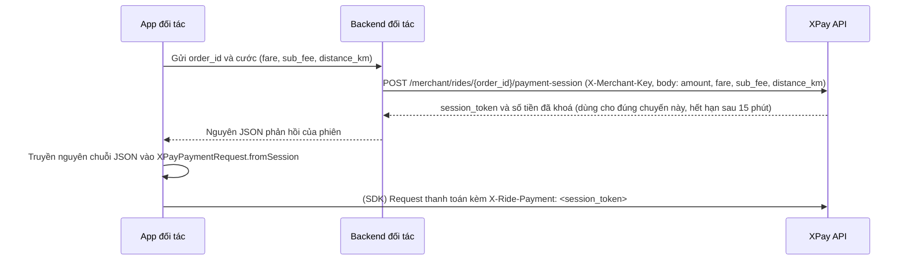
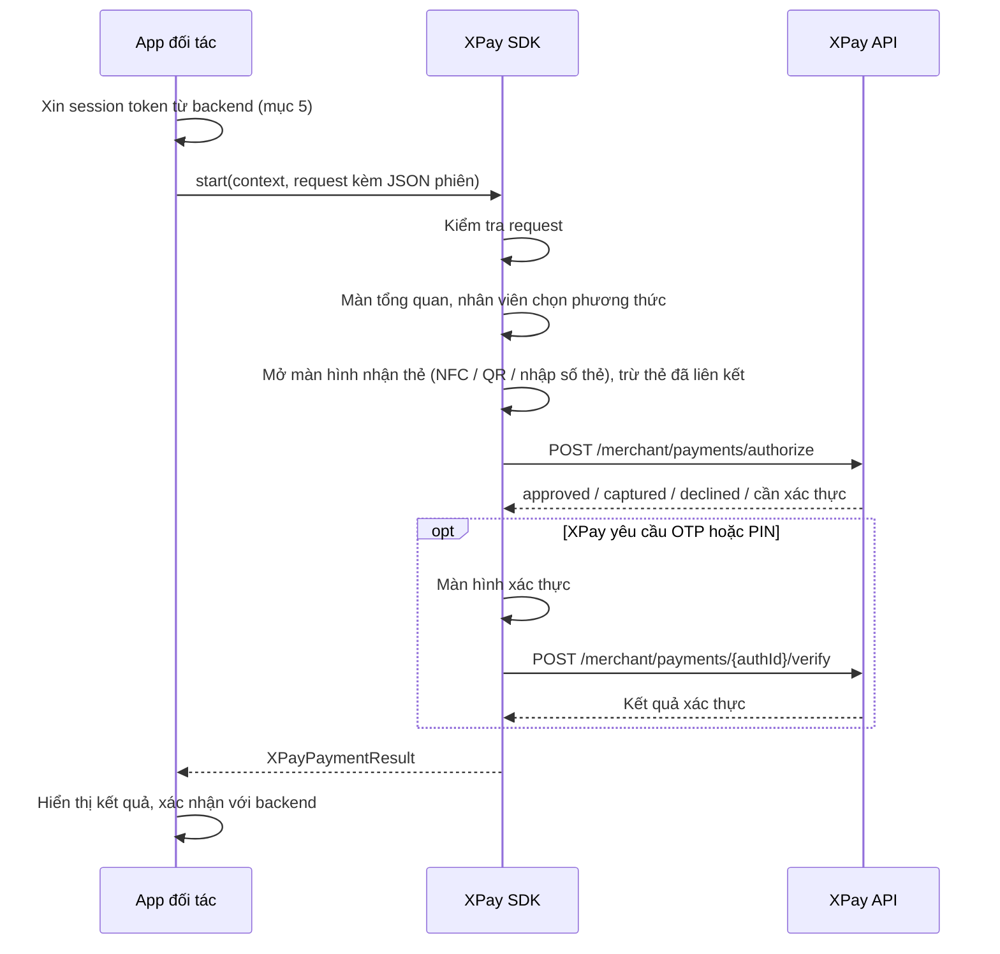

# XPay Payment SDK cho Flutter — Tài liệu tích hợp

SDK giúp app Flutter của đối tác thu tiền bằng thẻ XPay. SDK đảm nhận toàn bộ phần thẻ trong quy trình thanh toán: đọc thẻ (chạm NFC, quét QR hoặc nhập số thẻ), gửi yêu cầu authorize lên XPay, hiển thị bước xác thực OTP/PIN khi XPay yêu cầu, rồi trả về cho app **đúng một kết quả**. Với chuyến đặt bằng ví doanh nghiệp của khách, SDK thu từ ví thay cho thẻ: khách quét mã QR bằng ứng dụng XPERISE, hoặc đọc mã được gửi tới số điện thoại hay email của khách.

App của đối tác giữ mọi thứ xung quanh: đơn hàng, việc chọn phương thức thanh toán, và xử lý sau khi có kết quả.

> **Trạng thái: bản preview dùng để tích hợp thử và demo.** SDK dùng được cho app Flutter (tài liệu này) cho app Android native (Kotlin) qua AAR, và cho app iOS native (Swift) qua Swift package: xem [Tài liệu tích hợp Android native](docs/android_integration.vi.md) và [Tài liệu tích hợp iOS native](docs/ios_integration.vi.md).

Tài liệu dành cho đội mobile và backend của đối tác. Bản tiếng Anh: [README.md](README.md).

## Mục lục

1. [SDK làm gì](#1-sdk-làm-gì)
2. [Yêu cầu hệ thống](#2-yêu-cầu-hệ-thống)
3. [Cài đặt](#3-cài-đặt)
4. [Cấu hình Android và iOS](#4-cấu-hình-android-và-ios)
5. [Xác thực](#5-xác-thực)
6. [Khởi tạo SDK](#6-khởi-tạo-sdk)
7. [Thực hiện một thanh toán](#7-thực-hiện-một-thanh-toán)
8. [API reference](#8-api-reference)
9. [Kết quả và cách xử lý](#9-kết-quả-và-cách-xử-lý)
10. [Mã lỗi](#10-mã-lỗi)
11. [Thử lại và chống trừ tiền hai lần](#11-thử-lại-và-chống-trừ-tiền-hai-lần)
12. [Xác nhận thanh toán từ backend](#12-xác-nhận-thanh-toán-từ-backend)
13. [Logging](#13-logging)
14. [Thông tin kết nối mạng](#14-thông-tin-kết-nối-mạng)
15. [Bảo mật](#15-bảo-mật)
16. [Ứng dụng mẫu](#16-ứng-dụng-mẫu)
17. [Giới hạn hiện tại](#17-giới-hạn-hiện-tại)
18. [Câu hỏi thường gặp](#18-câu-hỏi-thường-gặp)

## 1. SDK làm gì

| SDK đảm nhận                                             | App đối tác đảm nhận                                               |
| -------------------------------------------------------- | ------------------------------------------------------------------ |
| Màn tổng quan & chọn phương thức, rồi các màn nhận thẻ   | Đơn hàng và phiên thanh toán của đơn                               |
| Gửi yêu cầu authorize lên XPay                           |                                                                    |
| Màn hình xác thực OTP/PIN, kể cả bước chọn người nhận mã | Đặt "Thẻ XPay" vào danh sách phương thức thanh toán của app        |
| Trả về đúng một kết quả cho mỗi lần thanh toán           | Màn hình thành công/thất bại, điều hướng, cập nhật dữ liệu của app |

SDK **không** hiển thị màn hình thành công hay bị từ chối. App tự hiển thị dựa trên kết quả trả về.

Màn đầu tiên của SDK hiện số tiền, thông tin chuyến (mã cuốc, điểm đón, điểm trả, biển số xe) và các phương thức theo đúng thứ tự `entry_modes` của phiên. Nhân viên chọn một:

| Giá trị `entry_modes` | Nhân viên làm gì                                                 | Android | iOS   |
| --------------------- | ---------------------------------------------------------------- | ------- | ----- |
| `ride_card`           | Thu bằng thẻ đã liên kết của chuyến, hiện tên thẻ và 4 số cuối   | Có      | Có    |
| `card_qr`             | Quét QR in trên thẻ XPay của khách, hoặc chọn ảnh QR từ thư viện | Có      | Có    |
| `manual_pan`          | Nhập số thẻ                                                      | Có      | Có    |
| `chip_tap`            | Chạm thẻ chip XPay của khách vào điện thoại                      | Có      | Không |
| `token`               | Quét mã thanh toán dùng một lần trên ứng dụng XPERISE của khách  | Có      | Có    |

Chỉ hiện các phương thức thiết bị chạy được. Chọn `card_qr` thì chỉ nhận QR thẻ, chọn `token` thì chỉ nhận mã dùng một lần. Bấm back ở màn nhận thẻ thì quay về danh sách phương thức; bấm back ở danh sách phương thức thì huỷ thanh toán.

NFC chỉ có trên Android: thẻ chip XPay là MIFARE Classic, và iOS không cho app truy cập thẻ MIFARE Classic.

### Chuyến thanh toán bằng ví doanh nghiệp

Khi `payment_method` của phiên là `corporate_wallet`, chuyến được trả bằng ví doanh nghiệp của khách. Màn đầu tiên vẫn như trên nhưng hiện các phương thức sau:

| Phương thức                       | Diễn ra thế nào                                                                                                                                       | Android | iOS |
| --------------------------------- | ----------------------------------------------------------------------------------------------------------------------------------------------------- | ------- | --- |
| Hiển thị mã QR                    | SDK hiện mã QR cho đúng số tiền đã khoá. Khách quét bằng ứng dụng XPERISE và thanh toán. SDK kiểm tra mỗi 3 giây, trả kết quả ngay khi khách trả xong | Có      | Có  |
| Gửi mã qua SMS / Gửi mã qua email | Mỗi người đi × mỗi kênh XPay có thông tin là một dòng, người đặt chuyến đứng đầu. SDK gửi mã 6 số; nhân viên nhập mã khách đọc                        | Có      | Có  |

1. Dòng "Hiển thị mã QR" luôn có. Các dòng gửi mã lấy từ XPay: người không có số điện thoại thì không có dòng SMS, không có email thì không có dòng email. Không ai có thông tin thì chỉ còn mã QR.
2. Ở màn nhập mã, nhân viên có thể gửi lại mã (40 giây sau lần gửi trước), và bấm **Đổi** để chuyển sang số điện thoại hoặc email khác.
3. Bấm back ở màn QR thì SDK huỷ mã QR với XPay trước. Nếu XPay chưa xác nhận đã huỷ, SDK giữ nguyên màn QR và báo lỗi, vì khách vẫn có thể quét mã đó; bấm back lần nữa để thử lại.
4. Mã sai, mã hết hạn hoặc nhập sai quá số lần được báo ngay trên màn nhập mã, thanh toán không kết thúc. Nhân viên gửi mã mới rồi tiếp tục.

## 2. Yêu cầu hệ thống

| Thành phần | Tối thiểu             |
| ---------- | --------------------- |
| Flutter    | 3.44 (Dart `^3.12.2`) |
| Android    | minSdk 24, Java 17    |
| iOS        | 15.0                  |

App của đối tác phải tương thích với các dependency mà SDK dùng. Nếu app đã dùng một trong các package dưới đây, version trong app phải nằm trong khoảng cho phép:

| Package              | Khoảng version SDK yêu cầu |
| -------------------- | -------------------------- |
| `dio`                | `^5.10.0`                  |
| `flutter_bloc`       | `^9.1.1`                   |
| `get_it`             | `^9.2.1`                   |
| `intl`               | `^0.20.3`                  |
| `mobile_scanner`     | `^7.4.0`                   |
| `nfc_manager`        | `^4.2.1`                   |
| `permission_handler` | `^12.0.3`                  |
| `image_picker`       | `^1.2.3`                   |
| `app_settings`       | `7.0.0`                    |
| `pretty_qr_code`     | `^3.6.0`                   |

Danh sách đầy đủ nằm trong `pubspec.yaml` của SDK. SDK dùng container `get_it` riêng (`GetIt.asNewInstance()`), nên không đụng tới các đăng ký `get_it` của app.

## 3. Cài đặt

SDK không publish lên pub.dev. Khai báo dependency qua repo Git và khoá theo tag của bản phát hành:

```yaml
dependencies:
  xpay_payment_sdk:
    git:
      url: https://github.com/nggiahuy09/xpay-payment-sdk.git
      ref: v3.1123.1
```

Nâng cấp: đổi `ref` sang tag mới rồi chạy `flutter pub get`. Đọc [CHANGELOG.md](CHANGELOG.md) trước, vì số phiên bản không theo Semantic Versioning nên breaking change chỉ được ghi ở đó.

Chỉ import thư viện public:

```dart
import 'package:xpay_payment_sdk/xpay_payment_sdk.dart';
```

Mọi thứ dưới `package:xpay_payment_sdk/src/` là nội bộ và có thể thay đổi mà không báo trước.

## 4. Cấu hình Android và iOS

### Android

Thêm vào `android/app/src/main/AndroidManifest.xml`, bên trong thẻ `<manifest>`:

```xml
<uses-permission android:name="android.permission.CAMERA"/>
<uses-permission android:name="android.permission.INTERNET"/>
<uses-permission android:name="android.permission.NFC"/>
<uses-feature android:name="android.hardware.camera" android:required="false"/>
<uses-feature android:name="android.hardware.nfc" android:required="false"/>
```

`required="false"` giúp app vẫn cài được trên máy không có NFC hoặc camera. Trên máy không có NFC, SDK không hiện `chip_tap` trong danh sách phương thức.

Đảm bảo `minSdk` trong `android/app/build.gradle(.kts)` từ 24 trở lên. Flutter 3.44 mặc định `flutter.minSdkVersion` là 24.

### iOS

Thêm vào `ios/Runner/Info.plist`:

```xml
<key>NSCameraUsageDescription</key>
<string>Ứng dụng cần quyền camera để quét mã QR XPay khi thanh toán.</string>
<key>NSPhotoLibraryUsageDescription</key>
<string>Ứng dụng cần quyền thư viện ảnh để quét mã QR XPay từ ảnh của bạn.</string>
```

Đặt iOS deployment target từ 15.0 trở lên (trong Xcode và trong `Podfile` nếu có).

Không cần entitlement NFC, vì SDK không dùng NFC trên iOS.

## 5. Xác thực

Mỗi thanh toán được xác thực bằng một **phiên thu tiền của chuyến** (session token) do **backend của đối tác** xin từ XPay. SDK không bao giờ nhìn thấy merchant key hay bất kỳ secret dài hạn nào.



1. Nhân viên nhập cước của chuyến trên app đối tác. App gửi `order_id` và cước cho backend.
2. Backend đối tác gọi `POST /merchant/rides/{order_id}/payment-session` bằng `X-Merchant-Key` của mình, kèm body JSON: `amount` (chuỗi, bằng `fare` + `sub_fee`, tính bằng đồng), `fare` (số), tuỳ chọn `sub_fee` (số, mặc định 0) và `distance_km` (số). Merchant key chỉ nằm trên server.
3. XPay trả `session_token` cho đúng chuyến đó, cùng `amount` đã khoá, `external_ref` (dạng `XP-…`) và dữ liệu chuyến. Token chỉ hiện một lần và hết hạn sau 15 phút.
4. Backend chuyển **nguyên** JSON phản hồi xuống app, không cần tách field. App truyền nguyên chuỗi đó vào `sessionJson` của `XPayPaymentRequest.fromSession`. SDK tự đọc `session_token`, `amount`, `external_ref`, `payment_method` và `payment_template` (`currency`, `product_type`).

Lưu ý:

1. SDK gửi token qua header `X-Ride-Payment` trong mọi request của lần thanh toán đó.
2. SDK **không** refresh token. Khi XPay từ chối token, ví dụ vì phiên đã hết hạn, thanh toán kết thúc với `failed` và một `errorCode`, ví dụ `token_expired`. App xin phiên mới từ backend rồi bắt đầu thanh toán lại. Với chuyến ví doanh nghiệp, phiên hết hạn lúc đang chờ khách quét QR cho kết quả `expired`.
3. SDK chỉ giữ token trong bộ nhớ khi thanh toán đang mở, không lưu xuống máy và không ghi log token.
4. **Số tiền bị khoá theo phiên.** SDK thu đúng `amount` trong phản hồi của phiên. Muốn thu số tiền khác thì xin phiên mới; không sửa JSON trước khi đưa vào SDK.
5. **Mở phiên mới cho cùng một chuyến sẽ thu hồi các phiên trước.** Request dùng phiên cũ bị trả `ride_payment_session_revoked` (HTTP 401). Chỉ xin phiên ngay trước khi thu tiền, và không xin phiên mới khi một thanh toán của chuyến đó còn đang mở.
6. **Dữ liệu chuyến lấy từ phiên.** XPay tự gắn điểm đón, điểm đến, biển số, cước, phụ phí và quãng đường của phiên vào giao dịch. App không truyền các thông tin này cho SDK.
7. **Mã tham chiếu lấy từ phiên.** SDK dùng `external_ref` (dạng `XP-…`) trong phản hồi, nên `externalRef` trong kết quả cũng là `XP-…`.
8. **JSON không đọc được thì không thanh toán.** Chuỗi không phải JSON object, thiếu `session_token`, hoặc `amount` không phải số nguyên đồng (ví dụ `"138000.50"`), hoặc (với phiên thẻ) không còn phương thức nào trong `entry_modes` thì `start` trả `failed` với `errorCode = sdk_invalid_request` và không gửi gì lên XPay. Lý do cụ thể được gửi qua `onLog` (`feature = payment`, `action = start_payment`, xem [mục 13](#13-logging)).

**Tuyệt đối không đưa merchant key, API key hay bất kỳ thông tin xác thực nào của server vào app.**

## 6. Khởi tạo SDK

Gọi `initialize` một lần trước lần thanh toán đầu tiên, ví dụ khi mở app hoặc sau khi nhân viên đăng nhập. Gọi lại khi cần đổi ngôn ngữ hoặc base URL.

```dart
await XPayPayment.initialize(
  XPayConfig(
    environment: const XPayEnvironment(baseUrl: 'https://<xpay api host>'),
    language: XPayLanguage.vi,
    onLog: (event) => myLogger.log(event.toString()),
  ),
);
```

Lưu ý khi gọi lại `initialize`:

1. Không gọi khi đang có một thanh toán mở (tức `start` chưa trả kết quả). Khi đó `initialize` ném `StateError` và giữ nguyên cấu hình cũ.
2. Không gọi khi lần `initialize` trước chưa xong. Khi đó lần gọi sau ném `StateError`, lần gọi trước vẫn chạy tiếp.
3. Trong lúc `initialize` đang chạy, `start` trả `failed` với `errorCode = sdk_not_initialized`. Luôn `await` xong `initialize` rồi mới gọi `start`.

## 7. Thực hiện một thanh toán

### Luồng tổng quát



### Ví dụ: thanh toán chuyến xe

```dart
Future<void> payWithXPay(BuildContext context, Order order) async {
  final sessionJson = await myBackend.openPaymentSession(order.id, fare: order.fare, subFee: order.subFee, distanceKm: order.distanceKm);
  if (context.mounted == false) return;

  final result = await XPayPayment.start(
    context,
    XPayPaymentRequest.fromSession(sessionJson),
  );

  switch (result.status) {
    case XPayPaymentStatus.approved:
    case XPayPaymentStatus.captured:
      await confirmOnBackend(order.id, externalRef: result.externalRef, authId: result.authId);
    case XPayPaymentStatus.declined:
    case XPayPaymentStatus.duplicate:
    case XPayPaymentStatus.failed:
      showMessage(result.message ?? 'Thanh toán không thành công.');
    case XPayPaymentStatus.expired:
      showMessage('Đã hết thời gian xác thực. Vui lòng tạo thanh toán mới.');
    case XPayPaymentStatus.cancelled:
    case XPayPaymentStatus.unsupported:
      break;
  }
}
```

`openPaymentSession` là hàm của đối tác: nó gọi backend của đối tác, backend gọi `payment-session` với body ở [mục 5](#5-xác-thực) rồi trả về nguyên body phản hồi dưới dạng chuỗi.

### Hành vi của `start`

1. `start` mở màn hình SDK trên **root navigator** của app. Khi thanh toán kết thúc, SDK tự đóng màn hình của mình rồi trả kết quả. SDK không đụng tới router của app.
2. `context` truyền vào phải nằm dưới một `MaterialApp`.
3. Trong lúc XPay đang authorize thẻ hoặc đang xác thực mã của ví doanh nghiệp, nút back bị vô hiệu hoá, để nhân viên không rời khỏi một thanh toán có thể đã bị trừ tiền.
4. Bấm back ở màn nhận thẻ thì quay về danh sách phương thức. Bấm back ở danh sách phương thức hoặc ở màn xác thực thì kết quả là `cancelled`.
5. Mã QR không phải của XPay, hoặc không đúng loại với phương thức đã chọn (QR thẻ / mã dùng một lần), bị báo lỗi ngay trên màn hình quét, SDK không gửi request nào và nhân viên có thể quét lại.
6. Không phương thức nào của phiên chạy được trên thiết bị (ví dụ phiên chỉ có `chip_tap`, chạy trên iOS) thì `start` trả `unsupported` mà không mở màn hình nào. Phiên ví doanh nghiệp luôn mở được, vì mã QR và gửi mã chạy trên mọi thiết bị.
7. Với phiên ví doanh nghiệp, bấm back ở màn QR hoặc màn nhập mã thì quay về danh sách phương thức. Xem [Chuyến thanh toán bằng ví doanh nghiệp](#chuyến-thanh-toán-bằng-ví-doanh-nghiệp).

## 8. API reference

### `XPayPayment`

Facade tĩnh, là điểm vào duy nhất của SDK.

#### `static Future<void> initialize(XPayConfig config)`

Cấu hình SDK: ngôn ngữ, base URL và callback log. Có thể gọi lại để cấu hình lại, trừ khi đang có thanh toán mở hoặc lần `initialize` trước chưa xong: khi đó hàm ném `StateError`. Xem [mục 6](#6-khởi-tạo-sdk).

#### `static Future<XPayPaymentResult> start(BuildContext context, XPayPaymentRequest request)`

Mở luồng thanh toán và luôn hoàn thành với **đúng một** `XPayPaymentResult`. Hàm không ném exception khi thanh toán thất bại; mọi lỗi đều nằm trong kết quả.

Thứ tự kiểm tra trước khi mở màn hình:

| Điều kiện                                                       | Kết quả                                     |
| --------------------------------------------------------------- | ------------------------------------------- |
| Chưa gọi `initialize`, hoặc `initialize` đang chạy              | `failed`, `errorCode = sdk_not_initialized` |
| Đang có một thanh toán khác mở                                  | `failed`, `errorCode = sdk_busy`            |
| Request không hợp lệ (xem [quy tắc](#quy-tắc-kiểm-tra-request)) | `failed`, `errorCode = sdk_invalid_request` |
| Thiết bị không hỗ trợ phương thức                               | `unsupported`                               |
| `context` không còn mounted                                     | `cancelled`                                 |

### `XPayConfig`

| Trường        | Kiểu                           | Bắt buộc | Mặc định          | Mô tả                                                        |
| ------------- | ------------------------------ | -------- | ----------------- | ------------------------------------------------------------ |
| `environment` | `XPayEnvironment`              | Có       |                   | Môi trường XPay (sandbox hoặc production)                    |
| `language`    | `XPayLanguage`                 | Không    | `XPayLanguage.vi` | Ngôn ngữ của màn hình SDK và của `XPayPaymentResult.message` |
| `onLog`       | `void Function(XPayLogEvent)?` | Không    | `null`            | Nhận sự kiện nghiệp vụ, xem [mục 13](#13-logging)            |

### `XPayEnvironment`

| Trường    | Kiểu     | Bắt buộc | Mô tả                                                          |
| --------- | -------- | -------- | -------------------------------------------------------------- |
| `baseUrl` | `String` | Có       | Base URL của XPay API. XPay cung cấp URL sandbox và production |

### `XPayLanguage`

| Giá trị | Ngôn ngữ   |
| ------- | ---------- |
| `vi`    | Tiếng Việt |
| `en`    | Tiếng Anh  |

### `XPayPaymentRequest`

Tạo bằng `XPayPaymentRequest.fromSession(...)`.

| Trường        | Kiểu     | Bắt buộc | Mặc định | Mô tả                                                                                                                                                                                                                                                                                                                                                                                |
| ------------- | -------- | -------- | -------- | ------------------------------------------------------------------------------------------------------------------------------------------------------------------------------------------------------------------------------------------------------------------------------------------------------------------------------------------------------------------------------------ |
| `sessionJson` | `String` | Có       |          | Nguyên body phản hồi của `POST /merchant/rides/{order_id}/payment-session`. SDK lấy `session_token`, `amount`, `external_ref`, `payment_template.currency` (mặc định `VND`), `payment_template.product_type`, `payment_method` (mặc định `card`), `entry_modes`, `ride_card`, `order_id` và thông tin chuyến trong `payment_template.enhanced_data` từ đây. Xem [mục 5](#5-xác-thực) |

Số thẻ, dữ liệu chip và mã xác thực **không** nằm trong request. SDK tự thu thập các thông tin này.

### Quy tắc kiểm tra request

SDK kiểm tra request trước khi mở bất kỳ màn hình nào. Vi phạm một trong các quy tắc dưới đây thì `start` trả `failed` với `errorCode = sdk_invalid_request` và **không gửi gì lên XPay**:

1. `sessionJson` là một JSON object có `session_token` không rỗng.
2. `amount` trong JSON là số nguyên đồng (chuỗi như `"138000"` hoặc `"138000.00"`), tối thiểu 1.000.
3. `external_ref` dài 1–64 ký tự sau khi bỏ khoảng trắng hai đầu.
4. `currency` (nếu có) không rỗng sau khi bỏ khoảng trắng.
5. Với phiên thẻ, `entry_modes` còn ít nhất một phương thức SDK biết. Giá trị lạ bị bỏ qua; `ride_card` bị bỏ qua khi thiếu `ride_card.card_last4` hoặc `order_id`. Phiên có `payment_method = corporate_wallet` không cần `entry_modes`.
6. `payment_method` thiếu hoặc là giá trị SDK chưa biết thì phiên được xử lý như phiên thẻ.

SDK không kiểm tra phiên còn hạn hay đã bị thu hồi. XPay kiểm tra ở bước authorize và trả `token_expired` hoặc `ride_payment_session_revoked`.

### `XPayPaymentResult`

| Trường         | Kiểu                | Mô tả                                                                                                |
| -------------- | ------------------- | ---------------------------------------------------------------------------------------------------- |
| `status`       | `XPayPaymentStatus` | Trạng thái cuối cùng, luôn có                                                                        |
| `authId`       | `String?`           | Mã authorize của XPay. Dùng để đối soát với backend. Luôn `null` với thanh toán bằng ví doanh nghiệp |
| `captureId`    | `String?`           | Mã capture, chỉ có khi `captured`                                                                    |
| `bookingRef`   | `String?`           | Mã booking, có khi thanh toán thành công sau bước xác thực                                           |
| `externalRef`  | `String?`           | Mã tham chiếu của đối tác, do XPay trả về                                                            |
| `amount`       | `int?`              | Số tiền XPay ghi nhận                                                                                |
| `currency`     | `String?`           | Mã tiền tệ XPay ghi nhận                                                                             |
| `createdAt`    | `DateTime?`         | Thời điểm XPay tạo giao dịch                                                                         |
| `declineCode`  | `String?`           | Mã từ chối thô từ XPay, khi `declined`                                                               |
| `errorCode`    | `String?`           | Mã lỗi, khi `failed`. Xem [mục 10](#10-mã-lỗi)                                                       |
| `message`      | `String?`           | Câu thông báo sẵn sàng hiển thị cho nhân viên, theo ngôn ngữ đã cấu hình                             |
| `isSuccessful` | `bool` (getter)     | `true` khi `status` là `approved` hoặc `captured`                                                    |

### `XPayPaymentStatus`

Xem [mục 9](#9-kết-quả-và-cách-xử-lý).

### `XPayErrorCode`

Hằng số cho các mã lỗi do chính SDK sinh ra.

| Hằng số                            | Giá trị                   |
| ---------------------------------- | ------------------------- |
| `XPayErrorCode.notInitialized`     | `sdk_not_initialized`     |
| `XPayErrorCode.invalidRequest`     | `sdk_invalid_request`     |
| `XPayErrorCode.busy`               | `sdk_busy`                |
| `XPayErrorCode.unexpectedResponse` | `sdk_unexpected_response` |

### `XPayLogEvent`

| Trường          | Kiểu                   | Mô tả                                                                                  |
| --------------- | ---------------------- | -------------------------------------------------------------------------------------- |
| `level`         | `XPayLogLevel`         | `info`, `warn`, `error`                                                                |
| `category`      | `XPayLogCategory`      | `api` (kết quả gọi API), `behavior` (hành vi người dùng), `error` (dữ liệu bất thường) |
| `feature`       | `String`               | Khu vực phát sinh sự kiện: `payment`, `verification`, `card_nfc`, `corporate_wallet`   |
| `action`        | `String`               | Hành động cụ thể, xem [mục 13](#13-logging)                                            |
| `reason`        | `String?`              | Lý do chi tiết, nếu có                                                                 |
| `errorCode`     | `String?`              | Mã lỗi, nếu sự kiện đến từ một lỗi                                                     |
| `serverMessage` | `String?`              | Thông báo lỗi gốc từ XPay, nếu có                                                      |
| `input`         | `Map<String, Object?>` | Các định danh liên quan (không thể sửa)                                                |

## 9. Kết quả và cách xử lý

| Trạng thái    | Ý nghĩa                                                  | Trường có giá trị                                                                                   | App nên làm gì                                                       |
| ------------- | -------------------------------------------------------- | --------------------------------------------------------------------------------------------------- | -------------------------------------------------------------------- |
| `approved`    | XPay đã duyệt (authorize). Có thể được capture sau       | `authId`, `externalRef`, `amount`, `currency`, `createdAt`; thêm `bookingRef` nếu qua bước xác thực | Coi là thành công, xác nhận với backend rồi hoàn tất đơn             |
| `captured`    | XPay đã duyệt và đã capture                              | Như `approved`, thêm `captureId`                                                                    | Như `approved`                                                       |
| `declined`    | XPay từ chối                                             | `declineCode`, `message`; `authId` nếu có                                                           | Hiển thị `message`, cho nhân viên thử thẻ khác hoặc phương thức khác |
| `cancelled`   | Nhân viên thoát trước khi thanh toán xong                | `authId` nếu thanh toán đã được authorize và đang chờ xác thực                                      | Quay lại màn chọn phương thức. Nếu có `authId`, kiểm tra với backend |
| `duplicate`   | XPay đang giữ một request khác dưới cùng idempotency key | `message`                                                                                           | Kiểm tra với backend trước khi thu tiền lại                          |
| `failed`      | Request lỗi, hoặc XPay trả dữ liệu SDK không xử lý được  | `errorCode`, `message`; `authId` nếu có                                                             | Hiển thị `message`. Nếu có `authId`, kiểm tra với backend            |
| `expired`     | Hết thời gian xác thực                                   | `authId`                                                                                            | Tạo thanh toán mới                                                   |
| `unsupported` | Thiết bị không chạy được phương thức này                 | Không có                                                                                            | Ẩn phương thức này, chọn phương thức khác                            |

Về `approved` và `captured`: với thẻ (chạm NFC, quét QR in trên thẻ, nhập số thẻ) SDK yêu cầu XPay tự capture; với QR trên app XPay thì không. Luôn xử lý cả hai trạng thái như thanh toán thành công.

Thanh toán bằng ví doanh nghiệp không tạo giao dịch thẻ, nên kết quả khác bảng trên:

| Trạng thái  | Ý nghĩa với thanh toán ví                                                              | Trường có giá trị                                                                      | App nên làm gì                                             |
| ----------- | -------------------------------------------------------------------------------------- | -------------------------------------------------------------------------------------- | ---------------------------------------------------------- |
| `captured`  | Khách đã trả bằng ví doanh nghiệp, qua mã QR hoặc qua mã gửi tới khách                 | `externalRef`, `amount`, `currency`; `createdAt` nếu trả qua QR. **Không có `authId`** | Coi là thành công, xác nhận với backend bằng `externalRef` |
| `declined`  | XPay từ chối khoản thanh toán qua mã QR                                                | `message`                                                                              | Hiển thị `message`                                         |
| `expired`   | Mã QR hết hạn, hoặc phiên thu tiền hết hạn khi SDK đang chờ khách quét QR              | Không có                                                                               | Xin phiên mới rồi thanh toán lại                           |
| `failed`    | Chuyến không còn thanh toán được bằng ví, XPay từ chối phiên thu tiền (`token_expired`, `ride_payment_session_revoked`), hoặc XPay từ chối trả trạng thái của mã QR | `errorCode`, `message`                                                                 | Hiển thị `message`, kiểm tra chuyến với backend            |
| `cancelled` | Nhân viên thoát trước khi khách trả. Mã QR đang hiện được huỷ với XPay trước khi thoát | Không có                                                                               | Kiểm tra chuyến với backend trước khi thu bằng cách khác   |

Về `message`:

1. Câu thông báo đã được dịch theo `XPayConfig.language`, có thể hiển thị thẳng cho nhân viên.
2. Khi XPay trả về một mã lỗi chưa có câu thông báo riêng, `message` kết thúc bằng một dòng `Mã lỗi:` (hoặc `Error code:` với tiếng Anh) để bộ phận hỗ trợ tra cứu.
3. Ngoại lệ: lỗi mạng (`no_connection`, `no_host`, `timeout`) và phiên hết hạn (`token_expired`) hiện luôn trả `message` tiếng Anh. Xem [mục 17](#17-giới-hạn-hiện-tại).

## 10. Mã lỗi

`errorCode` chỉ có giá trị khi `status` là `failed`.

### Mã do SDK sinh ra

| Mã                        | Nguyên nhân                                                   | Cách xử lý                                            |
| ------------------------- | ------------------------------------------------------------- | ----------------------------------------------------- |
| `sdk_not_initialized`     | Gọi `start` trước khi `initialize` hoàn tất                   | `await` xong `initialize` rồi mới gọi `start`         |
| `sdk_invalid_request`     | Request không qua được bước kiểm tra. Chưa gửi gì lên XPay    | Sửa dữ liệu theo [quy tắc](#quy-tắc-kiểm-tra-request) |
| `sdk_busy`                | Gọi `start` khi một thanh toán khác chưa kết thúc             | Chờ lần trước trả kết quả                             |
| `sdk_unexpected_response` | XPay trả trạng thái hoặc dữ liệu chip mà SDK không xử lý được | Kiểm tra với backend bằng `authId` nếu có, báo XPay   |

### Mã từ tầng mạng

| Mã              | Nguyên nhân                                                                    |
| --------------- | ------------------------------------------------------------------------------ |
| `no_connection` | Không có kết nối mạng                                                          |
| `no_host`       | Không kết nối được tới server (sai base URL, lỗi DNS, lỗi chứng chỉ)           |
| `timeout`       | Server không phản hồi trong 30 giây                                            |
| `token_expired` | Phiên thu tiền đã hết hạn. Xin session token mới từ backend rồi thanh toán lại |

### Mã từ XPay

Các giá trị `errorCode` khác được XPay trả về và SDK chuyển nguyên cho app. Danh sách mã do XPay cung cấp riêng. Các mã liên quan tới phiên thu tiền:

| Mã                             | Nguyên nhân                                                                                | Cách xử lý                                                             |
| ------------------------------ | ------------------------------------------------------------------------------------------ | ---------------------------------------------------------------------- |
| `amount_locked`                | `amount` khác số tiền đã khoá trong phiên (HTTP 422 ở bước authorize, 409 ở bước xác thực) | Truyền đúng `amount` của phiên, hoặc xin phiên mới với số tiền cần thu |
| `ride_payment_session_revoked` | Phiên bị thu hồi vì backend đã mở phiên mới cho cùng chuyến                                | Dùng phiên mới nhất; tránh mở nhiều phiên song song cho một chuyến     |

`message` của các mã này là câu thông báo chung kèm dòng `Mã lỗi:` (hoặc `Error code:`).

Các mã ở bước authorize có câu thông báo riêng, `message` nêu rõ nguyên nhân thay vì câu chung:

| Mã                        | Nguyên nhân                                                                                        | Cách xử lý                                             |
| ------------------------- | -------------------------------------------------------------------------------------------------- | ------------------------------------------------------ |
| `not_found`               | XPay không tìm thấy thẻ hoặc mã thanh toán đã quét, chạm hoặc nhập. `message` nêu theo phương thức | Kiểm tra lại thẻ hoặc mã rồi thử lại                   |
| `no_registered_phone`     | Thẻ không có số điện thoại để gửi OTP                                                              | Dùng thẻ khác, hoặc liên hệ quản trị viên doanh nghiệp |
| `static_code_unavailable` | Thẻ chưa được thiết lập mã PIN                                                                     | Dùng thẻ khác, hoặc liên hệ quản trị viên doanh nghiệp |
| `otp_delivery_failed`     | Không gửi được OTP tới số điện thoại của chủ thẻ                                                   | Thử lại                                                |
| `ride_card_not_found`     | Chuyến đi không còn được giao cho tài xế, hoặc không còn ở trạng thái thanh toán được              | Kiểm tra lại chuyến đi ở phía app                      |
| `ride_already_paid`       | Chuyến đi đã có giao dịch thanh toán                                                               | Kiểm tra trạng thái chuyến trước khi thu lại           |

### Mã kết thúc thanh toán bằng ví doanh nghiệp

Các mã dưới đây kết thúc thanh toán ví với `failed`, mỗi mã có `message` riêng:

| Mã                             | Nguyên nhân                                         | Cách xử lý                                   |
| ------------------------------ | --------------------------------------------------- | -------------------------------------------- |
| `amount_locked`                | XPay đã khoá số tiền khác cho chuyến sau khi gửi mã | Xin phiên mới rồi thanh toán lại             |
| `ride_not_found`               | Chuyến đã đóng hoặc không còn mở để thanh toán      | Kiểm tra trạng thái chuyến trước khi thu lại |
| `ride_not_on_corporate_wallet` | Chuyến không được đặt bằng ví doanh nghiệp          | Kiểm tra phương thức thanh toán của chuyến   |

Các lỗi ví khác (mã sai, mã hết hạn, mã bị khoá, gửi mã quá nhiều lần, không gửi được mã, người nhận không có thông tin liên hệ, ví doanh nghiệp từ chối hoặc tạm gián đoạn) được báo ngay trên màn hình SDK và không kết thúc thanh toán.

## 11. Thử lại và chống trừ tiền hai lần

Mỗi yêu cầu authorize mang một idempotency key, để request gửi lại không bị trừ tiền hai lần.

1. **Thử lại cùng một thanh toán**: gọi lại `start` với JSON của cùng phiên (hoặc phiên mới của cùng chuyến) và các trường khác giữ nguyên. Nếu khách đưa cùng thẻ, SDK dùng lại key cũ, và XPay trả lại kết quả ban đầu thay vì trừ tiền lần nữa. Điều này đúng giữa các lần gọi `start`, trong suốt thời gian process của app còn sống.
2. **Thanh toán mới**: mỗi chuyến có `external_ref` riêng trong phản hồi của phiên.
3. **Thẻ khác hoặc thông tin đơn thay đổi**: request khác đi nên SDK tạo key mới.
4. **`duplicate`**: XPay đang giữ một request khác dưới cùng key. Có thể đã có giao dịch: kiểm tra trước khi thu tiền lại.

Chạm thẻ NFC luôn tạo key mới, vì mỗi lần chạm sinh ra một cryptogram mới.

Session token không nằm trong idempotency key. Thử lại bằng một phiên mới (sau khi phiên cũ hết hạn) vẫn dùng lại key cũ. Lưu ý mở phiên mới sẽ thu hồi phiên cũ ([mục 5](#5-xác-thực)).

Gợi ý cho app:

1. Sau một thanh toán **thất bại**, thử lại cho cùng chuyến; `external_ref` của chuyến không đổi nên lần thử lại dùng lại key.
2. Sau một thanh toán **thành công**, chuyến đã đóng; chuyến tiếp theo dùng `external_ref` của phiên mới.

Chuyến ví doanh nghiệp chỉ được trả một lần, bằng mã QR hoặc bằng mã gửi tới khách: trả xong thì XPay đóng chuyến, và lần gửi mã sau cho chuyến đó trả `ride_not_found`. Sau một kết quả ví `failed` hoặc `cancelled`, kiểm tra chuyến với backend trước khi thanh toán lại.

## 12. Xác nhận thanh toán từ backend

Kết quả được trả về trên điện thoại của nhân viên, đây không phải nguồn đáng tin cậy. Trước khi hoàn tất đơn, backend của đối tác phải xác nhận thanh toán với XPay bằng `authId` hoặc `externalRef`.

Xử lý tương tự với các kết quả `cancelled` và `failed` có `authId`: thanh toán đã được authorize và vẫn có thể hoàn tất hoặc hết hạn phía XPay.

Thanh toán bằng ví doanh nghiệp không có `authId`: xác nhận bằng `externalRef`.

## 13. Logging

Truyền `onLog` vào `XPayConfig` để nhận các sự kiện nghiệp vụ của SDK. SDK không gửi log đi đâu khác. Không truyền `onLog` thì SDK im lặng.

Sự kiện **không bao giờ** chứa số thẻ, khoá chip, cryptogram, nonce, mã xác thực hay token. Sự kiện lỗi NFC có chứa UID của chip (`chip_uid`).

| `feature`          | `action`                                                 | `level` | Khi nào                                                                                                                                                                                                                                                       | `input` chính                                                                                      |
| ------------------ | -------------------------------------------------------- | ------- | ------------------------------------------------------------------------------------------------------------------------------------------------------------------------------------------------------------------------------------------------------------- | -------------------------------------------------------------------------------------------------- |
| `payment`          | `start_payment`                                          | `error` | Request bị từ chối trước khi mở màn hình (`sdk_invalid_request`). `reason`: `invalid_session_json`, `malformed_session`, `missing_session_token`, `missing_entry_modes`, `invalid_amount`, `amount_below_minimum`, `missing_currency`, `invalid_external_ref` | `session_json_length`                                                                              |
| `payment`          | `authorize_qr`, `authorize_manual`, `authorize_chip_tap` | `error` | Gọi authorize thất bại (lỗi mạng, lỗi từ XPay, xung đột)                                                                                                                                                                                                      | `entry_mode`, `amount`, `currency`, `external_ref`, `product_type`, `service_date`, `auto_capture` |
| `payment`          | `authorize_approved`                                     | `info`  | XPay duyệt hoặc capture                                                                                                                                                                                                                                       | `entry_mode`, `auth_id`                                                                            |
| `payment`          | `authorize_declined`                                     | `warn`  | XPay từ chối                                                                                                                                                                                                                                                  | `entry_mode`, `decline_reason`                                                                     |
| `payment`          | `authorize_verification`                                 | `info`  | XPay yêu cầu xác thực OTP/PIN                                                                                                                                                                                                                                 | `entry_mode`, `auth_id`, `verification_method`                                                     |
| `payment`          | `authorize_incomplete`                                   | `error` | XPay trả trạng thái SDK không xử lý được                                                                                                                                                                                                                      | `entry_mode`                                                                                       |
| `verification`     | `send_verification`, `resend_verification`               | `error` | Gửi hoặc gửi lại mã xác thực thất bại                                                                                                                                                                                                                         | `auth_id`, `recipient_id`                                                                          |
| `verification`     | `verify`                                                 | `error` | Gọi verify thất bại, hoặc XPay trả trạng thái không mong đợi                                                                                                                                                                                                  | `auth_id`                                                                                          |
| `verification`     | `verify_approved`                                        | `info`  | Xác thực thành công                                                                                                                                                                                                                                           | `auth_id`                                                                                          |
| `verification`     | `verify_rejected`                                        | `warn`  | Mã xác thực sai                                                                                                                                                                                                                                               | `auth_id`, `attempt`                                                                               |
| `verification`     | `verify_declined`                                        | `warn`  | XPay từ chối sau bước xác thực                                                                                                                                                                                                                                | `auth_id`, `decline_reason`                                                                        |
| `verification`     | `verification_expired`                                   | `error` | Hết thời gian xác thực                                                                                                                                                                                                                                        | `auth_id`                                                                                          |
| `verification`     | `verification_abandon`                                   | `info`  | Nhân viên rời màn hình xác thực                                                                                                                                                                                                                               | `auth_id`                                                                                          |
| `card_nfc`         | `prepare`, `sign`                                        | `error` | Gọi API chuẩn bị hoặc ký dữ liệu chip thất bại                                                                                                                                                                                                                | `chip_uid`, `counter`                                                                              |
| `card_nfc`         | `advance_counter`                                        | `error` | Không cập nhật được bộ đếm trên chip                                                                                                                                                                                                                          | `chip_uid`, `counter_sector`, `counter_block`                                                      |
| `corporate_wallet` | `get_otp_channels`                                       | `error` | Không tải được danh sách người nhận mã. Màn hình vẫn cho thu bằng mã QR                                                                                                                                                                                       | Không có                                                                                           |
| `corporate_wallet` | `request_otp`, `resend_otp`                              | `error` | Gửi hoặc gửi lại mã thất bại. `reason` là nguyên nhân, ví dụ `otpVelocityExceeded`                                                                                                                                                                            | `method`, `recipient_id`                                                                           |
| `corporate_wallet` | `verify_otp`                                             | `error` | Xác thực mã thất bại. `reason` là nguyên nhân, ví dụ `otpInvalid`                                                                                                                                                                                             | `wallet_payment_id`                                                                                |
| `corporate_wallet` | `verify_otp_captured`                                    | `info`  | Xác thực mã thành công, ví đã được trừ                                                                                                                                                                                                                        | `wallet_payment_id`                                                                                |
| `corporate_wallet` | `create_intent`                                          | `error` | Không tạo được mã QR                                                                                                                                                                                                                                          | `product_type`, `currency`, `external_ref`, `amount`                                               |
| `corporate_wallet` | `poll_intent`                                            | `error` | Kiểm tra mã QR gặp lỗi không thử lại được, thanh toán kết thúc                                                                                                                                                                                                | `intent_id`                                                                                        |
| `corporate_wallet` | `cancel_intent`                                          | `error` | Huỷ mã QR thất bại; `reason = cancel_unconfirmed` khi chưa xác nhận được mã đã bị huỷ                                                                                                                                                                         | `intent_id`                                                                                        |
| `corporate_wallet` | `intent_captured`                                        | `info`  | Khách đã trả qua mã QR                                                                                                                                                                                                                                        | `intent_id`                                                                                        |
| `corporate_wallet` | `intent_ended`                                           | `warn`  | Mã QR kết thúc mà không được trả. `reason`: `declined`, `canceled`, `expired`                                                                                                                                                                                 | `intent_id`                                                                                        |

Danh sách này phản ánh phiên bản `3.1123.1` và có thể được bổ sung ở các phiên bản sau. App không nên dựa vào việc một sự kiện cụ thể luôn xuất hiện để điều khiển luồng nghiệp vụ; hãy dùng `XPayPaymentResult`.

Nếu `onLog` ném exception, SDK bỏ qua lỗi đó và tiếp tục thanh toán.

## 14. Thông tin kết nối mạng

Phần này dành cho đội backend và hạ tầng của đối tác, ví dụ để cấu hình firewall hoặc proxy. App **không cần** và **không nên** gọi trực tiếp các endpoint này; SDK đã làm việc đó.

Đường dẫn tính từ `XPayEnvironment.baseUrl`:

| Method | Endpoint                                               | Dùng khi                           | Header riêng      |
| ------ | ------------------------------------------------------ | ---------------------------------- | ----------------- |
| `POST` | `/merchant/payments/authorize`                         | Authorize thanh toán               | `Idempotency-Key` |
| `POST` | `/merchant/payments/{authId}/verify`                   | Gửi mã OTP/PIN                     | `Idempotency-Key` |
| `POST` | `/merchant/payments/{authId}/resend-verification`      | Gửi hoặc gửi lại mã xác thực       |                   |
| `POST` | `/merchant/chip/tap/prepare`                           | Chuẩn bị đọc thẻ chip (NFC)        |                   |
| `POST` | `/merchant/chip/tap/cryptogram`                        | Ký dữ liệu chip (NFC)              |                   |
| `GET`  | `/merchant/wallet-payments/recipients`                 | Lấy danh sách người nhận mã của ví |                   |
| `POST` | `/merchant/wallet-payments`                            | Gửi hoặc gửi lại mã thanh toán ví  |                   |
| `POST` | `/merchant/wallet-payments/{wallet_payment_id}/verify` | Xác thực mã thanh toán ví          |                   |
| `POST` | `/merchant/payment-intents`                            | Tạo mã QR thanh toán ví            | `Idempotency-Key` |
| `GET`  | `/merchant/payment-intents/{intent_id}`                | Kiểm tra mã QR, mỗi 3 giây         |                   |
| `POST` | `/merchant/payment-intents/{intent_id}/cancel`         | Huỷ mã QR khi nhân viên rời màn QR |                   |

Hành vi chung:

1. Mọi request mang header `X-Ride-Payment: <session token>` lấy từ `session_token` trong `XPayPaymentRequest.sessionJson`.
2. Timeout kết nối và timeout nhận dữ liệu đều là 30 giây.
3. HTTP 401: SDK không gửi lại request. Mã `session_expired` được trả về app thành `token_expired`; các mã khác chuyển nguyên.
4. HTTP 429: nếu response có header `retry-after` không quá 3 giây, SDK chờ rồi gửi lại một lần; ngược lại trả lỗi.
5. HTTP 409 ở bước authorize: kết quả là `duplicate`.
6. HTTP 422 `amount_locked` ở bước authorize: kết quả là `failed` với `errorCode = amount_locked`.
7. Khi kiểm tra mã QR: lỗi mạng và HTTP 5xx thì SDK kiểm tra lại sau 3 giây; HTTP 401 `session_expired` cho kết quả `expired`; các lỗi 4xx khác cho kết quả `failed`.

Đây là thông tin tham khảo của phiên bản `3.1123.1`. Endpoint và header có thể thay đổi giữa các phiên bản SDK mà không cần app sửa code.

## 15. Bảo mật

Những gì SDK đảm bảo:

1. Không chứa merchant key hay secret nào. Mọi request xác thực bằng session token của chuyến, do backend đối tác xin từ XPay và hết hạn sau 15 phút.
2. Không lưu token, số thẻ, dữ liệu chip hay mã xác thực xuống bộ nhớ máy.
3. Không ghi log số thẻ, khoá chip, cryptogram, nonce, mã xác thực hay token.
4. Không gửi log hay dữ liệu đi đâu ngoài XPay API và callback `onLog` của app.
5. Log debug nội bộ của SDK bị tắt trong bản release.

Những gì đối tác cần làm:

1. Không đưa merchant key hay thông tin xác thực server vào app.
2. Chỉ xin session token khi sắp thu tiền một chuyến, và chỉ đưa token xuống đúng thiết bị đang thu tiền chuyến đó.
3. Xác nhận mọi thanh toán từ backend trước khi hoàn tất đơn (xem [mục 12](#12-xác-nhận-thanh-toán-từ-backend)).
4. Không ghi log hay chụp màn hình các màn hình SDK chứa số thẻ.
5. Xem xét chỉ chuyển `onLog` lên hệ thống log của mình khi đã chấp nhận việc lưu `chip_uid`.
6. Build bản release với `--obfuscate --split-debug-info=<thư mục>`.

## 16. Ứng dụng mẫu

Thư mục `example/` là một app host nhỏ chạy toàn bộ luồng chỉ với API public.

```bash
cd example
```

```bash
flutter run --dart-define=XPAY_BASE_URL=<base url sandbox> --dart-define=XPAY_SESSION_JSON='<JSON phản hồi payment-session>'
```

Cũng có thể nhập base URL và dán JSON phiên trực tiếp trong app. Phiên chỉ dùng cho một chuyến và hết hạn sau 15 phút, nên mỗi lần thanh toán hãy xin phiên mới từ backend.

App mẫu minh hoạ:

1. Khởi tạo SDK với môi trường, ngôn ngữ và callback log.
2. Bắt đầu thanh toán với JSON phiên và in ra `XPayPaymentResult`.
3. Hiển thị các sự kiện từ `onLog`.

Dùng điện thoại Android thật có NFC để thử chạm thẻ.

## 17. Giới hạn hiện tại

1. App Android và iOS native dùng bộ SDK trong tài liệu tích hợp native tương ứng, không dùng tài liệu này.
2. Màn hình SDK dùng giao diện của XPay, chưa tuỳ biến theme được. Chữ dùng font `Inter` nếu app có bundle font này, ngược lại dùng font mặc định của app.
3. SDK không hiển thị màn hình thành công hay bị từ chối. App tự hiển thị dựa trên kết quả.
4. Trên Android, `chip_tap` được hiện khi máy có NFC. Máy có NFC nhưng chip NFC không đọc được thẻ MIFARE Classic chỉ bị phát hiện khi chạm thẻ.
5. Các phương thức quét QR được hiện mà không kiểm tra máy có camera hay không. Nhân viên vẫn có thể chọn ảnh QR từ thư viện.
6. Lỗi mạng (`no_connection`, `no_host`, `timeout`) và phiên hết hạn (`token_expired`) trả `message` tiếng Anh ở cả hai ngôn ngữ.
7. Số tiền là số nguyên, phù hợp với VND. Chưa hỗ trợ tiền tệ có phần thập phân.
8. Trong lúc XPay đang authorize sau khi quét QR hoặc chạm thẻ, màn hình phía sau lớp loading là màn chọn phương thức.
9. Mã QR của ví doanh nghiệp được kiểm tra mỗi 3 giây, nên khoản trả qua QR có thể được báo về chậm tối đa 3 giây.
10. Trên Android, SDK không có app bar riêng và chỉ thoát được bằng nút back của hệ thống. iOS không có nút back hệ thống, nên trên iOS màn chọn phương thức có nút quay lại ở góc trên bên trái; bấm vào thì huỷ thanh toán như nút back của Android.

## 18. Câu hỏi thường gặp

**`start` trả ngay `failed` với `sdk_not_initialized`.**
Chưa gọi `XPayPayment.initialize`, hoặc gọi nhưng chưa `await` xong.

**`start` trả ngay `failed` với `sdk_invalid_request`.**
Kiểm tra lại request theo [quy tắc kiểm tra](#quy-tắc-kiểm-tra-request). Lỗi thường gặp: `sessionJson` không phải JSON object hoặc bị cắt bớt, thiếu `session_token`, `amount` có phần lẻ hoặc dưới 1.000, `external_ref` rỗng, mã số thuế sai định dạng.

**Nút NFC luôn bị vô hiệu hoá.**
NFC chỉ hỗ trợ Android. Trên Android, kiểm tra máy có NFC và manifest đã khai báo quyền `android.permission.NFC`.

**Màn hình quét QR báo không có quyền camera.**
Kiểm tra `NSCameraUsageDescription` (iOS) hoặc quyền `CAMERA` (Android). Nếu người dùng đã từ chối vĩnh viễn, SDK hiển thị thông báo kèm nút mở cài đặt.

**Thanh toán trả `failed` với `token_expired`.**
Session token đã quá 15 phút hoặc không còn hiệu lực. SDK không tự refresh: xin phiên mới qua backend (`POST /merchant/rides/{order_id}/payment-session`, kèm `amount`, `fare`, `sub_fee`, `distance_km`) rồi gọi lại `start`. Nên xin phiên ngay trước khi thu tiền, không xin sẵn từ lúc nhận chuyến.

**Thanh toán trả `failed` với `amount_locked`.**
JSON đưa vào SDK đã bị sửa `amount`, hoặc không phải phản hồi của phiên mới nhất. Truyền nguyên phản hồi của `payment-session`, hoặc xin phiên mới với số tiền cần thu.

**Thanh toán trả `failed` với `ride_payment_session_revoked`.**
Backend đã mở một phiên mới cho cùng chuyến nên phiên cũ bị thu hồi. Dùng phiên mới nhất, và tránh xin nhiều phiên cho một chuyến cùng lúc.

**Thanh toán ví doanh nghiệp thành công nhưng `authId` là `null`.**
Đúng như thiết kế: thanh toán ví không tạo giao dịch thẻ. Xác nhận với backend bằng `externalRef`.

**Màn chọn phương thức của chuyến ví chỉ có "Hiển thị mã QR".**
XPay không có số điện thoại hay email nào của người đặt chuyến và người đi cùng, hoặc không tải được danh sách (màn hình báo lỗi kèm nút thử lại). Vẫn thu được bằng mã QR.

**Có cần hiển thị màn hình kết quả không?**
Có. SDK chỉ trả `XPayPaymentResult`, app tự hiển thị thành công hoặc thất bại.

**Có thể gọi thẳng API XPay thay vì dùng SDK không?**
Không nên. Luồng chạm thẻ NFC và chống trừ tiền hai lần phụ thuộc vào logic bên trong SDK, và việc tự xử lý số thẻ trong app làm tăng phạm vi PCI-DSS của đối tác.
