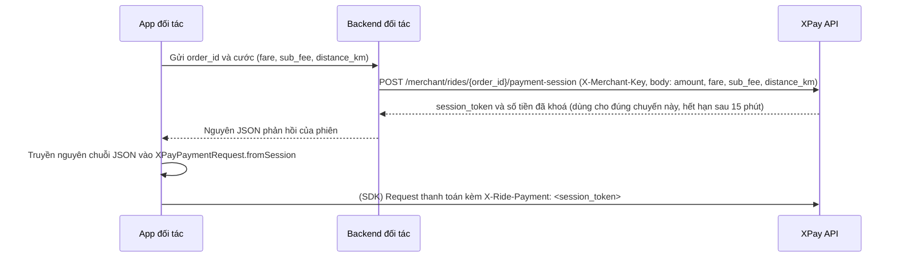
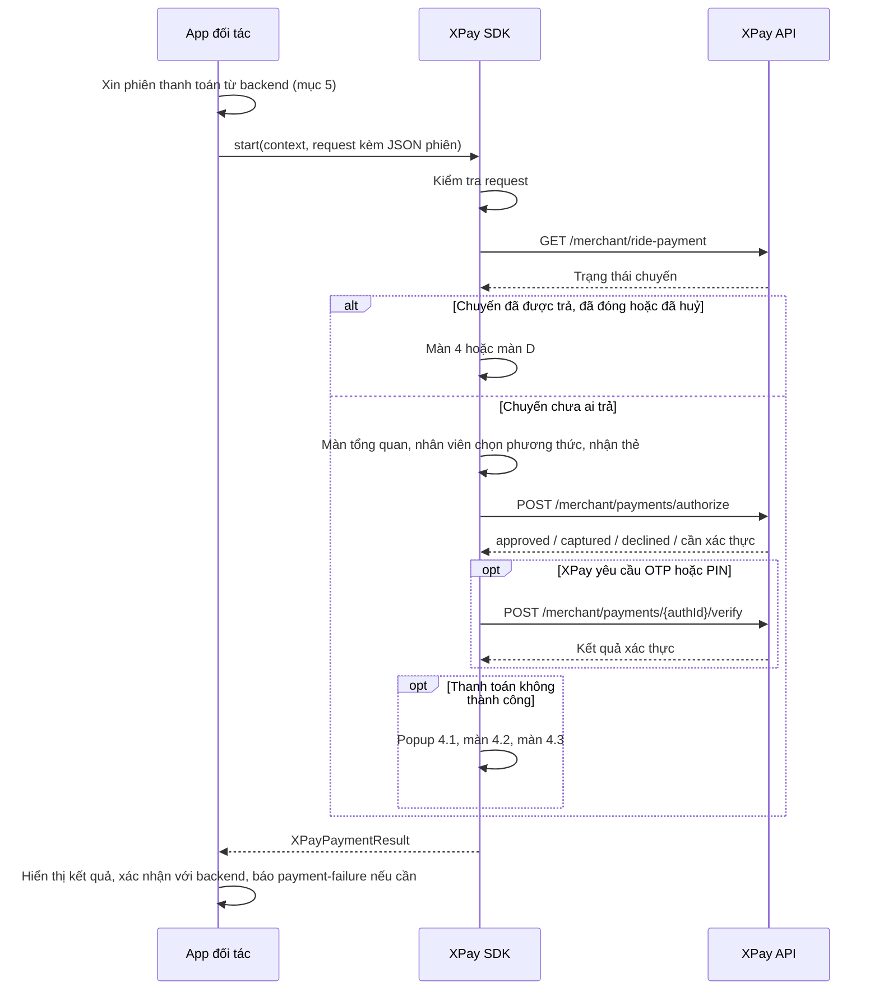

# XPay Payment SDK cho Flutter — Tài liệu tích hợp

SDK giúp app Flutter của đối tác thu tiền bằng thẻ XPay. SDK đảm nhận toàn bộ phần thẻ trong quy trình thanh toán: kiểm tra chuyến đã được trả chưa, đọc thẻ (chạm NFC, quét QR hoặc nhập số thẻ), gửi yêu cầu authorize lên XPay, hiển thị bước xác thực OTP/PIN khi XPay yêu cầu, xử lý khi thanh toán không thành công (thử lại, gọi tổng đài XPAY, chờ tổng đài thanh toán dùm), rồi trả về cho app **đúng một kết quả**. Với chuyến đặt bằng ví doanh nghiệp của khách, SDK thu từ ví thay cho thẻ: khách quét mã QR bằng ứng dụng XPERISE, hoặc đọc mã được gửi tới số điện thoại hay email của khách.

App của đối tác giữ mọi thứ xung quanh: đơn hàng, việc chọn phương thức thanh toán, và xử lý sau khi có kết quả.

> **Trạng thái: bản preview dùng để tích hợp thử và demo.** SDK dùng được cho app Flutter (tài liệu này) cho app Android native (Kotlin) qua AAR, và cho app iOS native (Swift) qua Swift package: xem [Tài liệu tích hợp Android native](docs/android_integration.vi.md) và [Tài liệu tích hợp iOS native](docs/ios_integration.vi.md).

Tài liệu dành cho đội mobile và backend của đối tác. Bản tiếng Anh: [README.md](README.md).

## Mục lục

1. [SDK làm gì](#1-sdk-làm-gì)
2. [Yêu cầu hệ thống](#2-yêu-cầu-hệ-thống)
3. [Cài đặt](#3-cài-đặt)
4. [Cấu hình Android và iOS](#4-cấu-hình-android-và-ios)
5. [Xác thực](#5-xác-thực)
6. [Khởi tạo SDK](#6-khởi-tạo-sdk)
7. [Thực hiện một thanh toán](#7-thực-hiện-một-thanh-toán)
8. [API reference](#8-api-reference)
9. [Kết quả và cách xử lý](#9-kết-quả-và-cách-xử-lý)
10. [Mã lỗi](#10-mã-lỗi)
11. [Thử lại và chống trừ tiền hai lần](#11-thử-lại-và-chống-trừ-tiền-hai-lần)
12. [Xác nhận thanh toán từ backend](#12-xác-nhận-thanh-toán-từ-backend)
13. [Logging](#13-logging)
14. [Thông tin kết nối mạng](#14-thông-tin-kết-nối-mạng)
15. [Bảo mật](#15-bảo-mật)
16. [Ứng dụng mẫu](#16-ứng-dụng-mẫu)
17. [Giới hạn hiện tại](#17-giới-hạn-hiện-tại)
18. [Câu hỏi thường gặp](#18-câu-hỏi-thường-gặp)

## 1. SDK làm gì

| SDK đảm nhận                                                                       | App đối tác đảm nhận                                                    |
| ---------------------------------------------------------------------------------- | ----------------------------------------------------------------------- |
| Kiểm tra trạng thái chuyến mỗi lần mở                                              | Đơn hàng và phiên thanh toán của đơn                                    |
| Màn tổng quan & chọn phương thức, rồi các màn nhận thẻ                             | Đặt "Thẻ XPay" vào danh sách phương thức thanh toán của app             |
| Gửi yêu cầu authorize lên XPay, màn xác thực OTP/PIN                               | Màn thanh toán thành công của app, điều hướng, cập nhật dữ liệu của app |
| Popup thanh toán không thành công, màn chọn cách thanh toán tiếp, màn chờ tổng đài | Báo `payment-failure` từ server, void giao dịch còn treo, thu tiền mặt  |
| Màn "Thanh toán thành công" khi chuyến đã được trả, màn chuyến đã đóng hoặc đã huỷ |                                                                         |
| Trả về đúng một kết quả cho mỗi lần thanh toán                                     |                                                                         |

SDK hiện lỗi và các màn xử lý lỗi của mình, nhưng **không** thay màn thanh toán thành công của app. App tự hiển thị dựa trên kết quả trả về.

Màn đầu tiên của SDK hiện số tiền, thông tin chuyến (mã cuốc, điểm đón, điểm trả, biển số xe) và các phương thức theo đúng thứ tự `entry_modes` của phiên. Nhân viên chọn một:

| Giá trị `entry_modes` | Nhân viên làm gì                                                 | Android | iOS   |
| --------------------- | ---------------------------------------------------------------- | ------- | ----- |
| `ride_card`           | Thu bằng thẻ đã liên kết của chuyến, hiện tên thẻ và 4 số cuối   | Có      | Có    |
| `card_qr`             | Quét QR in trên thẻ XPay của khách, hoặc chọn ảnh QR từ thư viện | Có      | Có    |
| `manual_pan`          | Nhập số thẻ                                                      | Có      | Có    |
| `chip_tap`            | Chạm thẻ chip XPay của khách vào điện thoại                      | Có      | Không |
| `token`               | Quét mã thanh toán dùng một lần trên ứng dụng XPERISE của khách  | Có      | Có    |

Chỉ hiện các phương thức thiết bị chạy được. Chọn `card_qr` thì chỉ nhận QR thẻ, chọn `token` thì chỉ nhận mã dùng một lần. Bấm back ở màn nhận thẻ thì quay về danh sách phương thức; bấm back ở danh sách phương thức thì huỷ thanh toán.

NFC chỉ có trên Android: thẻ chip XPay là MIFARE Classic, và iOS không cho app truy cập thẻ MIFARE Classic.

### Chuyến thanh toán bằng ví doanh nghiệp

Khi `payment_method` của phiên là `corporate_wallet`, chuyến được trả bằng ví doanh nghiệp của khách. Màn đầu tiên vẫn như trên nhưng hiện các phương thức sau:

| Phương thức                       | Diễn ra thế nào                                                                                                                                       | Android | iOS |
| --------------------------------- | ----------------------------------------------------------------------------------------------------------------------------------------------------- | ------- | --- |
| Hiển thị mã QR                    | SDK hiện mã QR cho đúng số tiền đã khoá. Khách quét bằng ứng dụng XPERISE và thanh toán. SDK kiểm tra mỗi 3 giây, trả kết quả ngay khi khách trả xong | Có      | Có  |
| Gửi mã qua SMS / Gửi mã qua email | Mỗi người đi × mỗi kênh XPay có thông tin là một dòng, người đặt chuyến đứng đầu. SDK gửi mã 6 số; nhân viên nhập mã khách đọc                        | Có      | Có  |

1. Dòng "Hiển thị mã QR" luôn có. Các dòng gửi mã lấy từ XPay: người không có số điện thoại thì không có dòng SMS, không có email thì không có dòng email. Không ai có thông tin thì chỉ còn mã QR.
2. Ở màn nhập mã, nhân viên có thể gửi lại mã (40 giây sau lần gửi trước), và bấm **Đổi** để chuyển sang số điện thoại hoặc email khác.
3. Bấm back ở màn QR thì SDK huỷ mã QR với XPay trước. Nếu XPay chưa xác nhận đã huỷ, SDK giữ nguyên màn QR và báo lỗi, vì khách vẫn có thể quét mã đó; bấm back lần nữa để thử lại.
4. Mã sai, mã hết hạn hoặc nhập sai quá số lần được báo ngay trên màn nhập mã, thanh toán không kết thúc. Nhân viên gửi mã mới rồi tiếp tục.

## 2. Yêu cầu hệ thống

| Thành phần | Tối thiểu             |
| ---------- | --------------------- |
| Flutter    | 3.44 (Dart `^3.12.2`) |
| Android    | minSdk 24, Java 17    |
| iOS        | 15.0                  |

App của đối tác phải tương thích với các dependency mà SDK dùng. Nếu app đã dùng một trong các package dưới đây, version trong app phải nằm trong khoảng cho phép:

| Package              | Khoảng version SDK yêu cầu |
| -------------------- | -------------------------- |
| `dio`                | `^5.10.0`                  |
| `flutter_bloc`       | `^9.1.1`                   |
| `get_it`             | `^9.2.1`                   |
| `intl`               | `^0.20.3`                  |
| `mobile_scanner`     | `^7.4.0`                   |
| `nfc_manager`        | `^4.2.1`                   |
| `permission_handler` | `^12.0.3`                  |
| `image_picker`       | `^1.2.3`                   |
| `app_settings`       | `7.0.0`                    |
| `pretty_qr_code`     | `^3.6.0`                   |
| `url_launcher`       | `^6.3.1`                   |

Danh sách đầy đủ nằm trong `pubspec.yaml` của SDK. SDK dùng container `get_it` riêng (`GetIt.asNewInstance()`), nên không đụng tới các đăng ký `get_it` của app.

## 3. Cài đặt

SDK không publish lên pub.dev. Khai báo dependency qua repo Git và khoá theo tag của bản phát hành:

```yaml
dependencies:
  xpay_payment_sdk:
    git:
      url: https://github.com/nggiahuy09/xpay-payment-sdk.git
      ref: v3.1128.1
```

Nâng cấp: đổi `ref` sang tag mới rồi chạy `flutter pub get`. Đọc [CHANGELOG.md](CHANGELOG.md) trước, vì số phiên bản không theo Semantic Versioning nên breaking change chỉ được ghi ở đó.

Chỉ import thư viện public:

```dart
import 'package:xpay_payment_sdk/xpay_payment_sdk.dart';
```

Mọi thứ dưới `package:xpay_payment_sdk/src/` là nội bộ và có thể thay đổi mà không báo trước.

## 4. Cấu hình Android và iOS

### Android

Thêm vào `android/app/src/main/AndroidManifest.xml`, bên trong thẻ `<manifest>`:

```xml
<uses-permission android:name="android.permission.CAMERA"/>
<uses-permission android:name="android.permission.INTERNET"/>
<uses-permission android:name="android.permission.NFC"/>
<uses-feature android:name="android.hardware.camera" android:required="false"/>
<uses-feature android:name="android.hardware.nfc" android:required="false"/>
```

`required="false"` giúp app vẫn cài được trên máy không có NFC hoặc camera. Trên máy không có NFC, SDK không hiện `chip_tap` trong danh sách phương thức.

Đảm bảo `minSdk` trong `android/app/build.gradle(.kts)` từ 24 trở lên. Flutter 3.44 mặc định `flutter.minSdkVersion` là 24.

### iOS

Thêm vào `ios/Runner/Info.plist`:

```xml
<key>NSCameraUsageDescription</key>
<string>Ứng dụng cần quyền camera để quét mã QR XPay khi thanh toán.</string>
<key>NSPhotoLibraryUsageDescription</key>
<string>Ứng dụng cần quyền thư viện ảnh để quét mã QR XPay từ ảnh của bạn.</string>
```

Đặt iOS deployment target từ 15.0 trở lên (trong Xcode và trong `Podfile` nếu có).

Không cần entitlement NFC, vì SDK không dùng NFC trên iOS.

## 5. Xác thực

Mỗi thanh toán được xác thực bằng một **phiên thu tiền của chuyến** (session token) do **backend của đối tác** xin từ XPay. SDK không bao giờ nhìn thấy merchant key hay bất kỳ secret dài hạn nào.



1. Nhân viên nhập cước của chuyến trên app đối tác. App gửi `order_id` và cước cho backend.
2. Backend đối tác gọi `POST /merchant/rides/{order_id}/payment-session` bằng `X-Merchant-Key` của mình, kèm body JSON: `amount` (chuỗi, bằng `fare` + `sub_fee`, tính bằng đồng), `fare` (số), tuỳ chọn `sub_fee` (số, mặc định 0) và `distance_km` (số). Merchant key chỉ nằm trên server.
3. XPay trả `session_token` cho đúng chuyến đó, cùng `amount` đã khoá, `external_ref` (dạng `XP-…`) và dữ liệu chuyến. Token chỉ hiện một lần và hết hạn sau 15 phút.
4. Backend chuyển **nguyên** JSON phản hồi xuống app, không cần tách field. App truyền nguyên chuỗi đó vào `sessionJson` của `XPayPaymentRequest.fromSession`. SDK tự đọc `session_token`, `amount`, `external_ref`, `payment_method` và `payment_template` (`currency`, `product_type`).

Lưu ý:

1. SDK gửi token qua header `X-Ride-Payment` trong mọi request của lần thanh toán đó.
2. Phiên hết hạn giữa chừng thì SDK gọi `fetchSession` để lấy phiên mới, xem [Gia hạn phiên](#gia-hạn-phiên-fetchsession). Không truyền `fetchSession`, hoặc không lấy được phiên mới, thì SDK hiện popup "Không mở được phiên thanh toán" và trả `retryInPartner`.
3. SDK chỉ giữ token trong bộ nhớ khi thanh toán đang mở, không lưu xuống máy và không ghi log token.
4. **Số tiền bị khoá theo phiên.** SDK thu đúng `amount` trong phản hồi của phiên. Muốn thu số tiền khác thì xin phiên mới; không sửa JSON trước khi đưa vào SDK.
5. **Mở phiên mới cho cùng một chuyến sẽ thu hồi các phiên trước.** Request dùng phiên cũ bị trả `ride_payment_session_revoked` (HTTP 401), SDK hiện popup "Cước đã được cập nhật" và trả `retryInPartner`. Chỉ xin phiên ngay trước khi thu tiền, và không xin phiên mới khi một thanh toán của chuyến đó còn đang mở (trừ trong `fetchSession`).
6. **Dữ liệu chuyến lấy từ phiên.** XPay tự gắn điểm đón, điểm đến, biển số, cước, phụ phí và quãng đường của phiên vào giao dịch. App không truyền các thông tin này cho SDK.
7. **Mã tham chiếu lấy từ phiên.** SDK dùng `external_ref` (dạng `XP-…`) trong phản hồi, nên `externalRef` trong kết quả cũng là `XP-…`.
8. **JSON không đọc được thì không thanh toán.** Chuỗi không phải JSON object, thiếu `session_token`, hoặc `amount` không phải số nguyên đồng (ví dụ `"138000.50"`), hoặc (với phiên thẻ) không còn phương thức nào trong `entry_modes` thì `start` trả `unavailable` với `errorCode = sdk_invalid_request` và không gửi gì lên XPay. Lý do cụ thể được gửi qua `onLog` (`feature = payment`, `action = start_payment`, xem [mục 13](#13-logging)).

**Tuyệt đối không đưa merchant key, API key hay bất kỳ thông tin xác thực nào của server vào app.**

### Gia hạn phiên: `fetchSession`

Phiên chỉ sống 15 phút, nên có thể hết hạn khi tài xế đang thao tác (khách tìm thẻ, chờ mã OTP). Truyền `fetchSession` vào `XPayPaymentRequest.fromSession` để SDK tự lấy phiên mới mà không làm gián đoạn thanh toán:

1. Khi XPay trả `401 ride_payment_session_expired`, SDK gọi `fetchSession` một lần, chờ tối đa 15 giây.
2. `fetchSession` gọi backend xin lại phiên cho **cùng chuyến, cùng cước** (`POST /merchant/rides/{order_id}/payment-session`) và trả về nguyên JSON phản hồi.
3. SDK gửi lại đúng request vừa bị từ chối, cùng body và cùng idempotency key, với phiên mới. Tài xế chỉ thấy loading lâu hơn một chút.
4. Phiên mới có cước khác: SDK hiện popup "Cước đã được cập nhật" và trả `retryInPartner` với `failure.errorCode = sdk_session_amount_changed`, `failure.note = cước đổi`.
5. `fetchSession` ném lỗi, quá 15 giây, hoặc trả phiên của chuyến khác: SDK hiện popup "Không mở được phiên thanh toán" và trả `retryInPartner` với `failure.reason = sdkError`.

## 6. Khởi tạo SDK

Gọi `initialize` một lần trước lần thanh toán đầu tiên, ví dụ khi mở app hoặc sau khi nhân viên đăng nhập. Gọi lại khi cần đổi ngôn ngữ hoặc base URL.

```dart
await XPayPayment.initialize(
  XPayConfig(
    environment: const XPayEnvironment(baseUrl: 'https://<xpay api host>'),
    language: XPayLanguage.vi,
    onLog: (event) => myLogger.log(event.toString()),
  ),
);
```

Lưu ý khi gọi lại `initialize`:

1. Không gọi khi đang có một thanh toán mở (tức `start` chưa trả kết quả). Khi đó `initialize` ném `StateError` và giữ nguyên cấu hình cũ.
2. Không gọi khi lần `initialize` trước chưa xong. Khi đó lần gọi sau ném `StateError`, lần gọi trước vẫn chạy tiếp.
3. Trong lúc `initialize` đang chạy, `start` trả `unavailable` với `errorCode = sdk_not_initialized`. Luôn `await` xong `initialize` rồi mới gọi `start`.

## 7. Thực hiện một thanh toán

### Luồng tổng quát



### Ví dụ: thanh toán chuyến xe

```dart
Future<void> payWithXPay(BuildContext context, Order order) async {
  final sessionJson = await myBackend.openPaymentSession(order.id, fare: order.fare, subFee: order.subFee, distanceKm: order.distanceKm);
  if (context.mounted == false) return;

  final result = await XPayPayment.start(
    context,
    XPayPaymentRequest.fromSession(
      sessionJson,
      () => myBackend.openPaymentSession(order.id, fare: order.fare, subFee: order.subFee, distanceKm: order.distanceKm),
    ),
  );
  await myBackend.saveXPayResult(order.id, result);

  switch (result.status) {
    case XPayPaymentStatus.paid:
      await confirmOnBackend(order.id, externalRef: result.externalRef);
      showPaidScreen(order);
    case XPayPaymentStatus.rideClosed:
      closeRide(order, result.rideStatus);
    case XPayPaymentStatus.retryInPartner:
    case XPayPaymentStatus.otherMethod:
    case XPayPaymentStatus.csPending:
    case XPayPaymentStatus.cancelled:
    case XPayPaymentStatus.unavailable:
      showPaymentScreen(order, lastXPayResult: result);
  }
}
```

`openPaymentSession` là hàm của đối tác: nó gọi backend của đối tác, backend gọi `payment-session` với body ở [mục 5](#5-xác-thực) rồi trả về nguyên body phản hồi dưới dạng chuỗi. Hàm thứ hai truyền vào `fromSession` là `fetchSession`, xem [Gia hạn phiên](#gia-hạn-phiên-fetchsession).

Màn thanh toán của app dùng `lastXPayResult` để: cho mở lại XPAY ngay khi `isRetryable`; nhắc hỏi tổng đài trước khi thu cách khác với `csPending`; void `pendingAuthId` và báo `payment-failure` khi tài xế chốt cách thu khác. Xem [mục 9](#9-kết-quả-và-cách-xử-lý).

### Hành vi của `start`

1. `start` mở màn hình SDK trên **root navigator** của app. Khi thanh toán kết thúc, SDK tự đóng màn hình của mình rồi trả kết quả. SDK không đụng tới router của app.
2. `context` truyền vào phải nằm dưới một `MaterialApp`.
3. Mỗi lần mở, SDK kiểm tra trạng thái chuyến trước (tối đa 15 giây). Chuyến đã được trả thì vào thẳng màn 4, đã đóng hoặc đã huỷ thì vào màn D, không cho thu lần nữa. Không kiểm tra được (mất mạng) thì vào màn chọn phương thức như bình thường.
4. Trong lúc XPay đang authorize thẻ hoặc đang xác thực mã, nút back bị vô hiệu hoá, để nhân viên không rời khỏi một thanh toán có thể đã bị trừ tiền.
5. Bấm back ở màn nhận thẻ thì quay về danh sách phương thức. Bấm back ở danh sách phương thức thì kết quả là `cancelled`. Bấm back ở màn xác thực OTP/PIN thì SDK hỏi lại; đồng ý rời đi thì kết quả là `cancelled` kèm `pendingAuthId`.
6. Mã QR không phải của XPay, hoặc không đúng loại với phương thức đã chọn (QR thẻ / mã dùng một lần), bị báo lỗi ngay trên màn hình quét, SDK không gửi request nào và nhân viên có thể quét lại.
7. Không phương thức nào của phiên chạy được trên thiết bị (ví dụ phiên chỉ có `chip_tap`, chạy trên iOS) thì `start` trả `unavailable` với `errorCode = sdk_unsupported` mà không mở màn hình nào. Phiên ví doanh nghiệp luôn mở được, vì mã QR và gửi mã chạy trên mọi thiết bị.
8. Với phiên ví doanh nghiệp, bấm back ở màn QR hoặc màn nhập mã thì quay về danh sách phương thức. Xem [Chuyến thanh toán bằng ví doanh nghiệp](#chuyến-thanh-toán-bằng-ví-doanh-nghiệp).
9. Thanh toán không thành công được SDK xử lý trên màn hình của SDK (popup 4.1, màn 4.2, màn 4.3) trước khi đóng. App không cần hiện thêm popup lỗi.

## 8. API reference

### `XPayPayment`

Facade tĩnh, là điểm vào duy nhất của SDK.

`XPayPayment.supportHotline` (`String`, `'19002189'`): số tổng đài XPAY. SDK đã hiện số này trên popup lỗi; dùng khi app cần hiện số tổng đài trên màn của mình.

#### `static Future<void> initialize(XPayConfig config)`

Cấu hình SDK: ngôn ngữ, base URL và callback log. Có thể gọi lại để cấu hình lại, trừ khi đang có thanh toán mở hoặc lần `initialize` trước chưa xong: khi đó hàm ném `StateError`. Xem [mục 6](#6-khởi-tạo-sdk).

#### `static Future<XPayPaymentResult> start(BuildContext context, XPayPaymentRequest request)`

Mở luồng thanh toán và luôn hoàn thành với **đúng một** `XPayPaymentResult`. Hàm không ném exception khi thanh toán thất bại; mọi lỗi đều nằm trong kết quả.

Thứ tự kiểm tra trước khi mở màn hình:

| Điều kiện                                                       | Kết quả                                          |
| --------------------------------------------------------------- | ------------------------------------------------ |
| Chưa gọi `initialize`, hoặc `initialize` đang chạy              | `unavailable`, `errorCode = sdk_not_initialized` |
| Đang có một thanh toán khác mở                                  | `unavailable`, `errorCode = sdk_busy`            |
| Request không hợp lệ (xem [quy tắc](#quy-tắc-kiểm-tra-request)) | `unavailable`, `errorCode = sdk_invalid_request` |
| Thiết bị không chạy được phương thức nào của phiên              | `unavailable`, `errorCode = sdk_unsupported`     |
| `context` không còn mounted                                     | `cancelled`                                      |

### `XPayConfig`

| Trường        | Kiểu                           | Bắt buộc | Mặc định          | Mô tả                                             |
| ------------- | ------------------------------ | -------- | ----------------- | ------------------------------------------------- |
| `environment` | `XPayEnvironment`              | Có       |                   | Môi trường XPay (sandbox hoặc production)         |
| `language`    | `XPayLanguage`                 | Không    | `XPayLanguage.vi` | Ngôn ngữ của màn hình SDK                         |
| `onLog`       | `void Function(XPayLogEvent)?` | Không    | `null`            | Nhận sự kiện nghiệp vụ, xem [mục 13](#13-logging) |

### `XPayEnvironment`

| Trường    | Kiểu     | Bắt buộc | Mô tả                                                          |
| --------- | -------- | -------- | -------------------------------------------------------------- |
| `baseUrl` | `String` | Có       | Base URL của XPay API. XPay cung cấp URL sandbox và production |

### `XPayLanguage`

| Giá trị | Ngôn ngữ   |
| ------- | ---------- |
| `vi`    | Tiếng Việt |
| `en`    | Tiếng Anh  |

### `XPayPaymentRequest`

Tạo bằng `XPayPaymentRequest.fromSession(sessionJson, [fetchSession])`.

| Trường         | Kiểu                         | Bắt buộc | Mô tả                                                                                                                                                                                                                                                                                                                                                                                |
| -------------- | ---------------------------- | -------- | ------------------------------------------------------------------------------------------------------------------------------------------------------------------------------------------------------------------------------------------------------------------------------------------------------------------------------------------------------------------------------------ |
| `sessionJson`  | `String`                     | Có       | Nguyên body phản hồi của `POST /merchant/rides/{order_id}/payment-session`. SDK lấy `session_token`, `amount`, `external_ref`, `payment_template.currency` (mặc định `VND`), `payment_template.product_type`, `payment_method` (mặc định `card`), `entry_modes`, `ride_card`, `order_id` và thông tin chuyến trong `payment_template.enhanced_data` từ đây. Xem [mục 5](#5-xác-thực) |
| `fetchSession` | `Future<String> Function()?` | Không    | SDK gọi khi phiên hết hạn giữa chừng. Trả về nguyên JSON của một phiên mới cho **cùng chuyến, cùng cước**. Xem [Gia hạn phiên](#gia-hạn-phiên-fetchsession)                                                                                                                                                                                                                          |

Số thẻ, dữ liệu chip và mã xác thực **không** nằm trong request. SDK tự thu thập các thông tin này.

### Quy tắc kiểm tra request

SDK kiểm tra request trước khi mở bất kỳ màn hình nào. Vi phạm một trong các quy tắc dưới đây thì `start` trả `unavailable` với `errorCode = sdk_invalid_request` và **không gửi gì lên XPay**:

1. `sessionJson` là một JSON object có `session_token` không rỗng.
2. `amount` trong JSON là số nguyên đồng (chuỗi như `"138000"` hoặc `"138000.00"`), tối thiểu 1.000.
3. `external_ref` dài 1–64 ký tự sau khi bỏ khoảng trắng hai đầu.
4. `currency` (nếu có) không rỗng sau khi bỏ khoảng trắng.
5. Với phiên thẻ, `entry_modes` còn ít nhất một phương thức SDK biết. Giá trị lạ bị bỏ qua; `ride_card` bị bỏ qua khi thiếu `ride_card.card_last4` hoặc `order_id`. Phiên có `payment_method = corporate_wallet` không cần `entry_modes`.
6. `payment_method` thiếu hoặc là giá trị SDK chưa biết thì phiên được xử lý như phiên thẻ.

SDK không kiểm tra phiên còn hạn hay đã bị thu hồi trước khi mở. Khi XPay báo phiên hết hạn, SDK gọi `fetchSession`; phiên bị thu hồi đi luồng B ([mục 9](#9-kết-quả-và-cách-xử-lý)).

### `XPayPaymentResult`

| Trường          | Kiểu                  | Mô tả                                                                                                                      |
| --------------- | --------------------- | -------------------------------------------------------------------------------------------------------------------------- |
| `status`        | `XPayPaymentStatus`   | Trạng thái cuối cùng, luôn có. Xem [mục 9](#9-kết-quả-và-cách-xử-lý)                                                       |
| `failure`       | `XPayPaymentFailure?` | Lý do XPay không thu được, có với `retryInPartner`, `otherMethod`, `csPending`, `unavailable`                              |
| `pendingAuthId` | `String?`             | Giao dịch thẻ còn chờ mã OTP/PIN khi SDK đóng. Server đối tác void trước khi thu cách khác                                 |
| `paidBy`        | `XPayPaidBy?`         | Với `paid`: ai đã thu, `partner` (thu tại xe qua SDK) hoặc `cs` (tổng đài trả dùm)                                         |
| `rideStatus`    | `XPayRideStatus?`     | Với `rideClosed`: `completed` (tổng đài đã đóng chuyến, không thu) hoặc `cancelled` (chuyến đã huỷ)                        |
| `authId`        | `String?`             | Với `paid`: mã giao dịch thẻ. Luôn `null` với thanh toán bằng ví doanh nghiệp                                              |
| `captureId`     | `String?`             | Với `paid`: mã capture, nếu có                                                                                             |
| `externalRef`   | `String?`             | Với `paid`: mã chuyến `XP-…`                                                                                               |
| `amount`        | `int?`                | Với `paid`: số tiền XPay đã thu. Khi tổng đài trả dùm, có thể khác số đã khoá trong phiên                                  |
| `currency`      | `String?`             | Với `paid`: mã tiền tệ                                                                                                     |
| `createdAt`     | `DateTime?`           | Với `paid`: thời điểm XPay ghi nhận, nếu có                                                                                |
| `errorCode`     | `String?`             | Với `unavailable`: mã lỗi của SDK. Xem [mục 10](#10-mã-lỗi)                                                                |
| `isSuccessful`  | `bool` (getter)       | `true` khi `status` là `paid`                                                                                              |
| `isRetryable`   | `bool` (getter)       | `true` với `retryInPartner` và `cancelled`: app được mở lại XPAY ngay (bằng phiên mới). `false` với các trạng thái còn lại |

### `XPayPaymentFailure`

| Trường      | Kiểu                | Mô tả                                                                                                                                     |
| ----------- | ------------------- | ----------------------------------------------------------------------------------------------------------------------------------------- |
| `reason`    | `XPayFailureReason` | Lý do để server gửi nguyên văn vào `payment-failure`                                                                                      |
| `authId`    | `String?`           | Giao dịch thẻ bị từ chối gần nhất. Chuyến ví không có                                                                                     |
| `errorCode` | `String?`           | Mã lỗi gốc (mã từ chối hoặc mã API), dùng để tra cứu và đối soát. Xem [mục 10](#10-mã-lỗi)                                                |
| `note`      | `String?`           | Ghi chú cho tổng đài: `cước đổi`, `chờ tổng đài quá 5 phút`, hoặc mã lỗi khi `reason` là `sdkError`. Gửi vào `note` của `payment-failure` |

### `XPayPaymentStatus`

| Giá trị          | `isRetryable` | Khi nào                                                                       |
| ---------------- | ------------- | ----------------------------------------------------------------------------- |
| `paid`           | `false`       | Chuyến đã được thanh toán, qua SDK hoặc do tổng đài trả dùm                   |
| `retryInPartner` | `true`        | Popup lỗi luồng B, tài xế bấm "Quay lại trang thanh toán"                     |
| `otherMethod`    | `false`       | Màn 4.2, tài xế chọn "Thử lại với phương thức thanh toán khác"                |
| `csPending`      | `false`       | Màn 4.3 hết 5 phút, hoặc tài xế bấm back. Tổng đài có thể vẫn đang thanh toán |
| `rideClosed`     | `false`       | Màn D: chuyến đã đóng không thu, hoặc đã huỷ                                  |
| `cancelled`      | `true`        | Tài xế thoát trước khi có kết quả, hoặc app đóng màn hình SDK                 |
| `unavailable`    | `false`       | SDK không mở được màn hình thanh toán                                         |

### `XPayFailureReason`

| Giá trị           | `toRemote()`       | Ý nghĩa                                        |
| ----------------- | ------------------ | ---------------------------------------------- |
| `paymentDeclined` | `payment_declined` | Thẻ hoặc ví từ chối, hoặc hết số lần thử       |
| `sdkError`        | `sdk_error`        | Lỗi hệ thống, lỗi phiên, lỗi tích hợp hoặc SDK |
| `other`           | `other`            | Lý do khác, hiện là cước vừa đổi               |

### `XPayPaidBy` và `XPayRideStatus`

| Enum             | Giá trị                                                                        |
| ---------------- | ------------------------------------------------------------------------------ |
| `XPayPaidBy`     | `partner`: thu tại xe qua SDK. `cs`: tổng đài XPAY trả dùm                     |
| `XPayRideStatus` | `completed`: tổng đài đã đóng chuyến, không thu. `cancelled`: chuyến đã bị huỷ |

### `XPayErrorCode`

Hằng số cho các mã lỗi do chính SDK sinh ra.

| Hằng số                              | Giá trị                      |
| ------------------------------------ | ---------------------------- |
| `XPayErrorCode.notInitialized`       | `sdk_not_initialized`        |
| `XPayErrorCode.busy`                 | `sdk_busy`                   |
| `XPayErrorCode.invalidRequest`       | `sdk_invalid_request`        |
| `XPayErrorCode.unsupported`          | `sdk_unsupported`            |
| `XPayErrorCode.unexpectedResponse`   | `sdk_unexpected_response`    |
| `XPayErrorCode.sessionAmountChanged` | `sdk_session_amount_changed` |

### `XPayLogEvent`

| Trường          | Kiểu                   | Mô tả                                                                                  |
| --------------- | ---------------------- | -------------------------------------------------------------------------------------- |
| `level`         | `XPayLogLevel`         | `info`, `warn`, `error`                                                                |
| `category`      | `XPayLogCategory`      | `api` (kết quả gọi API), `behavior` (hành vi người dùng), `error` (dữ liệu bất thường) |
| `feature`       | `String`               | Khu vực phát sinh sự kiện: `payment`, `verification`, `card_nfc`, `corporate_wallet`   |
| `action`        | `String`               | Hành động cụ thể, xem [mục 13](#13-logging)                                            |
| `reason`        | `String?`              | Lý do chi tiết, nếu có                                                                 |
| `errorCode`     | `String?`              | Mã lỗi, nếu sự kiện đến từ một lỗi                                                     |
| `serverMessage` | `String?`              | Thông báo lỗi gốc từ XPay, nếu có                                                      |
| `input`         | `Map<String, Object?>` | Các định danh liên quan (không thể sửa)                                                |

## 9. Kết quả và cách xử lý

SDK tự hiện lỗi và hướng dẫn tài xế trên màn hình của SDK: thử lại trong SDK, quay về app, hoặc gọi tổng đài XPAY rồi chọn cách thanh toán tiếp. Khi SDK đóng, app nhận một kết quả và làm theo bảng dưới. Năm luồng xử lý, từng màn hình và quy trình đầy đủ: [docs/failure_handling.vi.md](docs/failure_handling.vi.md).

| Trạng thái       | SDK đóng ở                                                      | Trường có giá trị                                                                                | App nên làm gì                                                                                                                |
| ---------------- | --------------------------------------------------------------- | ------------------------------------------------------------------------------------------------ | ----------------------------------------------------------------------------------------------------------------------------- |
| `paid`           | Màn 4 "Thanh toán thành công", tự đóng sau 3 giây               | `paidBy`, `externalRef`, `amount`, `currency`; `authId`, `captureId`, `createdAt` khi có         | Xác nhận với backend bằng `externalRef`, hiện màn thành công của app                                                          |
| `retryInPartner` | Popup lỗi, "Quay lại trang thanh toán"                          | `failure`                                                                                        | Về màn thanh toán, cho mở lại XPAY bằng phiên mới. `failure.note = cước đổi` thì hiện lại số tiền mới trước                   |
| `otherMethod`    | Màn 4.2, "Thử lại với phương thức thanh toán khác"              | `failure`; `pendingAuthId` khi có                                                                | Void `pendingAuthId` nếu có, về màn thanh toán để chọn cách khác, báo `payment-failure`                                       |
| `csPending`      | Màn 4.3 "Đang chờ tổng đài thanh toán", hết 5 phút hoặc back    | `failure` (`reason = paymentDeclined`, `note = chờ tổng đài quá 5 phút`); `pendingAuthId` khi có | **Không thu cách khác ngay**: hỏi tổng đài trước. Báo `payment-failure`; thu tiền mặt thì báo `paid_cash` trước khi nhận tiền |
| `rideClosed`     | Màn D "Tổng đài đã đóng chuyến, không thu" hoặc "Chuyến đã huỷ" | `rideStatus`                                                                                     | Không thu thêm, cập nhật chuyến theo `rideStatus`                                                                             |
| `cancelled`      | Tài xế thoát trước khi có kết quả, hoặc app đóng màn hình SDK   | `pendingAuthId` khi tài xế rời màn OTP/PIN                                                       | Về màn thanh toán. Void `pendingAuthId` nếu có. Có thể mở lại XPAY                                                            |
| `unavailable`    | Không mở màn hình nào                                           | `errorCode`, `failure` (`reason = sdkError`)                                                     | Xem [mục 10](#10-mã-lỗi): sửa tích hợp, hoặc để tài xế chọn cách khác                                                         |

Lưu ý:

1. **Mở lại XPAY luôn dùng phiên mới.** Backend gọi lại `POST /merchant/rides/{order_id}/payment-session` (phiên cũ bị thu hồi), app truyền nguyên phản hồi mới vào `start`. Không giới hạn số lần mở lại.
2. **Thanh toán bằng ví doanh nghiệp** thành công cũng là `paid`, nhưng `authId` và `captureId` là `null`, vì không có giao dịch thẻ. Xác nhận bằng `externalRef`.
3. **`paid` với `paidBy = cs`**: tổng đài XPAY đã trả dùm, kể cả khi SDK phát hiện việc này lúc mở hoặc lúc tài xế đang thử lại. Không thu thêm của khách.
4. **App không cần hiện popup lỗi thứ hai.** Tài xế đã thấy lý do, mã chuyến và số tổng đài trên popup của SDK.
5. **Báo `payment-failure`**: mỗi lần tài xế ở lại màn thanh toán của app mà chưa thu được bằng XPay (`otherMethod`, `csPending`, hoặc `retryInPartner`, `cancelled`, `unavailable` mà không mở lại XPAY), server đối tác gọi `POST /merchant/rides/{order_id}/payment-failure` với `reason`, `auth_id`, `note` lấy từ `failure`. Thu tiền mặt thì gửi `reason: "paid_cash"` kèm `amount` **trước khi** nhận tiền. Không báo khi `paid`, `rideClosed`. Chi tiết: [mục 6 của failure_handling.vi.md](docs/failure_handling.vi.md#6-báo-payment-failure-từ-server).

## 10. Mã lỗi

### `errorCode`: lỗi khi SDK không mở được

`errorCode` chỉ có giá trị khi `status` là `unavailable`.

| Mã                    | Nguyên nhân                                                | Cách xử lý                                            |
| --------------------- | ---------------------------------------------------------- | ----------------------------------------------------- |
| `sdk_not_initialized` | Gọi `start` trước khi `initialize` hoàn tất                | `await` xong `initialize` rồi mới gọi `start`         |
| `sdk_busy`            | Gọi `start` khi một thanh toán khác chưa kết thúc          | Chờ lần trước trả kết quả                             |
| `sdk_invalid_request` | Request không qua được bước kiểm tra. Chưa gửi gì lên XPay | Sửa dữ liệu theo [quy tắc](#quy-tắc-kiểm-tra-request) |
| `sdk_unsupported`     | Không phương thức nào của phiên chạy được trên thiết bị    | Ẩn XPAY cho phiên này, để tài xế chọn cách khác       |

### `failure.errorCode`: mã lỗi gốc của lần thất bại

`failure.errorCode` giữ nguyên mã mà SDK dựa vào để chọn luồng, dùng để tra cứu và đối soát. App không cần rẽ nhánh theo mã này.

1. Mã từ chối của giao dịch (`decline_reason`), ví dụ `insufficient_funds`, `card_blocked`, `employee_policy_violation`.
2. Mã lỗi API của XPay (`code`), ví dụ `ride_payment_session_revoked`, `corporate_wallet_refused`.
3. Mã của tầng mạng: `no_connection`, `no_host`, `timeout`.
4. Mã do SDK sinh ra: `sdk_session_amount_changed` (`fetchSession` trả phiên có cước khác), `sdk_unexpected_response` (XPay trả trạng thái SDK không xử lý được).

Bảng mã theo từng luồng: [mục 8 của failure_handling.vi.md](docs/failure_handling.vi.md#8-mã-lỗi-theo-luồng).

## 11. Thử lại và chống trừ tiền hai lần

Mỗi yêu cầu authorize và xác thực mã của thẻ mang một idempotency key, để request gửi lại không bị trừ tiền hai lần.

1. **SDK tự gửi lại** request authorize hoặc xác thực thẻ khi lỗi tạm thời (timeout, mất kết nối, HTTP 5xx, `request_in_flight`), với cùng key và cùng body. XPay trả lại kết quả của request đầu nếu đã ghi nhận.
2. **"Thử lại" trong SDK** (popup luồng A, hoặc "Thử lại với XPAY" ở màn 4.2): sau một lần bị từ chối, lần thử mới dùng key mới. Sau một lỗi hệ thống chưa rõ kết quả, nếu khách đưa lại cùng thẻ, SDK dùng lại key cũ để XPay trả kết quả cũ thay vì trừ lần nữa.
3. **Mở lại XPAY từ app** (gọi `start` lần nữa) cho cùng chuyến: nếu khách đưa cùng thẻ và số tiền không đổi, SDK dùng lại key của lần trước, trong suốt thời gian process của app còn sống.
4. **Thẻ khác hoặc số tiền khác**: request khác đi nên SDK tạo key mới. Chạm thẻ NFC luôn tạo key mới, vì mỗi lần chạm sinh ra một cryptogram mới.
5. Session token không nằm trong idempotency key. Thử lại bằng một phiên mới vẫn dùng lại key cũ.
6. Chuyến đã được trả (ví dụ tổng đài trả dùm trong lúc tài xế đang thử lại) thì XPay trả `ride_already_paid`, SDK chuyển sang màn 4 và trả `paid`, không trừ thẻ của khách lần nữa.

Chuyến ví doanh nghiệp chỉ được trả một lần, bằng mã QR hoặc bằng mã gửi tới khách: trả xong thì XPay đóng chuyến, và lần mở sau SDK vào thẳng màn 4.

## 12. Xác nhận thanh toán từ backend

Kết quả được trả về trên điện thoại của nhân viên, đây không phải nguồn đáng tin cậy. Trước khi hoàn tất đơn, backend của đối tác phải xác nhận thanh toán với XPay bằng `externalRef` (hoặc `authId` với thanh toán thẻ).

1. `paid` với `paidBy = cs` cũng xác nhận bằng `externalRef`. `amount` là số XPay đã thu, có thể khác số đã khoá trong phiên.
2. Thanh toán bằng ví doanh nghiệp không có `authId`: xác nhận bằng `externalRef`.
3. `pendingAuthId`: giao dịch thẻ còn chờ mã. Void bằng `POST /merchant/payments/{auth_id}/void` từ server, hoặc để tự hết hạn sau khoảng 10 phút. Chưa void thì `paid_cash` bị từ chối với `409 ride_payment_pending`.
4. Sau `csPending`, tổng đài vẫn có thể trả dùm. Server đối tác biết qua kênh xác nhận thanh toán đang dùng, hoặc qua `409 ride_already_paid` khi báo `paid_cash`.

## 13. Logging

Truyền `onLog` vào `XPayConfig` để nhận các sự kiện nghiệp vụ của SDK. SDK không gửi log đi đâu khác. Không truyền `onLog` thì SDK im lặng.

Sự kiện **không bao giờ** chứa số thẻ, khoá chip, cryptogram, nonce, mã xác thực hay token. Sự kiện lỗi NFC có chứa UID của chip (`chip_uid`).

| `feature`          | `action`                                                 | `level` | Khi nào                                                                                                                                                                                                                                                       | `input` chính                                                                                      |
| ------------------ | -------------------------------------------------------- | ------- | ------------------------------------------------------------------------------------------------------------------------------------------------------------------------------------------------------------------------------------------------------------- | -------------------------------------------------------------------------------------------------- |
| `payment`          | `start_payment`                                          | `error` | Request bị từ chối trước khi mở màn hình (`sdk_invalid_request`). `reason`: `invalid_session_json`, `malformed_session`, `missing_session_token`, `missing_entry_modes`, `invalid_amount`, `amount_below_minimum`, `missing_currency`, `invalid_external_ref` | `session_json_length`                                                                              |
| `payment`          | `checkout_failure`                                       | `warn`  | Thanh toán không thành công, SDK chọn luồng xử lý. `reason` là loại lỗi                                                                                                                                                                                       | `route`, `kind`, `error_code`, `auth_id`, `attempt`, `retry_in_sdk_count`                          |
| `payment`          | `authorize_qr`, `authorize_manual`, `authorize_chip_tap` | `error` | Gọi authorize thất bại (lỗi mạng, lỗi từ XPay, xung đột)                                                                                                                                                                                                      | `entry_mode`, `amount`, `currency`, `external_ref`, `product_type`, `service_date`, `auto_capture` |
| `payment`          | `authorize_approved`                                     | `info`  | XPay duyệt hoặc capture                                                                                                                                                                                                                                       | `entry_mode`, `auth_id`                                                                            |
| `payment`          | `authorize_declined`                                     | `warn`  | XPay từ chối                                                                                                                                                                                                                                                  | `entry_mode`, `decline_reason`                                                                     |
| `payment`          | `authorize_verification`                                 | `info`  | XPay yêu cầu xác thực OTP/PIN                                                                                                                                                                                                                                 | `entry_mode`, `auth_id`, `verification_method`                                                     |
| `payment`          | `authorize_incomplete`                                   | `error` | XPay trả trạng thái SDK không xử lý được                                                                                                                                                                                                                      | `entry_mode`                                                                                       |
| `verification`     | `send_verification`, `resend_verification`               | `error` | Gửi hoặc gửi lại mã xác thực thất bại                                                                                                                                                                                                                         | `auth_id`, `recipient_id`                                                                          |
| `verification`     | `verify`                                                 | `error` | Gọi verify thất bại, hoặc XPay trả trạng thái không mong đợi                                                                                                                                                                                                  | `auth_id`                                                                                          |
| `verification`     | `verify_approved`                                        | `info`  | Xác thực thành công                                                                                                                                                                                                                                           | `auth_id`                                                                                          |
| `verification`     | `verify_rejected`                                        | `warn`  | Mã xác thực sai                                                                                                                                                                                                                                               | `auth_id`, `attempt`                                                                               |
| `verification`     | `verify_declined`                                        | `warn`  | XPay từ chối sau bước xác thực                                                                                                                                                                                                                                | `auth_id`, `decline_reason`                                                                        |
| `verification`     | `verify_not_pending`                                     | `warn`  | XPay báo giao dịch không còn chờ mã, SDK đọc lại kết quả của giao dịch                                                                                                                                                                                        | `auth_id`, `payment_status`, `decline_reason`                                                      |
| `verification`     | `verification_expired`                                   | `error` | Hết thời gian xác thực                                                                                                                                                                                                                                        | `auth_id`                                                                                          |
| `verification`     | `verification_abandon`                                   | `info`  | Nhân viên rời màn hình xác thực                                                                                                                                                                                                                               | `auth_id`                                                                                          |
| `card_nfc`         | `prepare`, `sign`                                        | `error` | Gọi API chuẩn bị hoặc ký dữ liệu chip thất bại                                                                                                                                                                                                                | `chip_uid`, `counter`                                                                              |
| `card_nfc`         | `advance_counter`                                        | `error` | Không cập nhật được bộ đếm trên chip                                                                                                                                                                                                                          | `chip_uid`, `counter_sector`, `counter_block`                                                      |
| `corporate_wallet` | `get_otp_channels`                                       | `error` | Không tải được danh sách người nhận mã. Màn hình vẫn cho thu bằng mã QR                                                                                                                                                                                       | Không có                                                                                           |
| `corporate_wallet` | `request_otp`, `resend_otp`                              | `error` | Gửi hoặc gửi lại mã thất bại. `reason` là nguyên nhân, ví dụ `otpVelocityExceeded`                                                                                                                                                                            | `method`, `recipient_id`                                                                           |
| `corporate_wallet` | `verify_otp`                                             | `error` | Xác thực mã thất bại. `reason` là nguyên nhân, ví dụ `otpInvalid`                                                                                                                                                                                             | `wallet_payment_id`                                                                                |
| `corporate_wallet` | `verify_otp_captured`                                    | `info`  | Xác thực mã thành công, ví đã được trừ                                                                                                                                                                                                                        | `wallet_payment_id`                                                                                |
| `corporate_wallet` | `create_intent`                                          | `error` | Không tạo được mã QR                                                                                                                                                                                                                                          | `product_type`, `currency`, `external_ref`, `amount`                                               |
| `corporate_wallet` | `poll_intent`                                            | `error` | Kiểm tra mã QR gặp lỗi không thử lại được, thanh toán kết thúc                                                                                                                                                                                                | `intent_id`                                                                                        |
| `corporate_wallet` | `cancel_intent`                                          | `error` | Huỷ mã QR thất bại; `reason = cancel_unconfirmed` khi chưa xác nhận được mã đã bị huỷ                                                                                                                                                                         | `intent_id`                                                                                        |
| `corporate_wallet` | `intent_captured`                                        | `info`  | Khách đã trả qua mã QR                                                                                                                                                                                                                                        | `intent_id`                                                                                        |
| `corporate_wallet` | `intent_ended`                                           | `warn`  | Mã QR kết thúc mà không được trả. `reason`: `declined`, `canceled`, `expired`                                                                                                                                                                                 | `intent_id`                                                                                        |

Danh sách này có thể được bổ sung ở các phiên bản sau. App không nên dựa vào việc một sự kiện cụ thể luôn xuất hiện để điều khiển luồng nghiệp vụ; hãy dùng `XPayPaymentResult`.

Nếu `onLog` ném exception, SDK bỏ qua lỗi đó và tiếp tục thanh toán.

## 14. Thông tin kết nối mạng

Phần này dành cho đội backend và hạ tầng của đối tác, ví dụ để cấu hình firewall hoặc proxy. App **không cần** và **không nên** gọi trực tiếp các endpoint này; SDK đã làm việc đó.

Đường dẫn tính từ `XPayEnvironment.baseUrl`:

| Method | Endpoint                                               | Dùng khi                                                | Header riêng      |
| ------ | ------------------------------------------------------ | ------------------------------------------------------- | ----------------- |
| `GET`  | `/merchant/ride-payment`                               | Kiểm tra trạng thái chuyến khi mở, khi chờ tổng đài     |                   |
| `POST` | `/merchant/payments/authorize`                         | Authorize thanh toán                                    | `Idempotency-Key` |
| `GET`  | `/merchant/payments/{authId}`                          | Đọc lại kết quả giao dịch khi XPay báo không còn chờ mã |                   |
| `POST` | `/merchant/payments/{authId}/verify`                   | Gửi mã OTP/PIN                                          | `Idempotency-Key` |
| `POST` | `/merchant/payments/{authId}/resend-verification`      | Gửi hoặc gửi lại mã xác thực                            |                   |
| `POST` | `/merchant/chip/tap/prepare`                           | Chuẩn bị đọc thẻ chip (NFC)                             |                   |
| `POST` | `/merchant/chip/tap/cryptogram`                        | Ký dữ liệu chip (NFC)                                   |                   |
| `GET`  | `/merchant/wallet-payments/recipients`                 | Lấy danh sách người nhận mã của ví                      |                   |
| `POST` | `/merchant/wallet-payments`                            | Gửi hoặc gửi lại mã thanh toán ví                       |                   |
| `POST` | `/merchant/wallet-payments/{wallet_payment_id}/verify` | Xác thực mã thanh toán ví                               |                   |
| `POST` | `/merchant/payment-intents`                            | Tạo mã QR thanh toán ví                                 | `Idempotency-Key` |
| `GET`  | `/merchant/payment-intents/{intent_id}`                | Kiểm tra mã QR, mỗi 3 giây                              |                   |
| `POST` | `/merchant/payment-intents/{intent_id}/cancel`         | Huỷ mã QR khi nhân viên rời màn QR                      |                   |

Hành vi chung:

1. Mọi request mang header `X-Ride-Payment: <session token>` lấy từ `session_token` trong `XPayPaymentRequest.sessionJson`, hoặc từ phiên mới do `fetchSession` trả về.
2. Timeout kết nối và timeout nhận dữ liệu đều là 30 giây. `GET /merchant/ride-payment` có giới hạn 15 giây và không tự gửi lại.
3. Timeout, mất kết nối, HTTP 5xx và `409 request_in_flight`: SDK tự gửi lại tối đa 3 lần (chờ 1, 2, 4 giây; `request_in_flight` chờ 500 ms), chỉ với request `GET` hoặc request có `Idempotency-Key`.
4. HTTP 429: SDK chờ theo header `retry-after` (tối đa 3 giây), không có thì 1, 2, 4 giây, rồi gửi lại, tối đa 3 lần. `retry-after` lớn hơn 3 giây thì trả lỗi.
5. HTTP 401 `ride_payment_session_expired`: SDK gọi `fetchSession` rồi gửi lại request một lần với phiên mới. Các mã 401 khác không gửi lại.
6. Lỗi còn lại được SDK xử lý trên màn hình theo luồng, xem [failure_handling.vi.md](docs/failure_handling.vi.md).

Đây là thông tin tham khảo. Endpoint và header có thể thay đổi giữa các phiên bản SDK mà không cần app sửa code.

## 15. Bảo mật

Những gì SDK đảm bảo:

1. Không chứa merchant key hay secret nào. Mọi request xác thực bằng session token của chuyến, do backend đối tác xin từ XPay và hết hạn sau 15 phút.
2. Không lưu token, số thẻ, dữ liệu chip hay mã xác thực xuống bộ nhớ máy.
3. Không ghi log số thẻ, khoá chip, cryptogram, nonce, mã xác thực hay token.
4. Không gửi log hay dữ liệu đi đâu ngoài XPay API và callback `onLog` của app.
5. Log debug nội bộ của SDK bị tắt trong bản release.

Những gì đối tác cần làm:

1. Không đưa merchant key hay thông tin xác thực server vào app.
2. Chỉ xin session token khi sắp thu tiền một chuyến, và chỉ đưa token xuống đúng thiết bị đang thu tiền chuyến đó.
3. Xác nhận mọi thanh toán từ backend trước khi hoàn tất đơn (xem [mục 12](#12-xác-nhận-thanh-toán-từ-backend)).
4. Không ghi log hay chụp màn hình các màn hình SDK chứa số thẻ.
5. Xem xét chỉ chuyển `onLog` lên hệ thống log của mình khi đã chấp nhận việc lưu `chip_uid`.
6. Build bản release với `--obfuscate --split-debug-info=<thư mục>`.

## 16. Ứng dụng mẫu

Thư mục `example/` là một app host nhỏ chạy toàn bộ luồng chỉ với API public.

```bash
cd example
```

```bash
flutter run --dart-define=XPAY_BASE_URL=<base url sandbox> --dart-define=XPAY_SESSION_JSON='<JSON phản hồi payment-session>'
```

Cũng có thể nhập base URL và dán JSON phiên trực tiếp trong app. Phiên chỉ dùng cho một chuyến và hết hạn sau 15 phút, nên mỗi lần thanh toán hãy xin phiên mới từ backend.

App mẫu minh hoạ:

1. Khởi tạo SDK với môi trường, ngôn ngữ và callback log.
2. Bắt đầu thanh toán với JSON phiên và in ra `XPayPaymentResult`.
3. Chọn `fetchSession` khi phiên hết hạn: trả JSON phiên mới dán sẵn, ném lỗi, treo, hoặc không truyền.
4. Hiển thị các sự kiện từ `onLog`.

Dùng điện thoại Android thật có NFC để thử chạm thẻ.

## 17. Giới hạn hiện tại

1. App Android và iOS native dùng bộ SDK trong tài liệu tích hợp native tương ứng, không dùng tài liệu này.
2. Màn hình SDK dùng giao diện của XPay, chưa tuỳ biến theme được. Chữ dùng font `Inter` nếu app có bundle font này, ngược lại dùng font mặc định của app.
3. SDK hiện lỗi và các màn xử lý lỗi của mình, nhưng không thay màn thanh toán thành công của app. App tự hiển thị dựa trên kết quả.
4. Trên Android, `chip_tap` được hiện khi máy có NFC. Máy có NFC nhưng chip NFC không đọc được thẻ MIFARE Classic chỉ bị phát hiện khi chạm thẻ.
5. Các phương thức quét QR được hiện mà không kiểm tra máy có camera hay không. Nhân viên vẫn có thể chọn ảnh QR từ thư viện.
6. Số tiền là số nguyên, phù hợp với VND. Chưa hỗ trợ tiền tệ có phần thập phân.
7. Trong lúc XPay đang authorize sau khi quét QR hoặc chạm thẻ, màn hình phía sau lớp loading là màn chọn phương thức.
8. Mã QR của ví doanh nghiệp được kiểm tra mỗi 3 giây, nên khoản trả qua QR có thể được báo về chậm tối đa 3 giây.
9. Trên Android, SDK không có app bar riêng và chỉ thoát được bằng nút back của hệ thống. iOS không có nút back hệ thống, nên trên iOS màn chọn phương thức có nút quay lại ở góc trên bên trái; bấm vào thì huỷ thanh toán như nút back của Android.

## 18. Câu hỏi thường gặp

**`start` trả ngay `unavailable` với `sdk_not_initialized`.**
Chưa gọi `XPayPayment.initialize`, hoặc gọi nhưng chưa `await` xong.

**`start` trả ngay `unavailable` với `sdk_invalid_request`.**
Kiểm tra lại request theo [quy tắc kiểm tra](#quy-tắc-kiểm-tra-request). Lỗi thường gặp: `sessionJson` không phải JSON object hoặc bị cắt bớt, thiếu `session_token`, `amount` có phần lẻ hoặc dưới 1.000, `external_ref` rỗng, mã số thuế sai định dạng.

**Nút NFC luôn bị vô hiệu hoá.**
NFC chỉ hỗ trợ Android. Trên Android, kiểm tra máy có NFC và manifest đã khai báo quyền `android.permission.NFC`.

**Màn hình quét QR báo không có quyền camera.**
Kiểm tra `NSCameraUsageDescription` (iOS) hoặc quyền `CAMERA` (Android). Nếu người dùng đã từ chối vĩnh viễn, SDK hiển thị thông báo kèm nút mở cài đặt.

**Phiên hết hạn giữa chừng, SDK hiện "Không mở được phiên thanh toán".**
App chưa truyền `fetchSession`, hoặc `fetchSession` lỗi, quá 15 giây, hoặc trả phiên của chuyến khác. Kết quả là `retryInPartner` với `failure.errorCode = ride_payment_session_expired`: xin phiên mới rồi mở lại XPAY. Nên truyền `fetchSession`, xem [Gia hạn phiên](#gia-hạn-phiên-fetchsession).

**SDK hiện "Cước đã được cập nhật", kết quả `retryInPartner` với `failure.note = cước đổi`.**
Backend đã mở phiên mới cho chuyến với cước khác (`ride_payment_session_revoked`, `amount_locked`, hoặc `fetchSession` trả cước khác). Hiện lại số tiền mới cho tài xế rồi mở XPAY bằng phiên mới nhất.

**SDK hiện "Đã xảy ra lỗi khi xử lý thanh toán", `failure.note` là `amount_locked` hoặc `validation_failed`.**
Lỗi tích hợp: JSON đưa vào SDK đã bị sửa, hoặc dữ liệu phiên không hợp lệ. Truyền nguyên phản hồi của `payment-session` mới nhất.

**Mở XPAY mà SDK vào thẳng màn "Thanh toán thành công" hoặc "Chuyến đã huỷ".**
Đúng như thiết kế: chuyến đã được trả (thường là tổng đài trả dùm), đã đóng hoặc đã huỷ. Kết quả là `paid` hoặc `rideClosed`; không thu thêm.

**Thanh toán ví doanh nghiệp thành công nhưng `authId` là `null`.**
Đúng như thiết kế: thanh toán ví không tạo giao dịch thẻ. Xác nhận với backend bằng `externalRef`.

**Màn chọn phương thức của chuyến ví chỉ có "Hiển thị mã QR".**
XPay không có số điện thoại hay email nào của người đặt chuyến và người đi cùng, hoặc không tải được danh sách (màn hình báo lỗi kèm nút thử lại). Vẫn thu được bằng mã QR.

**Có cần hiển thị màn hình kết quả không?**
Có với thanh toán thành công: app hiện màn thành công của mình khi nhận `paid`. Với lỗi thì không: SDK đã hiện lý do và hướng dẫn tài xế, app chỉ cần đưa tài xế về màn thanh toán.

**Có thể gọi thẳng API XPay thay vì dùng SDK không?**
Không nên. Luồng chạm thẻ NFC và chống trừ tiền hai lần phụ thuộc vào logic bên trong SDK, và việc tự xử lý số thẻ trong app làm tăng phạm vi PCI-DSS của đối tác.
