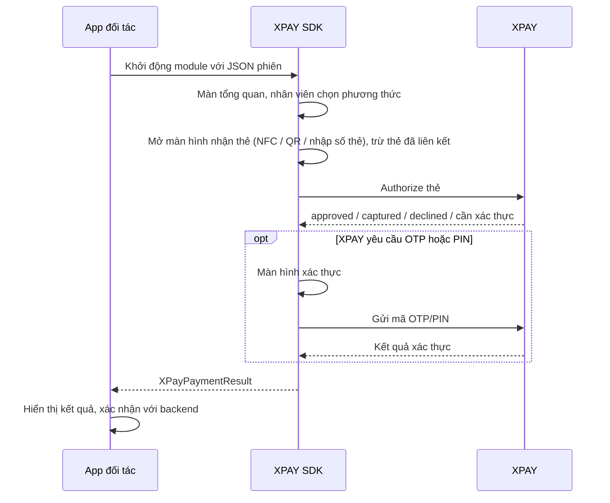

# XPAY Payment SDK cho Android native — Tài liệu tích hợp

Phiên bản SDK 3.1126.1

SDK giúp app Android (Kotlin) của đối tác thu tiền bằng thẻ XPAY. SDK đảm nhận toàn bộ phần thẻ trong quy trình thanh toán: đọc thẻ (chạm NFC, quét QR hoặc nhập số thẻ), gửi yêu cầu
authorize lên XPAY, hiển thị bước xác thực OTP/PIN khi XPAY yêu cầu, rồi trả về cho app **đúng một kết quả**.

Mỗi lần thanh toán, app đưa cho SDK **phản hồi của phiên thanh toán** (do backend đối tác xin từ XPAY). Số tiền bị khoá khi backend xin phiên, và SDK thu đúng số tiền đó (xem [mục 5](#5-mã-phiên-thanh-toán)).

Tài liệu dành cho đội mobile của đối tác dùng Android native. Nếu app của bạn viết bằng Flutter, xem [README.vi.md](../README.vi.md).

## Mục lục

1. [SDK làm gì](#1-sdk-làm-gì)
2. [Yêu cầu hệ thống](#2-yêu-cầu-hệ-thống)
3. [Cài đặt](#3-cài-đặt)
4. [Cấu hình Android](#4-cấu-hình-android)
5. [Mã phiên thanh toán](#5-mã-phiên-thanh-toán)
6. [Khởi tạo SDK](#6-khởi-tạo-sdk)
7. [Thực hiện một thanh toán](#7-thực-hiện-một-thanh-toán)
8. [API reference](#8-api-reference)
9. [Kết quả và cách xử lý](#9-kết-quả-và-cách-xử-lý)
10. [Mã lỗi](#10-mã-lỗi)
11. [Thử lại và chống trừ tiền hai lần](#11-thử-lại-và-chống-trừ-tiền-hai-lần)
12. [Xác nhận thanh toán từ backend](#12-xác-nhận-thanh-toán-từ-backend)
13. [Logging](#13-logging)
14. [Bảo mật](#14-bảo-mật)
15. [Ứng dụng mẫu](#15-ứng-dụng-mẫu)
16. [Giới hạn hiện tại](#16-giới-hạn-hiện-tại)
17. [Câu hỏi thường gặp](#17-câu-hỏi-thường-gặp)

---

## 1. SDK làm gì

| SDK đảm nhận                                                                             | App đối tác đảm nhận                                                                                    |
| ---------------------------------------------------------------------------------------- | ------------------------------------------------------------------------------------------------------- |
| Màn tổng quan & chọn phương thức, màn nhập số thẻ, quét mã QR, đọc NFC, xác thực PIN/OTP | Đặt "Thẻ XPAY" vào danh sách phương thức thanh toán của app và khởi động module XPAY khi nhân viên chọn |
| Gửi yêu cầu authorize lên XPAY                                                           | Nhập cước, xin phiên thanh toán cho từng lần thanh toán và đưa cho SDK nguyên phản hồi của phiên        |
| Trả về đúng một kết quả cho mỗi lần thanh toán                                           | Màn hình thành công/thất bại, điều hướng, cập nhật dữ liệu của app                                      |

SDK **không** hiển thị màn hình thành công hay bị từ chối: khi có kết quả, SDK đóng màn hình của mình và trả kết quả về cho app. App tự hiển thị dựa trên kết quả đó.

App đối tác không chọn phương thức. Màn đầu tiên của SDK hiện số tiền, thông tin chuyến (mã cuốc, điểm đón, điểm trả, biển số xe) và các phương thức theo đúng thứ tự `entry_modes` trong phản hồi của phiên. Nhân viên chọn một:

| Giá trị `entry_modes` | Nhân viên làm gì                                                                    |
| --------------------- | ----------------------------------------------------------------------------------- |
| `ride_card`           | Thu bằng thẻ đã liên kết của chuyến (hiện tên thẻ và 4 số cuối), không cần nhập thẻ |
| `card_qr`             | Quét mã QR in trên thẻ XPAY, hoặc chọn ảnh QR từ thư viện                           |
| `manual_pan`          | Nhập số thẻ                                                                         |
| `chip_tap`            | Chạm thẻ chip XPAY của khách vào điện thoại (cần máy có NFC)                        |
| `token`               | Quét mã thanh toán dùng một lần trên ứng dụng XPERISE                               |

SDK chỉ hiện các phương thức thiết bị chạy được. Chọn `card_qr` thì chỉ nhận QR thẻ, chọn `token` thì chỉ nhận mã dùng một lần.

### Chuyến thanh toán bằng ví doanh nghiệp

Khi `payment_method` của phiên là `corporate_wallet`, chuyến được trả bằng ví doanh nghiệp của khách. Màn đầu tiên vẫn hiện số tiền và thông tin chuyến, nhưng thay danh sách phương thức thẻ bằng:

| Phương thức                       | Diễn ra thế nào                                                                                                                                       |
| --------------------------------- | ----------------------------------------------------------------------------------------------------------------------------------------------------- |
| Hiển thị mã QR                    | SDK hiện mã QR cho đúng số tiền đã khoá. Khách quét bằng ứng dụng XPERISE và thanh toán. SDK kiểm tra mỗi 3 giây, trả kết quả ngay khi khách trả xong |
| Gửi mã qua SMS / Gửi mã qua email | Mỗi người đi × mỗi kênh XPAY có thông tin là một dòng, người đặt chuyến đứng đầu. SDK gửi mã 6 số; nhân viên nhập mã khách đọc                        |

1. Dòng "Hiển thị mã QR" luôn có. Các dòng gửi mã lấy từ XPAY: người không có số điện thoại thì không có dòng SMS, không có email thì không có dòng email. Không ai có thông tin thì chỉ còn mã QR.
2. Ở màn nhập mã, nhân viên có thể gửi lại mã (40 giây sau lần gửi trước), và bấm **Đổi** để chuyển sang số điện thoại hoặc email khác.
3. Quay lại từ màn nhập mã thì về danh sách phương thức. Quay lại từ màn QR thì SDK huỷ mã QR với XPAY trước, rồi mới về danh sách phương thức. Nếu XPAY chưa xác nhận đã huỷ, SDK giữ nguyên màn QR và báo lỗi, vì khách vẫn có thể quét mã đó; quay lại lần nữa để thử lại.
4. Mã sai, mã hết hạn hoặc nhập sai quá số lần được báo ngay trên màn nhập mã, thanh toán không kết thúc. Nhân viên gửi mã mới rồi tiếp tục.
5. Phiên ví doanh nghiệp không cần `entry_modes`, và luôn mở được vì mã QR và gửi mã không phụ thuộc phần cứng.

## 2. Yêu cầu hệ thống

| Thành phần | Tối thiểu                    |
| ---------- | ---------------------------- |
| Android    | minSdk 24, Java 17, AndroidX |
| Kotlin     | 2.1 trở lên                  |

Lưu ý:

1. App phải khai báo tương thích Java 17 (`compileOptions` và `jvmTarget`).
2. **Kotlin:** SDK và các thư viện đi kèm được biên dịch bằng Kotlin 2.2.20 và phụ thuộc `kotlin-stdlib` 2.2.20. Compiler Kotlin 2.1 trở lên đọc được. Gradle sẽ nâng `kotlin-stdlib` của app lên 2.2.20. Đã kiểm tra bản build app dùng Kotlin 2.1.0, Android Gradle Plugin 8.11.2, Gradle 8.14.1 và JDK 17+. Bản `3.11.18` build bằng Kotlin 2.3.20 nên **không** dùng được với Kotlin 2.1: hãy dùng `3.1118.2` trở lên.
3. SDK có thư viện native cho các ABI `arm64-v8a`, `armeabi-v7a` và `x86_64`. Nếu app khai báo `abiFilters`, chỉ giữ các ABI này.
4. Kiểm thử trên thiết bị thật: quét QR cần camera, chạm thẻ cần điện thoại Android có NFC.

## 3. Cài đặt

SDK được phát hành trên GitHub: <https://github.com/nggiahuy09/xpay-payment-sdk>. Mỗi bản có một tag dạng `v3.1126.1`, một mục trong [CHANGELOG.md](../CHANGELOG.md) và một bản Release. Số phiên bản **không** theo Semantic Versioning: đọc CHANGELOG trước khi nâng cấp để biết bản mới có thay đổi cần sửa code hay không.

XPAY gửi riêng cho bạn:

1. Base URL của môi trường sandbox, và production khi go-live.
2. Thẻ test cho môi trường sandbox.
3. `X-Merchant-Key` cho backend của bạn (không đưa vào app, xem [mục 5](#5-mã-phiên-thanh-toán)).

Có hai cách lấy SDK. Cách A không cần tải file: trỏ Gradle vào kho Maven trên GitHub. Cách B dùng file zip trong trang Release.

**Cách A: kho Maven trên GitHub.** Khai báo repository trong `settings.gradle.kts`, rồi làm tiếp từ bước dependency bên dưới:

```kotlin
dependencyResolutionManagement {
    repositories {
        google()
        mavenCentral()
        maven { url = uri("https://raw.githubusercontent.com/nggiahuy09/xpay-payment-sdk/maven") }
        maven { url = uri("https://storage.googleapis.com/download.flutter.io") }
    }
}
```

Luôn khai báo số phiên bản cụ thể, không dùng `+` hay `latest.release`. Nâng cấp: đổi số phiên bản trong dependency.

**Cách B: file zip.**

1. Tải `xpay-payment-sdk-android-3.1126.1.zip` ở trang [Releases](https://github.com/nggiahuy09/xpay-payment-sdk/releases). Mã SHA-256 của file nằm trong ghi chú của Release. Kiểm tra trước khi dùng:

   ```bash
   shasum -a 256 xpay-payment-sdk-android-3.1126.1.zip
   ```

   Kết quả phải trùng với mã trong ghi chú Release. Nếu XPAY gửi mã SHA-256 qua kênh riêng (email, chat), đối chiếu với mã đó.

2. Giải nén vào thư mục gốc của project, ví dụ thành `xpay-sdk/`. Thư mục `xpay-sdk/repo` là một Maven repository.
3. Khai báo repository trong `settings.gradle.kts`:

   ```kotlin
   dependencyResolutionManagement {
       repositories {
           google()
           mavenCentral()
           maven { url = uri("xpay-sdk/repo") }
           maven { url = uri("https://storage.googleapis.com/download.flutter.io") }
       }
   }
   ```

**Thêm dependency** (dùng cho cả hai cách) vào `app/build.gradle.kts`:

```kotlin
android {
    defaultConfig {
        minSdk = 24
        ndk { abiFilters += listOf("arm64-v8a", "armeabi-v7a", "x86_64") }
    }
}

dependencies {
    implementation("com.xperise.xpay.partner:flutter_release:3.1126.1")
}
```

Bộ SDK khai báo sẵn các thư viện nó cần; Gradle tự tải chúng từ `google()`, `mavenCentral()` và kho engine Flutter (`download.flutter.io`).

`abiFilters` là bắt buộc: một thư viện camera trong SDK có bản cho `x86`, còn Flutter không build cho `x86`. Thiếu dòng này, máy `x86` 32-bit sẽ crash khi khởi động SDK.

Nâng cấp với cách B: giải nén bộ SDK mới vào cùng thư mục, rồi đổi số phiên bản trong dependency.

## 4. Cấu hình Android

Thêm vào `app/src/main/AndroidManifest.xml`, bên trong thẻ `<manifest>`:

```xml
<uses-permission android:name="android.permission.CAMERA" />
<uses-permission android:name="android.permission.INTERNET" />
<uses-permission android:name="android.permission.NFC" />
<uses-feature android:name="android.hardware.camera" android:required="false" />
<uses-feature android:name="android.hardware.nfc" android:required="false" />
```

`required="false"` giúp app vẫn cài được trên máy không có NFC hoặc camera. Máy không có NFC: SDK không hiện `chip_tap`. Máy có NFC nhưng đang tắt: SDK vẫn hiện `chip_tap`, chọn vào thì màn chạm thẻ hiển thị "NFC chưa được bật" kèm nút "Mở cài đặt".

Đảm bảo `minSdk` trong `app/build.gradle.kts` từ 24 trở lên.

## 5. Mã phiên thanh toán

Mỗi lần thanh toán được xác thực bằng một **mã phiên** (session token) của chuyến, do **backend của đối tác** xin từ XPAY. SDK không bao giờ nhìn thấy merchant key hay bất kỳ secret dài hạn nào. App truyền nguyên phản hồi của phiên khi khởi động module; SDK tự lấy mã phiên trong đó và gửi kèm trong mọi request của lần thanh toán đó.

Luồng xin mã phiên:

1. Nhân viên nhập cước của chuyến trên app đối tác. App gửi `order_id` và cước cho backend.
2. Backend gọi `POST /merchant/rides/{order_id}/payment-session` bằng `X-Merchant-Key` (chỉ nằm trên server), body JSON gồm `amount` (chuỗi, bằng `fare` + `sub_fee`, tính bằng đồng), `fare` (số), tuỳ chọn `sub_fee` (số, mặc định 0) và `distance_km` (số).
3. XPAY trả `session_token` cùng `amount` đã khoá, `external_ref` (dạng `XP-…`) và dữ liệu chuyến. Token chỉ hiện một lần.
4. Backend chuyển **nguyên** body phản hồi xuống app, không cần tách field. App truyền nguyên chuỗi JSON đó vào `sessionJson` khi khởi động module. SDK tự đọc `session_token`, `amount`, `external_ref`, `payment_method` và `payment_template` (`currency`, `product_type`).

Quy tắc:

1. **Mã phiên dùng cho đúng một chuyến và hết hạn sau 15 phút.** SDK không tự refresh mã phiên.
2. **Số tiền bị khoá theo phiên.** SDK thu đúng `amount` trong phản hồi của phiên. Muốn thu số tiền khác thì xin phiên mới; không sửa JSON trước khi đưa vào SDK.
3. **Mở phiên mới cho cùng một chuyến sẽ thu hồi các phiên trước.** Request dùng phiên cũ bị trả `ride_payment_session_revoked` (HTTP 401). Chỉ xin phiên ngay trước khi thu tiền, và không xin phiên mới khi một thanh toán của chuyến đó còn đang mở.
4. **Mã phiên bị XPAY từ chối** (hết hạn, bị thu hồi, không hợp lệ): thanh toán trả `failed` kèm `errorCode` từ XPAY (`token_expired` khi hết hạn); riêng chuyến ví doanh nghiệp, mã phiên hết hạn lúc đang chờ khách quét QR cho kết quả `expired`. App cần xin một mã phiên mới rồi bắt đầu lại.
5. **JSON không đọc được thì không thanh toán.** Chuỗi không phải JSON object, thiếu `session_token`, `amount` không phải số nguyên đồng (ví dụ `"138000.50"`), hoặc (với phiên thẻ) `entry_modes` không còn phương thức nào SDK biết thì SDK trả `failed` với `sdk_invalid_request` và không gửi gì lên XPAY. Lý do cụ thể được gửi qua `onLog` (`feature = payment`, `action = start_payment`, xem [mục 13](#13-logging)).
6. SDK chỉ giữ mã phiên trong bộ nhớ trong lúc thanh toán, không lưu xuống máy và không ghi log mã phiên.

## 6. Khởi tạo SDK

Gọi `initialize` một lần trước lần thanh toán đầu tiên, ví dụ khi mở app hoặc sau khi nhân viên đăng nhập. Gọi lại khi cần đổi ngôn ngữ hoặc base URL. `initialize` là hàm `suspend`:

```kotlin
lifecycleScope.launch {
    XPayPayment.initialize(
        context = applicationContext,
        config = XPayConfig(
            environment = XPayEnvironment(baseUrl = "https://<xpay api host>"),
            language = XPayLanguage.VI,
            onLog = { event -> myLogger.log(event.toString()) },
        ),
    )
}
```

Lưu ý khi gọi lại `initialize`:

1. Không gọi khi đang có một thanh toán mở (tức thanh toán chưa trả kết quả). Khi đó `initialize` ném `IllegalStateException` và giữ nguyên cấu hình cũ.
2. Không gọi khi lần `initialize` trước chưa xong. Khi đó lần gọi sau ném `IllegalStateException`, lần gọi trước vẫn chạy tiếp.
3. Trong lúc `initialize` đang chạy, thanh toán trả `failed` với `errorCode = sdk_not_initialized`. Luôn chờ `initialize` xong rồi mới bắt đầu thanh toán.

## 7. Thực hiện một thanh toán

### Luồng tổng quát



### Khởi động module và nhận kết quả

Android trả kết quả qua Activity Result API. Đăng ký launcher bằng `registerForActivityResult(XPayPaymentContract())` khi khai báo Activity hoặc Fragment, rồi gọi
`launch(XPayCheckout(...))` để bắt đầu thanh toán. Kết quả vẫn về đúng callback khi Activity bị tạo lại, ví dụ lúc xoay màn hình.

```kotlin
class CheckoutActivity : AppCompatActivity() {
    private val xpayPayment = registerForActivityResult(XPayPaymentContract()) { result -> handleResult(result) }

    private fun payWithXPay(sessionJson: String) {
        xpayPayment.launch(XPayCheckout(sessionJson = sessionJson))
    }

    private fun handleResult(result: XPayPaymentResult) {
        when (result.status) {
            XPayPaymentStatus.APPROVED, XPayPaymentStatus.CAPTURED -> confirmOnBackend(result.externalRef, result.authId)
            XPayPaymentStatus.DECLINED, XPayPaymentStatus.DUPLICATE, XPayPaymentStatus.FAILED -> showMessage(result.message ?: "Thanh toán không thành công.")
            XPayPaymentStatus.EXPIRED -> showMessage("Đã hết thời gian xác thực. Vui lòng tạo thanh toán mới.")
            XPayPaymentStatus.CANCELLED, XPayPaymentStatus.UNSUPPORTED -> Unit
        }
    }
}
```

### Hành vi khi thanh toán

1. SDK mở màn hình của mình toàn màn hình, là một Activity riêng. Khi thanh toán kết thúc, SDK tự đóng màn hình của mình rồi trả kết quả. SDK không đụng tới điều hướng của app.
2. Launcher phải được đăng ký trước khi Activity hoặc Fragment được tạo xong, theo quy tắc của Activity Result API. Cách khai báo như ví dụ trên là đúng.
3. Trong lúc XPAY đang authorize thẻ hoặc đang xác thực mã của ví doanh nghiệp, màn hình của SDK không phản hồi nút back của Android, để nhân viên không rời khỏi một thanh toán có thể đã bị trừ tiền. SDK tự xử lý việc này, app không cần làm gì.
4. Bấm back ở màn nhận thẻ thì quay về danh sách phương thức. Bấm back ở danh sách phương thức hoặc ở màn xác thực thì kết quả là `cancelled`.
5. Mã QR không phải của XPAY, hoặc không đúng loại với phương thức đã chọn (QR thẻ / mã dùng một lần), bị báo lỗi ngay trên màn hình quét, SDK không gửi request nào và nhân viên có thể quét lại mà không cần tạo phiên giao dịch mới.
6. SDK không có thanh tiêu đề riêng và chỉ thoát bằng nút back của hệ thống.

## 8. API reference

### Tổng quan

SDK có hai thao tác, dùng theo thứ tự dưới đây. Mỗi kiểu dữ liệu trong mục này đều thuộc một nhánh của sơ đồ.

```text
XPayPayment
├── 1. initialize(context, XPayConfig)            Gọi một lần trước khi thanh toán (mục 6)
│       ├── environment: XPayEnvironment          Base URL sandbox hoặc production
│       ├── language:    XPayLanguage             Ngôn ngữ màn hình SDK và message
│       └── onLog:       (XPayLogEvent) -> Unit   Nhận sự kiện log (mục 13)
│
│
└── 2. Khởi động module, mỗi lần thanh toán (mục 7)
        registerForActivityResult(XPayPaymentContract())
        → launch(XPayCheckout(sessionJson))
                │
                ▼
        XPayPaymentResult
        ├── status:    XPayPaymentStatus          Ý nghĩa từng trạng thái (mục 9)
        ├── failureCategory: XPayFailureCategory? Nhóm lỗi (mục 9)
        └── errorCode: String?                    So với hằng số XPayErrorCode (mục 10)
```

### Ví dụ đầy đủ

```kotlin
class CheckoutActivity : AppCompatActivity() {
    private val xpayPayment = registerForActivityResult(XPayPaymentContract()) { result -> handleResult(result) }

    override fun onCreate(savedInstanceState: Bundle?) {
        super.onCreate(savedInstanceState)
        lifecycleScope.launch {
            XPayPayment.initialize(
                context = applicationContext,
                config = XPayConfig(
                    environment = XPayEnvironment(baseUrl = "https://<xpay api host>"),
                    language = XPayLanguage.VI,
                    onLog = { event -> myLogger.log(event.toString()) },
                ),
            )
        }
    }

    private fun payWithXPay(sessionJson: String) {
        xpayPayment.launch(XPayCheckout(sessionJson = sessionJson))
    }

    private fun handleResult(result: XPayPaymentResult) {
        when (result.status) {
            XPayPaymentStatus.APPROVED, XPayPaymentStatus.CAPTURED -> confirmOnBackend(result.externalRef, result.authId)
            XPayPaymentStatus.FAILED -> when (result.errorCode) {
                XPayErrorCode.NOT_INITIALIZED, XPayErrorCode.BUSY -> retryLater()
                else -> showMessage(result.message ?: "Thanh toán không thành công.")
            }
            XPayPaymentStatus.DECLINED, XPayPaymentStatus.DUPLICATE -> showMessage(result.message ?: "Thanh toán không thành công.")
            XPayPaymentStatus.EXPIRED -> showMessage("Đã hết thời gian xác thực. Vui lòng tạo thanh toán mới.")
            XPayPaymentStatus.CANCELLED, XPayPaymentStatus.UNSUPPORTED -> Unit
        }
    }
}
```

### `XPayPayment`

Điểm vào duy nhất của SDK (`object XPayPayment`).

| Thành phần                                                                        | Mô tả                                           |
| --------------------------------------------------------------------------------- | ----------------------------------------------- |
| `suspend fun initialize(context: Context, config: XPayConfig)`                    | Cấu hình SDK                                    |
| `XPayPaymentContract` (`ActivityResultContract<XPayCheckout, XPayPaymentResult>`) | Khởi động module và nhận kết quả của thanh toán |

#### `initialize`

Cấu hình SDK: ngôn ngữ, base URL và callback log. Có thể gọi lại để cấu hình lại, trừ khi đang có thanh toán mở hoặc lần `initialize` trước chưa xong: khi đó hàm ném `IllegalStateException`.
Xem [mục 6](#6-khởi-tạo-sdk).

#### Khởi động module: `XPayPaymentContract`

Mở luồng thanh toán và luôn hoàn thành với **đúng một** `XPayPaymentResult`. SDK không ném exception khi thanh toán thất bại; mọi lỗi đều nằm trong kết quả.

Thứ tự kiểm tra trước khi mở màn hình:

| Điều kiện                                          | Kết quả                                     |
| -------------------------------------------------- | ------------------------------------------- |
| Chưa gọi `initialize`, hoặc `initialize` đang chạy | `failed`, `errorCode = sdk_not_initialized` |
| Đang có một thanh toán khác mở                     | `failed`, `errorCode = sdk_busy`            |
| Request không hợp lệ (xem bảng `XPayCheckout`)     | `failed`, `errorCode = sdk_invalid_request` |
| Không phương thức nào của phiên chạy được trên máy | `unsupported`                               |

Không trường hợp nào ở bảng trên gửi request lên XPAY.

### `XPayCheckout`

Dùng ở: đầu vào của `launch` trên launcher `XPayPaymentContract`.

| Trường        | Kiểu     | Bắt buộc | Mô tả                                                                                                                                                                                                                                                                                                                                                                                                                                    |
| ------------- | -------- | -------- | ---------------------------------------------------------------------------------------------------------------------------------------------------------------------------------------------------------------------------------------------------------------------------------------------------------------------------------------------------------------------------------------------------------------------------------------- |
| `sessionJson` | `String` | Có       | Nguyên body phản hồi của `POST /merchant/rides/{order_id}/payment-session`. SDK lấy `session_token`, `amount` (số nguyên đồng, tối thiểu 1.000), `external_ref` (1–64 ký tự), `payment_template.currency` (mặc định `VND`), `payment_template.product_type`, `entry_modes`, `ride_card`, `order_id` và thông tin chuyến trong `payment_template.enhanced_data` từ đây, xem [mục 5](#5-mã-phiên-thanh-toán). `toString()` che giá trị này |

### `XPayConfig`

Dùng ở: tham số của `initialize`.

| Trường        | Kiểu                        | Bắt buộc | Mặc định          | Mô tả                                                        |
| ------------- | --------------------------- | -------- | ----------------- | ------------------------------------------------------------ |
| `environment` | `XPayEnvironment`           | Có       |                   | Môi trường XPAY (sandbox hoặc production)                    |
| `language`    | `XPayLanguage`              | Không    | `XPayLanguage.VI` | Ngôn ngữ của màn hình SDK và của `XPayPaymentResult.message` |
| `onLog`       | `((XPayLogEvent) -> Unit)?` | Không    | `null`            | Nhận sự kiện nghiệp vụ, xem [mục 13](#13-logging)            |

### `XPayEnvironment`

Dùng ở: trường `environment` của `XPayConfig`.

| Trường    | Kiểu     | Bắt buộc | Mô tả                                                          |
| --------- | -------- | -------- | -------------------------------------------------------------- |
| `baseUrl` | `String` | Có       | Base URL của XPAY API. XPAY cung cấp URL sandbox và production |

### `XPayLanguage`

Dùng ở: trường `language` của `XPayConfig`.

| Giá trị | Ngôn ngữ   |
| ------- | ---------- |
| `VI`    | Tiếng Việt |
| `EN`    | Tiếng Anh  |

### `XPayPaymentResult`

Dùng ở: kết quả của mỗi lần khởi động module (callback của launcher).

| Trường            | Kiểu                   | Mô tả                                                                                                |
| ----------------- | ---------------------- | ---------------------------------------------------------------------------------------------------- |
| `status`          | `XPayPaymentStatus`    | Trạng thái cuối cùng, luôn có                                                                        |
| `failureCategory` | `XPayFailureCategory?` | Nhóm lỗi khi `declined`, `failed` hoặc `duplicate`. Xem [mục 9](#9-kết-quả-và-cách-xử-lý)            |
| `authId`          | `String?`              | Mã authorize của XPAY. Dùng để đối soát với backend. Luôn `null` với thanh toán bằng ví doanh nghiệp |
| `captureId`       | `String?`              | Mã capture, chỉ có khi `captured`                                                                    |
| `bookingRef`      | `String?`              | Mã booking, có khi thanh toán thành công sau bước xác thực                                           |
| `externalRef`     | `String?`              | Mã tham chiếu của đối tác, do XPAY trả về                                                            |
| `amount`          | `Long?`                | Số tiền XPAY ghi nhận                                                                                |
| `currency`        | `String?`              | Mã tiền tệ XPAY ghi nhận                                                                             |
| `createdAt`       | `java.util.Date?`      | Thời điểm XPAY tạo giao dịch                                                                         |
| `declineCode`     | `String?`              | Mã từ chối thô từ XPAY, khi `declined`                                                               |
| `errorCode`       | `String?`              | Mã lỗi, khi `failed`. Xem [mục 10](#10-mã-lỗi)                                                       |
| `message`         | `String?`              | Câu thông báo sẵn sàng hiển thị cho nhân viên, theo ngôn ngữ đã cấu hình                             |
| `isSuccessful`    | `Boolean`              | `true` khi `status` là `approved` hoặc `captured`                                                    |

### `XPayPaymentStatus`

Dùng ở: trường `status` của `XPayPaymentResult`. Ý nghĩa và cách xử lý: xem [mục 9](#9-kết-quả-và-cách-xử-lý).

`APPROVED`, `CAPTURED`, `DECLINED`, `CANCELLED`, `DUPLICATE`, `FAILED`, `EXPIRED`, `UNSUPPORTED`.

### `XPayLogEvent`

Dùng ở: tham số của callback `onLog` trong `XPayConfig`.

| Trường          | Kiểu                | Mô tả                                                                                  |
| --------------- | ------------------- | -------------------------------------------------------------------------------------- |
| `level`         | `XPayLogLevel`      | `info`, `warn`, `error`                                                                |
| `category`      | `XPayLogCategory`   | `api` (kết quả gọi API), `behavior` (hành vi người dùng), `error` (dữ liệu bất thường) |
| `feature`       | `String`            | Khu vực phát sinh sự kiện: `payment`, `verification`, `card_nfc`, `corporate_wallet`   |
| `action`        | `String`            | Hành động cụ thể, xem [mục 13](#13-logging)                                            |
| `reason`        | `String?`           | Lý do chi tiết, nếu có                                                                 |
| `errorCode`     | `String?`           | Mã lỗi, nếu sự kiện đến từ một lỗi                                                     |
| `serverMessage` | `String?`           | Thông báo lỗi gốc từ XPAY, nếu có                                                      |
| `input`         | `Map<String, Any?>` | Các định danh liên quan (không thể sửa)                                                |

## 9. Kết quả và cách xử lý

| Trạng thái    | Ý nghĩa                                                  | Trường có giá trị                                                                                   | App nên làm gì                                                       |
| ------------- | -------------------------------------------------------- | --------------------------------------------------------------------------------------------------- | -------------------------------------------------------------------- |
| `approved`    | Thanh toán thành công                                    | `authId`, `externalRef`, `amount`, `currency`, `createdAt`; thêm `bookingRef` nếu qua bước xác thực | Xác nhận với backend rồi hoàn tất đơn                                |
| `captured`    | Thanh toán thành công                                    | Như `approved`, thêm `captureId`                                                                    | Như `approved`                                                       |
| `declined`    | XPAY từ chối                                             | `declineCode`, `message`; `authId` nếu có                                                           | Hiển thị `message`, cho nhân viên thử thẻ khác hoặc phương thức khác |
| `cancelled`   | Nhân viên thoát trước khi thanh toán xong                | `authId` nếu thanh toán đã được authorize và đang chờ xác thực                                      | Quay lại màn chọn phương thức. Nếu có `authId`, kiểm tra với backend |
| `duplicate`   | XPAY đang giữ một request khác dưới cùng idempotency key | `message`                                                                                           | Kiểm tra với backend trước khi thu tiền lại                          |
| `failed`      | Request lỗi, hoặc XPAY trả dữ liệu SDK không xử lý được  | `errorCode`, `message`; `authId` nếu có                                                             | Hiển thị `message`. Nếu có `authId`, kiểm tra với backend            |
| `expired`     | Hết thời gian xác thực                                   | `authId`                                                                                            | Tạo thanh toán mới                                                   |
| `unsupported` | Thiết bị không chạy được phương thức này                 | Không có                                                                                            | Ẩn phương thức này, chọn phương thức khác                            |

`approved` và `captured` đều là thanh toán thành công; app xử lý hai trạng thái như nhau.

Thanh toán bằng ví doanh nghiệp không tạo giao dịch thẻ, nên kết quả khác bảng trên:

| Trạng thái  | Ý nghĩa với thanh toán ví                                                                                                                                           | Trường có giá trị                                                                      | App nên làm gì                                             |
| ----------- | ------------------------------------------------------------------------------------------------------------------------------------------------------------------- | -------------------------------------------------------------------------------------- | ---------------------------------------------------------- |
| `captured`  | Khách đã trả bằng ví doanh nghiệp, qua mã QR hoặc qua mã gửi tới khách                                                                                              | `externalRef`, `amount`, `currency`; `createdAt` nếu trả qua QR. **Không có `authId`** | Coi là thành công, xác nhận với backend bằng `externalRef` |
| `declined`  | XPAY từ chối khoản thanh toán qua mã QR                                                                                                                             | `message`                                                                              | Hiển thị `message`                                         |
| `expired`   | Mã QR hết hạn, hoặc mã phiên hết hạn khi SDK đang chờ khách quét QR                                                                                                 | Không có                                                                               | Xin mã phiên mới rồi thanh toán lại                        |
| `failed`    | Chuyến không còn thanh toán được bằng ví, XPAY từ chối phiên thu tiền (`token_expired`, `ride_payment_session_revoked`), hoặc XPAY từ chối trả trạng thái của mã QR | `errorCode`, `message`                                                                 | Hiển thị `message`, kiểm tra chuyến với backend            |
| `cancelled` | Nhân viên thoát trước khi khách trả. Mã QR đang hiện được huỷ với XPAY trước khi thoát                                                                              | Không có                                                                               | Kiểm tra chuyến với backend trước khi thu bằng cách khác   |

### Nhóm lỗi

`failureCategory` cho biết mỗi kết quả `declined`, `failed` hoặc `duplicate` thuộc nhóm lỗi nào, để app xử lý theo nhóm thay vì đọc từng mã. Với các trạng thái còn lại, trường này là `null`.

Giá trị: `SYSTEM`, `NETWORK`, `CARDHOLDER_RETRY`, `CARDHOLDER_CHANGE`, `CORPORATE_POLICY`, `SESSION`, `UNKNOWN`. Ý nghĩa từng nhóm, danh sách mã theo nhóm và quy định xử lý (khi nào không được thu tiền mặt, khi nào liên hệ tổng đài XPAY): [failure_categories.vi.md](failure_categories.vi.md).

Về `message`:

1. Câu thông báo đã được dịch theo `XPayConfig.language`, có thể hiển thị thẳng cho nhân viên.
2. Khi XPAY trả về một mã lỗi chưa có câu thông báo riêng, `message` kết thúc bằng một dòng `Mã lỗi:` (hoặc `Error code:` với tiếng Anh) để bộ phận hỗ trợ tra cứu.

Cách thử lại sau mỗi kết quả: xem [mục 11](#11-thử-lại-và-chống-trừ-tiền-hai-lần).

## 10. Mã lỗi

`errorCode` chỉ có giá trị khi `status` là `failed`.

### Mã do SDK sinh ra

Dùng hằng số trong `XPayErrorCode` để so sánh với `XPayPaymentResult.errorCode`, thay vì viết cứng chuỗi.

| Mã                        | Hằng số               | Khi nào trả về                                                                                                                                                                      | Cách xử lý                                          |
| ------------------------- | --------------------- | ----------------------------------------------------------------------------------------------------------------------------------------------------------------------------------- | --------------------------------------------------- |
| `sdk_not_initialized`     | `NOT_INITIALIZED`     | Khởi động module khi chưa gọi `initialize` hoặc `initialize` chưa xong. SDK không mở màn hình                                                                                       | Chờ `initialize` xong rồi khởi động lại             |
| `sdk_busy`                | `BUSY`                | Khởi động module khi một thanh toán khác chưa trả kết quả. SDK không mở màn hình                                                                                                    | Chờ lần trước trả kết quả                           |
| `sdk_invalid_request`     | `INVALID_REQUEST`     | `sessionJson` không đọc được (không phải JSON object, thiếu `session_token`, `amount` có phần lẻ hoặc dưới 1.000, `external_ref` rỗng hoặc dài quá 64 ký tự). SDK không mở màn hình | Sửa dữ liệu truyền vào                              |
| `sdk_unexpected_response` | `UNEXPECTED_RESPONSE` | Sau khi đọc thẻ hoặc authorize, XPAY trả trạng thái hoặc dữ liệu chip mà SDK không xử lý được                                                                                       | Kiểm tra với backend bằng `authId` nếu có, báo XPAY |

### Mã từ tầng mạng

| Mã              | Nguyên nhân                                                          |
| --------------- | -------------------------------------------------------------------- |
| `no_connection` | Không có kết nối mạng                                                |
| `no_host`       | Không kết nối được tới server (sai base URL, lỗi DNS, lỗi chứng chỉ) |
| `timeout`       | Server không phản hồi trong 30 giây                                  |

### Mã từ XPAY

Các giá trị `errorCode` khác được XPAY trả về và SDK chuyển nguyên cho app. Danh sách mã do XPAY cung cấp riêng. Các mã liên quan tới mã phiên:

| Mã                             | Nguyên nhân                                                                                | Cách xử lý                                                             |
| ------------------------------ | ------------------------------------------------------------------------------------------ | ---------------------------------------------------------------------- |
| `token_expired`                | Mã phiên đã hết hạn (quá 15 phút)                                                          | Xin mã phiên mới từ backend rồi thanh toán lại                         |
| `ride_payment_session_revoked` | Mã phiên bị thu hồi vì backend đã mở phiên mới cho cùng chuyến                             | Dùng mã phiên mới nhất; tránh mở nhiều phiên song song cho một chuyến  |
| `amount_locked`                | `amount` khác số tiền đã khoá trong phiên (HTTP 422 ở bước authorize, 409 ở bước xác thực) | Truyền đúng `amount` của phiên, hoặc xin phiên mới với số tiền cần thu |

`message` của các mã này là câu thông báo chung kèm dòng mã lỗi (mục 9).

Các mã ở bước authorize có câu thông báo riêng, `message` nêu rõ nguyên nhân thay vì câu chung:

| Mã                        | Nguyên nhân                                                                                        | Cách xử lý                                             |
| ------------------------- | -------------------------------------------------------------------------------------------------- | ------------------------------------------------------ |
| `not_found`               | XPAY không tìm thấy thẻ hoặc mã thanh toán đã quét, chạm hoặc nhập. `message` nêu theo phương thức | Kiểm tra lại thẻ hoặc mã rồi thử lại                   |
| `no_registered_phone`     | Thẻ không có số điện thoại để gửi OTP                                                              | Dùng thẻ khác, hoặc liên hệ quản trị viên doanh nghiệp |
| `static_code_unavailable` | Thẻ chưa được thiết lập mã PIN                                                                     | Dùng thẻ khác, hoặc liên hệ quản trị viên doanh nghiệp |
| `otp_delivery_failed`     | Không gửi được OTP tới số điện thoại của chủ thẻ                                                   | Thử lại                                                |
| `ride_card_not_found`     | Chuyến đi không còn được giao cho tài xế, hoặc không còn ở trạng thái thanh toán được              | Kiểm tra lại chuyến đi ở phía app                      |
| `ride_already_paid`       | Chuyến đi đã có giao dịch thanh toán                                                               | Kiểm tra trạng thái chuyến trước khi thu lại           |

### Mã kết thúc thanh toán bằng ví doanh nghiệp

Các mã dưới đây kết thúc thanh toán ví với `failed`, mỗi mã có `message` riêng:

| Mã                             | Nguyên nhân                                         | Cách xử lý                                   |
| ------------------------------ | --------------------------------------------------- | -------------------------------------------- |
| `amount_locked`                | XPAY đã khoá số tiền khác cho chuyến sau khi gửi mã | Xin mã phiên mới rồi thanh toán lại          |
| `ride_not_found`               | Chuyến đã đóng hoặc không còn mở để thanh toán      | Kiểm tra trạng thái chuyến trước khi thu lại |
| `ride_not_on_corporate_wallet` | Chuyến không được đặt bằng ví doanh nghiệp          | Kiểm tra phương thức thanh toán của chuyến   |

Các lỗi ví khác (mã sai, mã hết hạn, mã bị khoá, gửi mã quá nhiều lần, không gửi được mã, người nhận không có thông tin liên hệ, ví doanh nghiệp từ chối hoặc tạm gián đoạn) được báo ngay trên màn hình SDK và không kết thúc thanh toán.

## 11. Thử lại và chống trừ tiền hai lần

Mỗi yêu cầu authorize mang một idempotency key, để request gửi lại không bị trừ tiền hai lần.

1. **Thử lại cùng một thanh toán**: khởi động lại module với JSON của cùng phiên (hoặc phiên mới của cùng chuyến) và các trường khác giữ nguyên. Nếu khách đưa cùng thẻ, SDK dùng lại key cũ, và XPAY trả lại kết quả ban đầu thay vì trừ tiền lần nữa. Điều này đúng giữa các lần khởi động module, trong suốt thời gian process của app còn sống.
2. **Thanh toán mới**: mỗi chuyến có `external_ref` riêng trong phản hồi của phiên.
3. **Thẻ khác hoặc thông tin đơn thay đổi**: request khác đi nên SDK tạo key mới.
4. **`duplicate`**: XPAY đang giữ một request khác dưới cùng key. Có thể đã có giao dịch: kiểm tra trước khi thu tiền lại.

Chạm thẻ NFC luôn tạo key mới, vì mỗi lần chạm sinh ra một cryptogram mới.

Mã phiên không nằm trong idempotency key. Thử lại bằng một phiên mới (sau khi phiên cũ hết hạn) vẫn dùng lại key cũ. Lưu ý mở phiên mới sẽ thu hồi phiên cũ (xem [mục 5](#5-mã-phiên-thanh-toán)).

Gợi ý cho app:

1. Sau một thanh toán **thất bại**, thử lại cho cùng chuyến; `external_ref` của chuyến không đổi nên lần thử lại dùng lại key.
2. Sau một thanh toán **thành công**, chuyến đã đóng; chuyến tiếp theo dùng phản hồi của phiên mới.

Chuyến ví doanh nghiệp chỉ được trả một lần, bằng mã QR hoặc bằng mã gửi tới khách: trả xong thì XPAY đóng chuyến, và lần gửi mã sau cho chuyến đó trả `ride_not_found`. Sau một kết quả ví `failed` hoặc `cancelled`, kiểm tra chuyến với backend trước khi thanh toán lại.

## 12. Xác nhận thanh toán từ backend

Kết quả được trả về trên điện thoại của nhân viên, đây không phải nguồn đáng tin cậy. Trước khi hoàn tất đơn, backend của đối tác phải xác nhận thanh toán với XPAY bằng `authId`
hoặc `externalRef`.

Xử lý tương tự với các kết quả `cancelled` và `failed` có `authId`: thanh toán đã được authorize và vẫn có thể hoàn tất hoặc hết hạn phía XPAY.

Thanh toán bằng ví doanh nghiệp không có `authId`: xác nhận bằng `externalRef`.

## 13. Logging

Truyền `onLog` vào `XPayConfig` để nhận các sự kiện nghiệp vụ của SDK. SDK không gửi log đi đâu khác. Không truyền `onLog` thì SDK im lặng.

Sự kiện **không bao giờ** chứa số thẻ, khoá chip, cryptogram, nonce, mã xác thực hay mã phiên. Sự kiện lỗi NFC có chứa UID của chip (`chip_uid`).

| `feature`          | `action`                                                 | `level` | Khi nào                                                                                                                                                                                                                                                       | `input` chính                                        |
| ------------------ | -------------------------------------------------------- | ------- | ------------------------------------------------------------------------------------------------------------------------------------------------------------------------------------------------------------------------------------------------------------- | ---------------------------------------------------- |
| `payment`          | `start_payment`                                          | `error` | Request bị từ chối trước khi mở màn hình (`sdk_invalid_request`). `reason`: `invalid_session_json`, `malformed_session`, `missing_session_token`, `missing_entry_modes`, `invalid_amount`, `amount_below_minimum`, `missing_currency`, `invalid_external_ref` | `session_json_length`                                |
| `payment`          | `authorize_qr`, `authorize_manual`, `authorize_chip_tap` | `error` | Gọi authorize thất bại (lỗi mạng, lỗi từ XPAY, xung đột)                                                                                                                                                                                                      | `entry_mode`, `auto_capture`                         |
| `payment`          | `authorize_approved`                                     | `info`  | XPAY duyệt hoặc capture                                                                                                                                                                                                                                       | `entry_mode`, `auth_id`                              |
| `payment`          | `authorize_declined`                                     | `warn`  | XPAY từ chối                                                                                                                                                                                                                                                  | `entry_mode`, `decline_reason`                       |
| `payment`          | `authorize_verification`                                 | `info`  | XPAY yêu cầu xác thực OTP/PIN                                                                                                                                                                                                                                 | `entry_mode`, `auth_id`, `verification_method`       |
| `payment`          | `authorize_incomplete`                                   | `error` | XPAY trả trạng thái SDK không xử lý được                                                                                                                                                                                                                      | `entry_mode`                                         |
| `verification`     | `send_verification`, `resend_verification`               | `error` | Gửi hoặc gửi lại mã xác thực thất bại                                                                                                                                                                                                                         | `auth_id`, `recipient_id`                            |
| `verification`     | `verify`                                                 | `error` | Gọi verify thất bại, hoặc XPAY trả trạng thái không mong đợi                                                                                                                                                                                                  | `auth_id`                                            |
| `verification`     | `verify_approved`                                        | `info`  | Xác thực thành công                                                                                                                                                                                                                                           | `auth_id`                                            |
| `verification`     | `verify_rejected`                                        | `warn`  | Mã xác thực sai                                                                                                                                                                                                                                               | `auth_id`, `attempt`                                 |
| `verification`     | `verify_declined`                                        | `warn`  | XPAY từ chối sau bước xác thực                                                                                                                                                                                                                                | `auth_id`, `decline_reason`                          |
| `verification`     | `verification_expired`                                   | `error` | Hết thời gian xác thực                                                                                                                                                                                                                                        | `auth_id`                                            |
| `verification`     | `verification_abandon`                                   | `info`  | Nhân viên rời màn hình xác thực                                                                                                                                                                                                                               | `auth_id`                                            |
| `card_nfc`         | `prepare`, `sign`                                        | `error` | Gọi API chuẩn bị hoặc ký dữ liệu chip thất bại                                                                                                                                                                                                                | `chip_uid`, `counter`                                |
| `card_nfc`         | `advance_counter`                                        | `error` | Không cập nhật được bộ đếm trên chip                                                                                                                                                                                                                          | `chip_uid`, `counter_sector`, `counter_block`        |
| `corporate_wallet` | `get_otp_channels`                                       | `error` | Không tải được danh sách người nhận mã. Màn hình vẫn cho thu bằng mã QR                                                                                                                                                                                       | Không có                                             |
| `corporate_wallet` | `request_otp`, `resend_otp`                              | `error` | Gửi hoặc gửi lại mã thất bại. `reason` là nguyên nhân, ví dụ `otpVelocityExceeded`                                                                                                                                                                            | `method`, `recipient_id`                             |
| `corporate_wallet` | `verify_otp`                                             | `error` | Xác thực mã thất bại. `reason` là nguyên nhân, ví dụ `otpInvalid`                                                                                                                                                                                             | `wallet_payment_id`                                  |
| `corporate_wallet` | `verify_otp_captured`                                    | `info`  | Xác thực mã thành công, ví đã được trừ                                                                                                                                                                                                                        | `wallet_payment_id`                                  |
| `corporate_wallet` | `create_intent`                                          | `error` | Không tạo được mã QR                                                                                                                                                                                                                                          | `product_type`, `currency`, `external_ref`, `amount` |
| `corporate_wallet` | `poll_intent`                                            | `error` | Kiểm tra mã QR gặp lỗi không thử lại được, thanh toán kết thúc                                                                                                                                                                                                | `intent_id`                                          |
| `corporate_wallet` | `cancel_intent`                                          | `error` | Huỷ mã QR thất bại; `reason = cancel_unconfirmed` khi chưa xác nhận được mã đã bị huỷ                                                                                                                                                                         | `intent_id`                                          |
| `corporate_wallet` | `intent_captured`                                        | `info`  | Khách đã trả qua mã QR                                                                                                                                                                                                                                        | `intent_id`                                          |
| `corporate_wallet` | `intent_ended`                                           | `warn`  | Mã QR kết thúc mà không được trả. `reason`: `declined`, `canceled`, `expired`                                                                                                                                                                                 | `intent_id`                                          |

Danh sách này phản ánh phiên bản `3.1126.1` và có thể được bổ sung ở các phiên bản sau. App không nên dựa vào việc một sự kiện cụ thể luôn xuất hiện để điều khiển luồng nghiệp vụ;
hãy dùng `XPayPaymentResult`.

Nếu `onLog` ném exception, SDK bỏ qua lỗi đó và tiếp tục thanh toán.

## 14. Bảo mật

Những gì SDK đảm bảo:

1. Không chứa secret nào. Mọi request xác thực bằng mã phiên của đúng lần thanh toán đó.
2. Không lưu mã phiên, số thẻ, dữ liệu chip hay mã xác thực xuống bộ nhớ máy.
3. Không ghi log số thẻ, khoá chip, cryptogram, nonce, mã xác thực hay mã phiên.
4. Không gửi log hay dữ liệu đi đâu ngoài XPAY và callback `onLog` của app.
5. Log debug nội bộ của SDK bị tắt trong bản release.

Những gì đối tác cần làm:

1. Không lưu và không ghi log mã phiên thanh toán.
2. Giữ `X-Merchant-Key` trên server của đối tác, không đưa vào app hay vào repo.
3. Xác nhận mọi thanh toán từ backend trước khi hoàn tất đơn (xem [mục 12](#12-xác-nhận-thanh-toán-từ-backend)).
4. Không ghi log hay chụp màn hình các màn hình SDK chứa số thẻ.
5. Xem xét chỉ chuyển `onLog` lên hệ thống log của mình khi đã chấp nhận việc lưu `chip_uid`.
6. Kiểm tra SHA-256 của file zip nếu dùng cách B ở [mục 3](#3-cài-đặt).

## 15. Ứng dụng mẫu

XPAY có thể gửi riêng một app mẫu Android (mở bằng Android Studio), chạy toàn bộ luồng chỉ với API public. Liên hệ XPAY nếu bạn cần.

Mở app mẫu, nhập base URL sandbox và dán JSON phản hồi của phiên ngay trong app. Phiên gắn với một chuyến và hết hạn sau 15 phút, nên mỗi lần thử một thanh toán mới hãy xin phiên mới.

App mẫu minh hoạ:

1. Khởi tạo SDK với môi trường, ngôn ngữ và callback log.
2. Khởi động module với JSON phiên, rồi in ra `XPayPaymentResult`.
3. Hiển thị các sự kiện từ `onLog`.

Dùng điện thoại Android thật có NFC để thử chạm thẻ.

## 16. Giới hạn hiện tại

1. Màn hình SDK dùng giao diện của XPAY, chưa tuỳ biến theme được.
2. SDK không hiển thị màn hình thành công hay bị từ chối. App tự hiển thị dựa trên kết quả.
3. Các phương thức quét QR được hiện mà không kiểm tra máy có camera hay không. Nhân viên vẫn có thể chọn ảnh QR từ thư viện.
4. SDK chỉ thoát bằng nút back của hệ thống.
5. App iOS native dùng bộ SDK riêng, xem [ios_integration.vi.md](ios_integration.vi.md).
6. Mã QR của ví doanh nghiệp được kiểm tra mỗi 3 giây, nên khoản trả qua QR có thể được báo về chậm tối đa 3 giây.

## 17. Câu hỏi thường gặp

**Thanh toán trả ngay `failed` với `sdk_not_initialized`.**
Chưa gọi `XPayPayment.initialize`, hoặc gọi nhưng chưa chờ xong.

**Thanh toán trả ngay `failed` với `sdk_invalid_request`.**
`sessionJson` không đọc được: không phải JSON object hoặc bị cắt bớt, thiếu `session_token`, `amount` có phần lẻ hoặc dưới 1.000, hoặc `external_ref` rỗng. Truyền nguyên body phản hồi của phiên, xem bảng `XPayCheckout`.

**Thanh toán trả `failed` với `token_expired` hoặc `ride_payment_session_revoked`.**
Mã phiên đã quá 15 phút, hoặc đã bị thu hồi vì backend mở phiên mới cho cùng chuyến. Kiểm tra trạng thái thanh toán với backend, rồi xin mã phiên mới
(xem [mục 5](#5-mã-phiên-thanh-toán) và [mục 11](#11-thử-lại-và-chống-trừ-tiền-hai-lần)). Nên xin phiên ngay trước khi thu tiền.

**Thanh toán trả `failed` với `amount_locked`.**
`amount` truyền cho SDK khác số tiền đã khoá khi xin phiên. Truyền đúng `amount` lấy từ phản hồi của phiên, hoặc xin phiên mới với số tiền cần thu.

**Gradle báo không tìm thấy `com.xperise.xpay.partner:flutter_release`.**
Kiểm tra:

1. Cách A: dòng `maven { url = uri("https://raw.githubusercontent.com/nggiahuy09/xpay-payment-sdk/maven") }` có trong `settings.gradle.kts`, và số phiên bản trong dependency đã được phát hành (xem trang Releases).
2. Cách B: `maven { url = uri("xpay-sdk/repo") }` trỏ đúng thư mục `repo` của bộ SDK đã giải nén, và số phiên bản khớp với bộ SDK.
3. Đã khai báo thêm `maven { url = uri("https://storage.googleapis.com/download.flutter.io") }`.
4. Gradle có thể đã lưu cache kết quả lỗi cũ: chạy lại với `--refresh-dependencies`.

**Build báo "Module was compiled with an incompatible version of Kotlin. The binary version of its metadata is 2.3.0, expected version is 2.1.0".**
Đang dùng bản `3.11.18` (build bằng Kotlin 2.3.20). Đổi sang `3.1118.2` trở lên, build bằng Kotlin 2.2.20.

**App crash khi khởi động SDK trên máy `x86`.**
Thiếu `abiFilters` trong `app/build.gradle.kts`, xem [mục 3](#3-cài-đặt).

**Nút NFC luôn bị vô hiệu hoá.**
Kiểm tra máy có NFC và manifest đã khai báo quyền `android.permission.NFC`.

**Màn hình quét QR báo không có quyền camera.**
Kiểm tra manifest đã khai báo quyền `CAMERA`. Nếu người dùng đã từ chối vĩnh viễn, SDK hiển thị thông báo kèm nút mở cài đặt.

**Thanh toán ví doanh nghiệp thành công nhưng `authId` là `null`.**
Đúng như thiết kế: thanh toán ví không tạo giao dịch thẻ. Xác nhận với backend bằng `externalRef`.

**Màn chọn phương thức của chuyến ví chỉ có "Hiển thị mã QR".**
XPAY không có số điện thoại hay email nào của người đặt chuyến và người đi cùng, hoặc không tải được danh sách (màn hình báo lỗi kèm nút thử lại). Vẫn thu được bằng mã QR.

**Có cần hiển thị màn hình kết quả không?**
Có. SDK chỉ trả `XPayPaymentResult`, app tự hiển thị thành công hoặc thất bại.

**Có thể gọi thẳng API XPAY thay vì dùng SDK không?**
Không nên. Luồng chạm thẻ NFC và chống trừ tiền hai lần phụ thuộc vào logic bên trong SDK, và việc tự xử lý số thẻ trong app làm tăng phạm vi PCI-DSS của đối tác.
