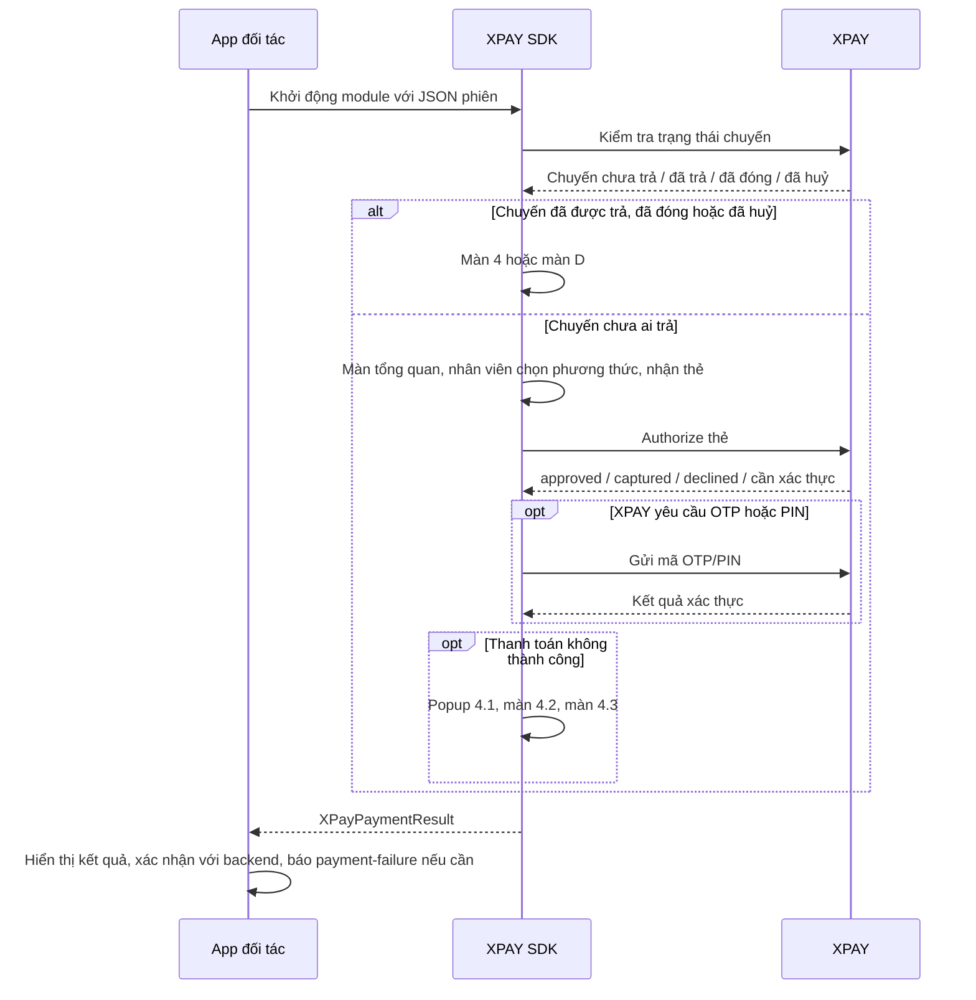

# XPAY Payment SDK cho Android native — Tài liệu tích hợp

Phiên bản SDK 3.1128.1

SDK giúp app Android (Kotlin) của đối tác thu tiền bằng thẻ XPAY. SDK đảm nhận toàn bộ phần thẻ trong quy trình thanh toán: đọc thẻ (chạm NFC, quét QR hoặc nhập số thẻ), gửi yêu cầu
authorize lên XPAY, hiển thị bước xác thực OTP/PIN khi XPAY yêu cầu, rồi trả về cho app **đúng một kết quả**.

Mỗi lần thanh toán, app đưa cho SDK **phản hồi của phiên thanh toán** (do backend đối tác xin từ XPAY). Số tiền bị khoá khi backend xin phiên, và SDK thu đúng số tiền đó (xem [mục 5](#5-mã-phiên-thanh-toán)).

Tài liệu dành cho đội mobile của đối tác dùng Android native. Nếu app của bạn viết bằng Flutter, xem [README.vi.md](../README.vi.md).

## Mục lục

1. [SDK làm gì](#1-sdk-làm-gì)
2. [Yêu cầu hệ thống](#2-yêu-cầu-hệ-thống)
3. [Cài đặt](#3-cài-đặt)
4. [Cấu hình Android](#4-cấu-hình-android)
5. [Mã phiên thanh toán](#5-mã-phiên-thanh-toán)
6. [Khởi tạo SDK](#6-khởi-tạo-sdk)
7. [Thực hiện một thanh toán](#7-thực-hiện-một-thanh-toán)
8. [API reference](#8-api-reference)
9. [Kết quả và cách xử lý](#9-kết-quả-và-cách-xử-lý)
10. [Mã lỗi](#10-mã-lỗi)
11. [Thử lại và chống trừ tiền hai lần](#11-thử-lại-và-chống-trừ-tiền-hai-lần)
12. [Xác nhận thanh toán từ backend](#12-xác-nhận-thanh-toán-từ-backend)
13. [Logging](#13-logging)
14. [Bảo mật](#14-bảo-mật)
15. [Ứng dụng mẫu](#15-ứng-dụng-mẫu)
16. [Giới hạn hiện tại](#16-giới-hạn-hiện-tại)
17. [Câu hỏi thường gặp](#17-câu-hỏi-thường-gặp)

---

## 1. SDK làm gì

| SDK đảm nhận                                                                             | App đối tác đảm nhận                                                                                    |
| ---------------------------------------------------------------------------------------- | ------------------------------------------------------------------------------------------------------- |
| Kiểm tra trạng thái chuyến mỗi lần mở                                                    | Đặt "Thẻ XPAY" vào danh sách phương thức thanh toán của app và khởi động module XPAY khi nhân viên chọn |
| Màn tổng quan & chọn phương thức, màn nhập số thẻ, quét mã QR, đọc NFC, xác thực PIN/OTP | Nhập cước, xin phiên thanh toán cho từng lần thanh toán và đưa cho SDK nguyên phản hồi của phiên        |
| Gửi yêu cầu authorize lên XPAY                                                           | Màn thanh toán thành công của app, điều hướng, cập nhật dữ liệu của app                                 |
| Popup thanh toán không thành công, màn chọn cách thanh toán tiếp, màn chờ tổng đài       | Báo `payment-failure` từ server, void giao dịch còn treo, thu tiền mặt                                  |
| Màn "Thanh toán thành công" khi chuyến đã được trả, màn chuyến đã đóng hoặc đã huỷ       |                                                                                                         |
| Trả về đúng một kết quả cho mỗi lần thanh toán                                           |                                                                                                         |

SDK hiện lỗi và các màn xử lý lỗi của mình, nhưng **không** thay màn thanh toán thành công của app: khi có kết quả, SDK đóng màn hình của mình và trả kết quả về cho app. App tự hiển thị dựa trên kết quả đó.

App đối tác không chọn phương thức. Màn đầu tiên của SDK hiện số tiền, thông tin chuyến (mã cuốc, điểm đón, điểm trả, biển số xe) và các phương thức theo đúng thứ tự `entry_modes` trong phản hồi của phiên. Nhân viên chọn một:

| Giá trị `entry_modes` | Nhân viên làm gì                                                                    |
| --------------------- | ----------------------------------------------------------------------------------- |
| `ride_card`           | Thu bằng thẻ đã liên kết của chuyến (hiện tên thẻ và 4 số cuối), không cần nhập thẻ |
| `card_qr`             | Quét mã QR in trên thẻ XPAY, hoặc chọn ảnh QR từ thư viện                           |
| `manual_pan`          | Nhập số thẻ                                                                         |
| `chip_tap`            | Chạm thẻ chip XPAY của khách vào điện thoại (cần máy có NFC)                        |
| `token`               | Quét mã thanh toán dùng một lần trên ứng dụng XPERISE                               |

SDK chỉ hiện các phương thức thiết bị chạy được. Chọn `card_qr` thì chỉ nhận QR thẻ, chọn `token` thì chỉ nhận mã dùng một lần.

### Chuyến thanh toán bằng ví doanh nghiệp

Khi `payment_method` của phiên là `corporate_wallet`, chuyến được trả bằng ví doanh nghiệp của khách. Màn đầu tiên vẫn hiện số tiền và thông tin chuyến, nhưng thay danh sách phương thức thẻ bằng:

| Phương thức                       | Diễn ra thế nào                                                                                                                                       |
| --------------------------------- | ----------------------------------------------------------------------------------------------------------------------------------------------------- |
| Hiển thị mã QR                    | SDK hiện mã QR cho đúng số tiền đã khoá. Khách quét bằng ứng dụng XPERISE và thanh toán. SDK kiểm tra mỗi 3 giây, trả kết quả ngay khi khách trả xong |
| Gửi mã qua SMS / Gửi mã qua email | Mỗi người đi × mỗi kênh XPAY có thông tin là một dòng, người đặt chuyến đứng đầu. SDK gửi mã 6 số; nhân viên nhập mã khách đọc                        |

1. Dòng "Hiển thị mã QR" luôn có. Các dòng gửi mã lấy từ XPAY: người không có số điện thoại thì không có dòng SMS, không có email thì không có dòng email. Không ai có thông tin thì chỉ còn mã QR.
2. Ở màn nhập mã, nhân viên có thể gửi lại mã (40 giây sau lần gửi trước), và bấm **Đổi** để chuyển sang số điện thoại hoặc email khác.
3. Quay lại từ màn nhập mã thì về danh sách phương thức. Quay lại từ màn QR thì SDK huỷ mã QR với XPAY trước, rồi mới về danh sách phương thức. Nếu XPAY chưa xác nhận đã huỷ, SDK giữ nguyên màn QR và báo lỗi, vì khách vẫn có thể quét mã đó; quay lại lần nữa để thử lại.
4. Mã sai, mã hết hạn hoặc nhập sai quá số lần được báo ngay trên màn nhập mã, thanh toán không kết thúc. Nhân viên gửi mã mới rồi tiếp tục.
5. Phiên ví doanh nghiệp không cần `entry_modes`, và luôn mở được vì mã QR và gửi mã không phụ thuộc phần cứng.

## 2. Yêu cầu hệ thống

| Thành phần | Tối thiểu                    |
| ---------- | ---------------------------- |
| Android    | minSdk 24, Java 17, AndroidX |
| Kotlin     | 2.1 trở lên                  |

Lưu ý:

1. App phải khai báo tương thích Java 17 (`compileOptions` và `jvmTarget`).
2. **Kotlin:** SDK và các thư viện đi kèm được biên dịch bằng Kotlin 2.2.20 và phụ thuộc `kotlin-stdlib` 2.2.20. Compiler Kotlin 2.1 trở lên đọc được. Gradle sẽ nâng `kotlin-stdlib` của app lên 2.2.20. Đã kiểm tra bản build app dùng Kotlin 2.1.0, Android Gradle Plugin 8.11.2, Gradle 8.14.1 và JDK 17+. Bản `3.11.18` build bằng Kotlin 2.3.20 nên **không** dùng được với Kotlin 2.1: hãy dùng `3.1118.2` trở lên.
3. SDK có thư viện native cho các ABI `arm64-v8a`, `armeabi-v7a` và `x86_64`. Nếu app khai báo `abiFilters`, chỉ giữ các ABI này.
4. Kiểm thử trên thiết bị thật: quét QR cần camera, chạm thẻ cần điện thoại Android có NFC.

## 3. Cài đặt

SDK được phát hành trên GitHub: <https://github.com/nggiahuy09/xpay-payment-sdk>. Mỗi bản có một tag dạng `v3.1128.1`, một mục trong [CHANGELOG.md](../CHANGELOG.md) và một bản Release. Số phiên bản **không** theo Semantic Versioning: đọc CHANGELOG trước khi nâng cấp để biết bản mới có thay đổi cần sửa code hay không.

XPAY gửi riêng cho bạn:

1. Base URL của môi trường sandbox, và production khi go-live.
2. Thẻ test cho môi trường sandbox.
3. `X-Merchant-Key` cho backend của bạn (không đưa vào app, xem [mục 5](#5-mã-phiên-thanh-toán)).

Có hai cách lấy SDK. Cách A không cần tải file: trỏ Gradle vào kho Maven trên GitHub. Cách B dùng file zip trong trang Release.

**Cách A: kho Maven trên GitHub.** Khai báo repository trong `settings.gradle.kts`, rồi làm tiếp từ bước dependency bên dưới:

```kotlin
dependencyResolutionManagement {
    repositories {
        google()
        mavenCentral()
        maven { url = uri("https://raw.githubusercontent.com/nggiahuy09/xpay-payment-sdk/maven") }
        maven { url = uri("https://storage.googleapis.com/download.flutter.io") }
    }
}
```

Luôn khai báo số phiên bản cụ thể, không dùng `+` hay `latest.release`. Nâng cấp: đổi số phiên bản trong dependency.

**Cách B: file zip.**

1. Tải `xpay-payment-sdk-android-3.1128.1.zip` ở trang [Releases](https://github.com/nggiahuy09/xpay-payment-sdk/releases). Mã SHA-256 của file nằm trong ghi chú của Release. Kiểm tra trước khi dùng:

   ```bash
   shasum -a 256 xpay-payment-sdk-android-3.1128.1.zip
   ```

   Kết quả phải trùng với mã trong ghi chú Release. Nếu XPAY gửi mã SHA-256 qua kênh riêng (email, chat), đối chiếu với mã đó.

2. Giải nén vào thư mục gốc của project, ví dụ thành `xpay-sdk/`. Thư mục `xpay-sdk/repo` là một Maven repository.
3. Khai báo repository trong `settings.gradle.kts`:

   ```kotlin
   dependencyResolutionManagement {
       repositories {
           google()
           mavenCentral()
           maven { url = uri("xpay-sdk/repo") }
           maven { url = uri("https://storage.googleapis.com/download.flutter.io") }
       }
   }
   ```

**Thêm dependency** (dùng cho cả hai cách) vào `app/build.gradle.kts`:

```kotlin
android {
    defaultConfig {
        minSdk = 24
        ndk { abiFilters += listOf("arm64-v8a", "armeabi-v7a", "x86_64") }
    }
}

dependencies {
    implementation("com.xperise.xpay.partner:flutter_release:3.1128.1")
}
```

Bộ SDK khai báo sẵn các thư viện nó cần; Gradle tự tải chúng từ `google()`, `mavenCentral()` và kho engine Flutter (`download.flutter.io`).

`abiFilters` là bắt buộc: một thư viện camera trong SDK có bản cho `x86`, còn Flutter không build cho `x86`. Thiếu dòng này, máy `x86` 32-bit sẽ crash khi khởi động SDK.

Nâng cấp với cách B: giải nén bộ SDK mới vào cùng thư mục, rồi đổi số phiên bản trong dependency.

## 4. Cấu hình Android

Thêm vào `app/src/main/AndroidManifest.xml`, bên trong thẻ `<manifest>`:

```xml
<uses-permission android:name="android.permission.CAMERA" />
<uses-permission android:name="android.permission.INTERNET" />
<uses-permission android:name="android.permission.NFC" />
<uses-feature android:name="android.hardware.camera" android:required="false" />
<uses-feature android:name="android.hardware.nfc" android:required="false" />
```

`required="false"` giúp app vẫn cài được trên máy không có NFC hoặc camera. Máy không có NFC: SDK không hiện `chip_tap`. Máy có NFC nhưng đang tắt: SDK vẫn hiện `chip_tap`, chọn vào thì màn chạm thẻ hiển thị "NFC chưa được bật" kèm nút "Mở cài đặt".

Đảm bảo `minSdk` trong `app/build.gradle.kts` từ 24 trở lên.

## 5. Mã phiên thanh toán

Mỗi lần thanh toán được xác thực bằng một **mã phiên** (session token) của chuyến, do **backend của đối tác** xin từ XPAY. SDK không bao giờ nhìn thấy merchant key hay bất kỳ secret dài hạn nào. App truyền nguyên phản hồi của phiên khi khởi động module; SDK tự lấy mã phiên trong đó và gửi kèm trong mọi request của lần thanh toán đó.

Luồng xin mã phiên:

1. Nhân viên nhập cước của chuyến trên app đối tác. App gửi `order_id` và cước cho backend.
2. Backend gọi `POST /merchant/rides/{order_id}/payment-session` bằng `X-Merchant-Key` (chỉ nằm trên server), body JSON gồm `amount` (chuỗi, bằng `fare` + `sub_fee`, tính bằng đồng), `fare` (số), tuỳ chọn `sub_fee` (số, mặc định 0) và `distance_km` (số).
3. XPAY trả `session_token` cùng `amount` đã khoá, `external_ref` (dạng `XP-…`) và dữ liệu chuyến. Token chỉ hiện một lần.
4. Backend chuyển **nguyên** body phản hồi xuống app, không cần tách field. App truyền nguyên chuỗi JSON đó vào `sessionJson` khi khởi động module. SDK tự đọc `session_token`, `amount`, `external_ref`, `payment_method` và `payment_template` (`currency`, `product_type`).

Quy tắc:

1. **Mã phiên dùng cho đúng một chuyến và hết hạn sau 15 phút.** Hết hạn giữa chừng thì SDK gọi `fetchSession` để lấy phiên mới, xem [Gia hạn phiên](#gia-hạn-phiên-fetchsession).
2. **Số tiền bị khoá theo phiên.** SDK thu đúng `amount` trong phản hồi của phiên. Muốn thu số tiền khác thì xin phiên mới; không sửa JSON trước khi đưa vào SDK.
3. **Mở phiên mới cho cùng một chuyến sẽ thu hồi các phiên trước.** Request dùng phiên cũ bị trả `ride_payment_session_revoked` (HTTP 401), SDK hiện popup "Cước đã được cập nhật" và trả `RETRY_IN_PARTNER`. Chỉ xin phiên ngay trước khi thu tiền, và không xin phiên mới khi một thanh toán của chuyến đó còn đang mở (trừ trong `fetchSession`).
4. **Mã phiên bị XPAY từ chối** mà SDK không lấy được phiên mới (không có `fetchSession`, phiên không hợp lệ): SDK hiện popup "Không mở được phiên thanh toán" hoặc "Phiên thanh toán không hợp lệ" và trả `RETRY_IN_PARTNER`. App xin mã phiên mới rồi mở lại XPAY.
5. **JSON không đọc được thì không thanh toán.** Chuỗi không phải JSON object, thiếu `session_token`, `amount` không phải số nguyên đồng (ví dụ `"138000.50"`), hoặc (với phiên thẻ) `entry_modes` không còn phương thức nào SDK biết thì SDK trả `UNAVAILABLE` với `sdk_invalid_request` và không gửi gì lên XPAY. Lý do cụ thể được gửi qua `onLog` (`feature = payment`, `action = start_payment`, xem [mục 13](#13-logging)).
6. SDK chỉ giữ mã phiên trong bộ nhớ trong lúc thanh toán, không lưu xuống máy và không ghi log mã phiên.

### Gia hạn phiên: `fetchSession`

Phiên chỉ sống 15 phút, nên có thể hết hạn khi tài xế đang thao tác (khách tìm thẻ, chờ mã OTP). Truyền `fetchSession` vào `XPayCheckout` để SDK tự lấy phiên mới mà không làm gián đoạn thanh toán:

```kotlin
XPayCheckout(
    sessionJson = sessionJson,
    fetchSession = { withContext(Dispatchers.IO) { partnerBackend.openPaymentSession(order.id, order.fare, order.subFee, order.distanceKm) } },
)
```

1. Khi XPAY trả `401 ride_payment_session_expired`, SDK gọi `fetchSession` một lần, chờ tối đa 15 giây.
2. `fetchSession` gọi backend xin lại phiên cho **cùng chuyến, cùng cước** (`POST /merchant/rides/{order_id}/payment-session`) và trả về nguyên JSON phản hồi.
3. SDK gửi lại đúng request vừa bị từ chối, cùng body và cùng idempotency key, với phiên mới. Tài xế chỉ thấy loading lâu hơn một chút.
4. Phiên mới có cước khác: SDK hiện popup "Cước đã được cập nhật" và trả `RETRY_IN_PARTNER` với `failure.errorCode = sdk_session_amount_changed`, `failure.note = cước đổi`.
5. `fetchSession` ném exception, quá 15 giây, hoặc trả phiên của chuyến khác: SDK hiện popup "Không mở được phiên thanh toán" và trả `RETRY_IN_PARTNER` với `failure.reason = SDK_ERROR`.
6. `fetchSession` là hàm `suspend` được gọi trên main thread: chuyển sang `Dispatchers.IO` (hoặc dispatcher của app) trước khi gọi mạng, như ví dụ trên.
7. SDK giữ `fetchSession` tới khi thanh toán trả kết quả. Để tránh giữ `Activity` cũ khi Activity bị tạo lại (xoay màn hình), gọi backend qua ViewModel hoặc repository thay vì tham chiếu tới `Activity`.

## 6. Khởi tạo SDK

Gọi `initialize` một lần trước lần thanh toán đầu tiên, ví dụ khi mở app hoặc sau khi nhân viên đăng nhập. Gọi lại khi cần đổi ngôn ngữ hoặc base URL. `initialize` là hàm `suspend`:

```kotlin
lifecycleScope.launch {
    XPayPayment.initialize(
        context = applicationContext,
        config = XPayConfig(
            environment = XPayEnvironment(baseUrl = "https://<xpay api host>"),
            language = XPayLanguage.VI,
            onLog = { event -> myLogger.log(event.toString()) },
        ),
    )
}
```

Lưu ý khi gọi lại `initialize`:

1. Không gọi khi đang có một thanh toán mở (tức thanh toán chưa trả kết quả). Khi đó `initialize` ném `IllegalStateException` và giữ nguyên cấu hình cũ.
2. Không gọi khi lần `initialize` trước chưa xong. Khi đó lần gọi sau ném `IllegalStateException`, lần gọi trước vẫn chạy tiếp.
3. Trong lúc `initialize` đang chạy, thanh toán trả `UNAVAILABLE` với `errorCode = sdk_not_initialized`. Luôn chờ `initialize` xong rồi mới bắt đầu thanh toán.

## 7. Thực hiện một thanh toán

### Luồng tổng quát



### Khởi động module và nhận kết quả

Android trả kết quả qua Activity Result API. Đăng ký launcher bằng `registerForActivityResult(XPayPaymentContract())` khi khai báo Activity hoặc Fragment, rồi gọi
`launch(XPayCheckout(...))` để bắt đầu thanh toán. Kết quả vẫn về đúng callback khi Activity bị tạo lại, ví dụ lúc xoay màn hình.

```kotlin
class CheckoutActivity : AppCompatActivity() {
    private val xpayPayment = registerForActivityResult(XPayPaymentContract()) { result -> handleResult(result) }

    private fun payWithXPay(sessionJson: String) {
        xpayPayment.launch(XPayCheckout(sessionJson = sessionJson, fetchSession = viewModel::openPaymentSession))
    }

    private fun handleResult(result: XPayPaymentResult) {
        partnerBackend.saveXPayResult(currentOrder.id, result)
        when (result.status) {
            XPayPaymentStatus.PAID -> {
                confirmOnBackend(result.externalRef)
                showPaidScreen()
            }
            XPayPaymentStatus.RIDE_CLOSED -> closeRide(result.rideStatus)
            XPayPaymentStatus.RETRY_IN_PARTNER,
            XPayPaymentStatus.OTHER_METHOD,
            XPayPaymentStatus.CS_PENDING,
            XPayPaymentStatus.CANCELLED,
            XPayPaymentStatus.UNAVAILABLE,
            -> showPaymentScreen(lastXPayResult = result)
        }
    }
}
```

`viewModel.openPaymentSession` là hàm `suspend` của đối tác, xin phiên mới cho chuyến đang thu, xem [Gia hạn phiên](#gia-hạn-phiên-fetchsession). Màn thanh toán của app dùng `lastXPayResult` để: cho mở lại XPAY ngay khi `isRetryable`; nhắc hỏi tổng đài trước khi thu cách khác với `CS_PENDING`; void `pendingAuthId` và báo `payment-failure` khi tài xế chốt cách thu khác. Xem [mục 9](#9-kết-quả-và-cách-xử-lý).

### Hành vi khi thanh toán

1. SDK mở màn hình của mình toàn màn hình, là một Activity riêng. Khi thanh toán kết thúc, SDK tự đóng màn hình của mình rồi trả kết quả. SDK không đụng tới điều hướng của app.
2. Launcher phải được đăng ký trước khi Activity hoặc Fragment được tạo xong, theo quy tắc của Activity Result API. Cách khai báo như ví dụ trên là đúng.
3. Trong lúc XPAY đang authorize thẻ hoặc đang xác thực mã của ví doanh nghiệp, màn hình của SDK không phản hồi nút back của Android, để nhân viên không rời khỏi một thanh toán có thể đã bị trừ tiền. SDK tự xử lý việc này, app không cần làm gì.
4. Bấm back ở màn nhận thẻ thì quay về danh sách phương thức. Bấm back ở danh sách phương thức thì kết quả là `CANCELLED`. Bấm back ở màn xác thực OTP/PIN thì SDK hỏi lại; đồng ý rời đi thì kết quả là `CANCELLED` kèm `pendingAuthId`.
5. Mã QR không phải của XPAY, hoặc không đúng loại với phương thức đã chọn (QR thẻ / mã dùng một lần), bị báo lỗi ngay trên màn hình quét, SDK không gửi request nào và nhân viên có thể quét lại mà không cần tạo phiên giao dịch mới.
6. SDK không có thanh tiêu đề riêng và chỉ thoát bằng nút back của hệ thống.
7. Mỗi lần mở, SDK kiểm tra trạng thái chuyến trước (tối đa 15 giây). Chuyến đã được trả thì vào thẳng màn thanh toán thành công, đã đóng hoặc đã huỷ thì vào màn chuyến đã đóng, không cho thu lần nữa. Không kiểm tra được (mất mạng) thì vào màn chọn phương thức như bình thường.
8. Thanh toán không thành công được SDK xử lý trên màn hình của SDK (popup 4.1, màn 4.2, màn 4.3) trước khi đóng. App không cần hiện thêm popup lỗi.
9. Hệ điều hành dừng app trong lúc SDK đang mở thì kết quả của lần thanh toán đó bị mất: launcher nhận `UNAVAILABLE` với `sdk_result_lost`. Mở lại XPAY bằng phiên mới; SDK kiểm tra chuyến trước nên không thu hai lần.

## 8. API reference

### Tổng quan

SDK có hai thao tác, dùng theo thứ tự dưới đây. Mỗi kiểu dữ liệu trong mục này đều thuộc một nhánh của sơ đồ.

```text
XPayPayment
├── 1. initialize(context, XPayConfig)            Gọi một lần trước khi thanh toán (mục 6)
│       ├── environment: XPayEnvironment          Base URL sandbox hoặc production
│       ├── language:    XPayLanguage             Ngôn ngữ màn hình SDK
│       └── onLog:       (XPayLogEvent) -> Unit   Nhận sự kiện log (mục 13)
│
│
└── 2. Khởi động module, mỗi lần thanh toán (mục 7)
        registerForActivityResult(XPayPaymentContract())
        → launch(XPayCheckout(sessionJson, fetchSession))
                │
                ▼
        XPayPaymentResult
        ├── status:        XPayPaymentStatus      Ý nghĩa từng trạng thái (mục 9)
        ├── isRetryable:   Boolean                Mở lại XPAY ngay được không (mục 9)
        ├── failure:       XPayPaymentFailure?    Lý do, gửi vào payment-failure (mục 9)
        ├── pendingAuthId: String?                Giao dịch còn chờ mã, cần void (mục 12)
        └── errorCode:     String?                So với hằng số XPayErrorCode (mục 10)
```

### Ví dụ đầy đủ

```kotlin
class CheckoutActivity : AppCompatActivity() {
    private val xpayPayment = registerForActivityResult(XPayPaymentContract()) { result -> handleResult(result) }

    override fun onCreate(savedInstanceState: Bundle?) {
        super.onCreate(savedInstanceState)
        lifecycleScope.launch {
            XPayPayment.initialize(
                context = applicationContext,
                config = XPayConfig(
                    environment = XPayEnvironment(baseUrl = "https://<xpay api host>"),
                    language = XPayLanguage.VI,
                    onLog = { event -> myLogger.log(event.toString()) },
                ),
            )
        }
    }

    private fun payWithXPay(sessionJson: String) {
        xpayPayment.launch(XPayCheckout(sessionJson = sessionJson, fetchSession = viewModel::openPaymentSession))
    }

    private fun handleResult(result: XPayPaymentResult) {
        partnerBackend.saveXPayResult(currentOrder.id, result)
        when (result.status) {
            XPayPaymentStatus.PAID -> {
                confirmOnBackend(result.externalRef)
                showPaidScreen()
            }
            XPayPaymentStatus.RIDE_CLOSED -> closeRide(result.rideStatus)
            XPayPaymentStatus.RETRY_IN_PARTNER,
            XPayPaymentStatus.OTHER_METHOD,
            XPayPaymentStatus.CS_PENDING,
            XPayPaymentStatus.CANCELLED,
            XPayPaymentStatus.UNAVAILABLE,
            -> showPaymentScreen(lastXPayResult = result)
        }
    }
}
```

### `XPayPayment`

Điểm vào duy nhất của SDK (`object XPayPayment`).

| Thành phần                                                                        | Mô tả                                               |
| --------------------------------------------------------------------------------- | --------------------------------------------------- |
| `suspend fun initialize(context: Context, config: XPayConfig)`                    | Cấu hình SDK                                        |
| `XPayPaymentContract` (`ActivityResultContract<XPayCheckout, XPayPaymentResult>`) | Khởi động module và nhận kết quả của thanh toán     |
| `const val SUPPORT_HOTLINE = "19002189"`                                          | Số tổng đài XPAY. SDK đã hiện số này trên popup lỗi |

#### `initialize`

Cấu hình SDK: ngôn ngữ, base URL và callback log. Có thể gọi lại để cấu hình lại, trừ khi đang có thanh toán mở hoặc lần `initialize` trước chưa xong: khi đó hàm ném `IllegalStateException`.
Xem [mục 6](#6-khởi-tạo-sdk).

#### Khởi động module: `XPayPaymentContract`

Mở luồng thanh toán và luôn hoàn thành với **đúng một** `XPayPaymentResult`. SDK không ném exception khi thanh toán thất bại; mọi lỗi đều nằm trong kết quả.

Thứ tự kiểm tra trước khi mở màn hình:

| Điều kiện                                          | Kết quả                                          |
| -------------------------------------------------- | ------------------------------------------------ |
| Chưa gọi `initialize`, hoặc `initialize` đang chạy | `UNAVAILABLE`, `errorCode = sdk_not_initialized` |
| Đang có một thanh toán khác mở                     | `UNAVAILABLE`, `errorCode = sdk_busy`            |
| Request không hợp lệ (xem bảng `XPayCheckout`)     | `UNAVAILABLE`, `errorCode = sdk_invalid_request` |
| Không phương thức nào của phiên chạy được trên máy | `UNAVAILABLE`, `errorCode = sdk_unsupported`     |

Không trường hợp nào ở bảng trên gửi request lên XPAY.

### `XPayCheckout`

Dùng ở: đầu vào của `launch` trên launcher `XPayPaymentContract`.

| Trường         | Kiểu                      | Bắt buộc | Mô tả                                                                                                                                                                                                                                                                                                                                                                                                                                    |
| -------------- | ------------------------- | -------- | ---------------------------------------------------------------------------------------------------------------------------------------------------------------------------------------------------------------------------------------------------------------------------------------------------------------------------------------------------------------------------------------------------------------------------------------- |
| `sessionJson`  | `String`                  | Có       | Nguyên body phản hồi của `POST /merchant/rides/{order_id}/payment-session`. SDK lấy `session_token`, `amount` (số nguyên đồng, tối thiểu 1.000), `external_ref` (1–64 ký tự), `payment_template.currency` (mặc định `VND`), `payment_template.product_type`, `entry_modes`, `ride_card`, `order_id` và thông tin chuyến trong `payment_template.enhanced_data` từ đây, xem [mục 5](#5-mã-phiên-thanh-toán). `toString()` che giá trị này |
| `fetchSession` | `(suspend () -> String)?` | Không    | SDK gọi khi phiên hết hạn giữa chừng. Trả về nguyên JSON của một phiên mới cho **cùng chuyến, cùng cước**. Mặc định `null`. Xem [Gia hạn phiên](#gia-hạn-phiên-fetchsession)                                                                                                                                                                                                                                                             |

### `XPayConfig`

Dùng ở: tham số của `initialize`.

| Trường        | Kiểu                        | Bắt buộc | Mặc định          | Mô tả                                             |
| ------------- | --------------------------- | -------- | ----------------- | ------------------------------------------------- |
| `environment` | `XPayEnvironment`           | Có       |                   | Môi trường XPAY (sandbox hoặc production)         |
| `language`    | `XPayLanguage`              | Không    | `XPayLanguage.VI` | Ngôn ngữ của màn hình SDK                         |
| `onLog`       | `((XPayLogEvent) -> Unit)?` | Không    | `null`            | Nhận sự kiện nghiệp vụ, xem [mục 13](#13-logging) |

### `XPayEnvironment`

Dùng ở: trường `environment` của `XPayConfig`.

| Trường    | Kiểu     | Bắt buộc | Mô tả                                                          |
| --------- | -------- | -------- | -------------------------------------------------------------- |
| `baseUrl` | `String` | Có       | Base URL của XPAY API. XPAY cung cấp URL sandbox và production |

### `XPayLanguage`

Dùng ở: trường `language` của `XPayConfig`.

| Giá trị | Ngôn ngữ   |
| ------- | ---------- |
| `VI`    | Tiếng Việt |
| `EN`    | Tiếng Anh  |

### `XPayPaymentResult`

Dùng ở: kết quả của mỗi lần thanh toán.

| Trường          | Kiểu                  | Mô tả                                                                                                                        |
| --------------- | --------------------- | ---------------------------------------------------------------------------------------------------------------------------- |
| `status`        | `XPayPaymentStatus`   | Trạng thái cuối cùng, luôn có. Xem [mục 9](#9-kết-quả-và-cách-xử-lý)                                                         |
| `failure`       | `XPayPaymentFailure?` | Lý do XPAY không thu được, có với `RETRY_IN_PARTNER`, `OTHER_METHOD`, `CS_PENDING`, `UNAVAILABLE`                            |
| `pendingAuthId` | `String?`             | Giao dịch thẻ còn chờ mã OTP/PIN khi SDK đóng. Server đối tác void trước khi thu cách khác                                   |
| `paidBy`        | `XPayPaidBy?`         | Với `PAID`: `PARTNER` (thu tại xe qua SDK) hoặc `CS` (tổng đài trả dùm)                                                      |
| `rideStatus`    | `XPayRideStatus?`     | Với `RIDE_CLOSED`: `COMPLETED` (tổng đài đã đóng chuyến, không thu) hoặc `CANCELLED` (đã huỷ)                                |
| `authId`        | `String?`             | Với `PAID`: mã giao dịch thẻ. Luôn `null` với thanh toán bằng ví doanh nghiệp                                                |
| `captureId`     | `String?`             | Với `PAID`: mã capture, nếu có                                                                                               |
| `externalRef`   | `String?`             | Với `PAID`: mã chuyến `XP-…`                                                                                                 |
| `amount`        | `Long?`               | Với `PAID`: số tiền XPAY đã thu. Khi tổng đài trả dùm, có thể khác số đã khoá trong phiên                                    |
| `currency`      | `String?`             | Với `PAID`: mã tiền tệ                                                                                                       |
| `createdAt`     | `java.util.Date?`     | Với `PAID`: thời điểm XPAY ghi nhận, nếu có                                                                                  |
| `errorCode`     | `String?`             | Với `UNAVAILABLE`: mã lỗi của SDK. Xem [mục 10](#10-mã-lỗi)                                                                  |
| `isSuccessful`  | `Boolean`             | `true` khi `status` là `PAID`                                                                                                |
| `isRetryable`   | `Boolean`             | `true` với `RETRY_IN_PARTNER` và `CANCELLED`: app được mở lại XPAY ngay (bằng phiên mới). `false` với các trạng thái còn lại |

### `XPayPaymentFailure`

Dùng ở: trường `failure` của `XPayPaymentResult`.

| Trường      | Kiểu                | Mô tả                                                                                                                                      |
| ----------- | ------------------- | ------------------------------------------------------------------------------------------------------------------------------------------ |
| `reason`    | `XPayFailureReason` | Lý do để server gửi nguyên văn (`reason.remoteValue`) vào `payment-failure`                                                                |
| `authId`    | `String?`           | Giao dịch thẻ bị từ chối gần nhất. Chuyến ví không có                                                                                      |
| `errorCode` | `String?`           | Mã lỗi gốc (mã từ chối hoặc mã API), dùng để tra cứu và đối soát. Xem [mục 10](#10-mã-lỗi)                                                 |
| `note`      | `String?`           | Ghi chú cho tổng đài: `cước đổi`, `chờ tổng đài quá 5 phút`, hoặc mã lỗi khi `reason` là `SDK_ERROR`. Gửi vào `note` của `payment-failure` |

### `XPayPaymentStatus`

Dùng ở: trường `status` của `XPayPaymentResult`. Mỗi giá trị có thuộc tính `isRetryable`. Cách xử lý: xem [mục 9](#9-kết-quả-và-cách-xử-lý).

| Giá trị            | `isRetryable` | Khi nào                                                                       |
| ------------------ | ------------- | ----------------------------------------------------------------------------- |
| `PAID`             | `false`       | Chuyến đã được thanh toán, qua SDK hoặc do tổng đài trả dùm                   |
| `RETRY_IN_PARTNER` | `true`        | Popup lỗi luồng B, tài xế bấm "Quay lại trang thanh toán"                     |
| `OTHER_METHOD`     | `false`       | Màn 4.2, tài xế chọn "Thử lại với phương thức thanh toán khác"                |
| `CS_PENDING`       | `false`       | Màn 4.3 hết 5 phút, hoặc tài xế bấm back. Tổng đài có thể vẫn đang thanh toán |
| `RIDE_CLOSED`      | `false`       | Màn D: chuyến đã đóng không thu, hoặc đã huỷ                                  |
| `CANCELLED`        | `true`        | Tài xế thoát trước khi có kết quả, hoặc app đóng màn hình SDK                 |
| `UNAVAILABLE`      | `false`       | SDK không mở được màn hình thanh toán                                         |

### `XPayFailureReason`, `XPayPaidBy`, `XPayRideStatus`

| Enum                | Giá trị                                                                                                                                                                                       |
| ------------------- | --------------------------------------------------------------------------------------------------------------------------------------------------------------------------------------------- |
| `XPayFailureReason` | `PAYMENT_DECLINED` (`payment_declined`): thẻ hoặc ví từ chối, hoặc hết số lần thử. `SDK_ERROR` (`sdk_error`): lỗi hệ thống, phiên, tích hợp hoặc SDK. `OTHER` (`other`): hiện là cước vừa đổi |
| `XPayPaidBy`        | `PARTNER`: thu tại xe qua SDK. `CS`: tổng đài XPAY trả dùm                                                                                                                                    |
| `XPayRideStatus`    | `COMPLETED`: tổng đài đã đóng chuyến, không thu. `CANCELLED`: chuyến đã bị huỷ                                                                                                                |

### `XPayLogEvent`

Dùng ở: tham số của callback `onLog` trong `XPayConfig`.

| Trường          | Kiểu                | Mô tả                                                                                  |
| --------------- | ------------------- | -------------------------------------------------------------------------------------- |
| `level`         | `XPayLogLevel`      | `info`, `warn`, `error`                                                                |
| `category`      | `XPayLogCategory`   | `api` (kết quả gọi API), `behavior` (hành vi người dùng), `error` (dữ liệu bất thường) |
| `feature`       | `String`            | Khu vực phát sinh sự kiện: `payment`, `verification`, `card_nfc`, `corporate_wallet`   |
| `action`        | `String`            | Hành động cụ thể, xem [mục 13](#13-logging)                                            |
| `reason`        | `String?`           | Lý do chi tiết, nếu có                                                                 |
| `errorCode`     | `String?`           | Mã lỗi, nếu sự kiện đến từ một lỗi                                                     |
| `serverMessage` | `String?`           | Thông báo lỗi gốc từ XPAY, nếu có                                                      |
| `input`         | `Map<String, Any?>` | Các định danh liên quan (không thể sửa)                                                |

## 9. Kết quả và cách xử lý

SDK tự hiện lỗi và hướng dẫn tài xế trên màn hình của SDK: thử lại trong SDK, quay về app, hoặc gọi tổng đài XPAY rồi chọn cách thanh toán tiếp. Khi SDK đóng, app nhận một kết quả và làm theo bảng dưới. Năm luồng xử lý, từng màn hình và quy trình đầy đủ: [failure_handling.vi.md](failure_handling.vi.md).

| Trạng thái         | SDK đóng ở                                                      | Trường có giá trị                                                                                       | App nên làm gì                                                                                                                |
| ------------------ | --------------------------------------------------------------- | ------------------------------------------------------------------------------------------------------- | ----------------------------------------------------------------------------------------------------------------------------- |
| `PAID`             | Màn 4 "Thanh toán thành công", tự đóng sau 3 giây               | `paidBy`, `externalRef`, `amount`, `currency`; `authId`, `captureId`, `createdAt` khi có                | Xác nhận với backend bằng `externalRef`, hiện màn thành công của app                                                          |
| `RETRY_IN_PARTNER` | Popup lỗi, "Quay lại trang thanh toán"                          | `failure`                                                                                               | Về màn thanh toán, cho mở lại XPAY bằng phiên mới. `failure.note` là `cước đổi` thì hiện lại số tiền mới trước                |
| `OTHER_METHOD`     | Màn 4.2, "Thử lại với phương thức thanh toán khác"              | `failure`; `pendingAuthId` khi có                                                                       | Void `pendingAuthId` nếu có, về màn thanh toán để chọn cách khác, báo `payment-failure`                                       |
| `CS_PENDING`       | Màn 4.3 "Đang chờ tổng đài thanh toán", hết 5 phút hoặc back    | `failure` (`reason` là `PAYMENT_DECLINED`, `note` là `chờ tổng đài quá 5 phút`); `pendingAuthId` khi có | **Không thu cách khác ngay**: hỏi tổng đài trước. Báo `payment-failure`; thu tiền mặt thì báo `paid_cash` trước khi nhận tiền |
| `RIDE_CLOSED`      | Màn D "Tổng đài đã đóng chuyến, không thu" hoặc "Chuyến đã huỷ" | `rideStatus`                                                                                            | Không thu thêm, cập nhật chuyến theo `rideStatus`                                                                             |
| `CANCELLED`        | Tài xế thoát trước khi có kết quả, hoặc app đóng màn hình SDK   | `pendingAuthId` khi tài xế rời màn OTP/PIN                                                              | Về màn thanh toán. Void `pendingAuthId` nếu có. Có thể mở lại XPAY                                                            |
| `UNAVAILABLE`      | Không mở màn hình nào                                           | `errorCode`, `failure` (`reason` là `SDK_ERROR`)                                                        | Xem [mục 10](#10-mã-lỗi): sửa tích hợp, hoặc để tài xế chọn cách khác                                                         |

Lưu ý:

1. **Mở lại XPAY luôn dùng phiên mới.** Backend gọi lại `POST /merchant/rides/{order_id}/payment-session` (phiên cũ bị thu hồi), app khởi động lại module với nguyên phản hồi mới. Không giới hạn số lần mở lại.
2. **Thanh toán bằng ví doanh nghiệp** thành công cũng là `PAID`, nhưng `authId` và `captureId` trống, vì không có giao dịch thẻ. Xác nhận bằng `externalRef`.
3. **`PAID` với `paidBy` là `CS`**: tổng đài XPAY đã trả dùm, kể cả khi SDK phát hiện việc này lúc mở hoặc lúc tài xế đang thử lại. Không thu thêm của khách.
4. **App không cần hiện popup lỗi thứ hai.** Tài xế đã thấy lý do, mã chuyến và số tổng đài trên popup của SDK. Số tổng đài cũng có sẵn trong `XPayPayment.SUPPORT_HOTLINE` nếu app cần hiện trên màn của mình.
5. **Báo `payment-failure`**: mỗi lần tài xế ở lại màn thanh toán của app mà chưa thu được bằng XPAY (`OTHER_METHOD`, `CS_PENDING`, hoặc `RETRY_IN_PARTNER`, `CANCELLED`, `UNAVAILABLE` mà không mở lại XPAY), server đối tác gọi `POST /merchant/rides/{order_id}/payment-failure` với `reason`, `auth_id`, `note` lấy từ `failure`. Thu tiền mặt thì gửi `reason: "paid_cash"` kèm `amount` **trước khi** nhận tiền. Không báo khi `PAID`, `RIDE_CLOSED`. Chi tiết: [mục 6 của failure_handling.vi.md](failure_handling.vi.md#6-báo-payment-failure-từ-server).

## 10. Mã lỗi

### `errorCode`: lỗi khi SDK không mở được

`errorCode` chỉ có giá trị khi `status` là `UNAVAILABLE`. Dùng hằng số trong `XPayErrorCode` để so sánh, thay vì viết cứng chuỗi.

| Mã                        | Hằng số               | Khi nào trả về                                                                                                                                               | Cách xử lý                                                                                                        |
| ------------------------- | --------------------- | ------------------------------------------------------------------------------------------------------------------------------------------------------------ | ----------------------------------------------------------------------------------------------------------------- |
| `sdk_not_initialized`     | `NOT_INITIALIZED`     | Khởi động module khi chưa gọi `initialize` hoặc `initialize` chưa xong                                                                                       | Chờ `initialize` xong rồi khởi động lại                                                                           |
| `sdk_busy`                | `BUSY`                | Khởi động module khi một thanh toán khác chưa trả kết quả                                                                                                    | Chờ lần trước trả kết quả                                                                                         |
| `sdk_invalid_request`     | `INVALID_REQUEST`     | `sessionJson` không đọc được (không phải JSON object, thiếu `session_token`, `amount` có phần lẻ hoặc dưới 1.000, `external_ref` rỗng hoặc dài quá 64 ký tự) | Truyền nguyên body phản hồi của phiên                                                                             |
| `sdk_unsupported`         | `UNSUPPORTED`         | Không phương thức nào của phiên chạy được trên máy (ví dụ phiên chỉ có `chip_tap`, máy không có NFC)                                                         | Để tài xế chọn cách khác                                                                                          |
| `sdk_result_lost`         | `RESULT_LOST`         | Hệ điều hành đã dừng app trong lúc SDK đang mở, kết quả của lần thanh toán đó bị mất                                                                         | Mở lại XPAY bằng phiên mới: SDK kiểm tra chuyến trước, chuyến đã được trả thì vào thẳng màn thanh toán thành công |
| `sdk_unexpected_response` | `UNEXPECTED_RESPONSE` | Phần native không nhận được kết quả hợp lệ từ SDK                                                                                                            | Mở lại XPAY bằng phiên mới, báo XPAY nếu lặp lại                                                                  |

### `failure.errorCode`: mã lỗi gốc của lần thất bại

`failure.errorCode` giữ nguyên mã mà SDK dựa vào để chọn luồng, dùng để tra cứu và đối soát. App không cần rẽ nhánh theo mã này.

1. Mã từ chối của giao dịch (`decline_reason`), ví dụ `insufficient_funds`, `card_blocked`, `employee_policy_violation`.
2. Mã lỗi API của XPAY (`code`), ví dụ `ride_payment_session_revoked`, `corporate_wallet_refused`.
3. Mã của tầng mạng: `no_connection`, `no_host`, `timeout`.
4. Mã do SDK sinh ra: `sdk_session_amount_changed` (`fetchSession` trả phiên có cước khác, hằng số `XPayErrorCode.SESSION_AMOUNT_CHANGED`), `sdk_unexpected_response` (XPAY trả trạng thái SDK không xử lý được).

Bảng mã theo từng luồng: [mục 8 của failure_handling.vi.md](failure_handling.vi.md#8-mã-lỗi-theo-luồng).

## 11. Thử lại và chống trừ tiền hai lần

Mỗi yêu cầu authorize và xác thực mã của thẻ mang một idempotency key, để request gửi lại không bị trừ tiền hai lần.

1. **SDK tự gửi lại** request authorize hoặc xác thực thẻ khi lỗi tạm thời (timeout, mất kết nối, HTTP 5xx, `request_in_flight`), với cùng key và cùng body. XPAY trả lại kết quả của request đầu nếu đã ghi nhận.
2. **"Thử lại" trong SDK** (popup luồng A, hoặc "Thử lại với XPAY" ở màn 4.2): sau một lần bị từ chối, lần thử mới dùng key mới. Sau một lỗi hệ thống chưa rõ kết quả, nếu khách đưa lại cùng thẻ, SDK dùng lại key cũ để XPAY trả kết quả cũ thay vì trừ lần nữa.
3. **Mở lại XPAY từ app** (khởi động lại module) cho cùng chuyến: nếu khách đưa cùng thẻ và số tiền không đổi, SDK dùng lại key của lần trước, trong suốt thời gian process của app còn sống.
4. **Thẻ khác hoặc số tiền khác**: request khác đi nên SDK tạo key mới. Chạm thẻ NFC luôn tạo key mới, vì mỗi lần chạm sinh ra một cryptogram mới.
5. Mã phiên không nằm trong idempotency key. Thử lại bằng một phiên mới vẫn dùng lại key cũ.
6. Chuyến đã được trả (ví dụ tổng đài trả dùm trong lúc tài xế đang thử lại) thì XPAY trả `ride_already_paid`, SDK chuyển sang màn thanh toán thành công và trả `PAID`, không trừ thẻ của khách lần nữa.

Chuyến ví doanh nghiệp chỉ được trả một lần, bằng mã QR hoặc bằng mã gửi tới khách: trả xong thì XPAY đóng chuyến, và lần mở sau SDK vào thẳng màn thanh toán thành công.

## 12. Xác nhận thanh toán từ backend

Kết quả được trả về trên điện thoại của nhân viên, đây không phải nguồn đáng tin cậy. Trước khi hoàn tất đơn, backend của đối tác phải xác nhận thanh toán với XPAY bằng `externalRef` (hoặc `authId` với thanh toán thẻ).

1. `PAID` với `paidBy` là `CS` cũng xác nhận bằng `externalRef`. `amount` là số XPAY đã thu, có thể khác số đã khoá trong phiên.
2. Thanh toán bằng ví doanh nghiệp không có `authId`: xác nhận bằng `externalRef`.
3. `pendingAuthId`: giao dịch thẻ còn chờ mã. Void bằng `POST /merchant/payments/{auth_id}/void` từ server, hoặc để tự hết hạn sau khoảng 10 phút. Chưa void thì `paid_cash` bị từ chối với `409 ride_payment_pending`.
4. Sau `CS_PENDING`, tổng đài vẫn có thể trả dùm. Server đối tác biết qua kênh xác nhận thanh toán đang dùng, hoặc qua `409 ride_already_paid` khi báo `paid_cash`.

## 13. Logging

Truyền `onLog` vào `XPayConfig` để nhận các sự kiện nghiệp vụ của SDK. SDK không gửi log đi đâu khác. Không truyền `onLog` thì SDK im lặng.

Sự kiện **không bao giờ** chứa số thẻ, khoá chip, cryptogram, nonce, mã xác thực hay mã phiên. Sự kiện lỗi NFC có chứa UID của chip (`chip_uid`).

| `feature`          | `action`                                                 | `level` | Khi nào                                                                                                                                                                                                                                                       | `input` chính                                                             |
| ------------------ | -------------------------------------------------------- | ------- | ------------------------------------------------------------------------------------------------------------------------------------------------------------------------------------------------------------------------------------------------------------- | ------------------------------------------------------------------------- |
| `payment`          | `start_payment`                                          | `error` | Request bị từ chối trước khi mở màn hình (`sdk_invalid_request`). `reason`: `invalid_session_json`, `malformed_session`, `missing_session_token`, `missing_entry_modes`, `invalid_amount`, `amount_below_minimum`, `missing_currency`, `invalid_external_ref` | `session_json_length`                                                     |
| `payment`          | `checkout_failure`                                       | `warn`  | Thanh toán không thành công, SDK chọn luồng xử lý. `reason` là loại lỗi                                                                                                                                                                                       | `route`, `kind`, `error_code`, `auth_id`, `attempt`, `retry_in_sdk_count` |
| `payment`          | `authorize_qr`, `authorize_manual`, `authorize_chip_tap` | `error` | Gọi authorize thất bại (lỗi mạng, lỗi từ XPAY, xung đột)                                                                                                                                                                                                      | `entry_mode`, `auto_capture`                                              |
| `payment`          | `authorize_approved`                                     | `info`  | XPAY duyệt hoặc capture                                                                                                                                                                                                                                       | `entry_mode`, `auth_id`                                                   |
| `payment`          | `authorize_declined`                                     | `warn`  | XPAY từ chối                                                                                                                                                                                                                                                  | `entry_mode`, `decline_reason`                                            |
| `payment`          | `authorize_verification`                                 | `info`  | XPAY yêu cầu xác thực OTP/PIN                                                                                                                                                                                                                                 | `entry_mode`, `auth_id`, `verification_method`                            |
| `payment`          | `authorize_incomplete`                                   | `error` | XPAY trả trạng thái SDK không xử lý được                                                                                                                                                                                                                      | `entry_mode`                                                              |
| `verification`     | `send_verification`, `resend_verification`               | `error` | Gửi hoặc gửi lại mã xác thực thất bại                                                                                                                                                                                                                         | `auth_id`, `recipient_id`                                                 |
| `verification`     | `verify`                                                 | `error` | Gọi verify thất bại, hoặc XPAY trả trạng thái không mong đợi                                                                                                                                                                                                  | `auth_id`                                                                 |
| `verification`     | `verify_approved`                                        | `info`  | Xác thực thành công                                                                                                                                                                                                                                           | `auth_id`                                                                 |
| `verification`     | `verify_rejected`                                        | `warn`  | Mã xác thực sai                                                                                                                                                                                                                                               | `auth_id`, `attempt`                                                      |
| `verification`     | `verify_declined`                                        | `warn`  | XPAY từ chối sau bước xác thực                                                                                                                                                                                                                                | `auth_id`, `decline_reason`                                               |
| `verification`     | `verify_not_pending`                                     | `warn`  | XPAY báo giao dịch không còn chờ mã, SDK đọc lại kết quả của giao dịch                                                                                                                                                                                        | `auth_id`, `payment_status`, `decline_reason`                             |
| `verification`     | `verification_expired`                                   | `error` | Hết thời gian xác thực                                                                                                                                                                                                                                        | `auth_id`                                                                 |
| `verification`     | `verification_abandon`                                   | `info`  | Nhân viên rời màn hình xác thực                                                                                                                                                                                                                               | `auth_id`                                                                 |
| `card_nfc`         | `prepare`, `sign`                                        | `error` | Gọi API chuẩn bị hoặc ký dữ liệu chip thất bại                                                                                                                                                                                                                | `chip_uid`, `counter`                                                     |
| `card_nfc`         | `advance_counter`                                        | `error` | Không cập nhật được bộ đếm trên chip                                                                                                                                                                                                                          | `chip_uid`, `counter_sector`, `counter_block`                             |
| `corporate_wallet` | `get_otp_channels`                                       | `error` | Không tải được danh sách người nhận mã. Màn hình vẫn cho thu bằng mã QR                                                                                                                                                                                       | Không có                                                                  |
| `corporate_wallet` | `request_otp`, `resend_otp`                              | `error` | Gửi hoặc gửi lại mã thất bại. `reason` là nguyên nhân, ví dụ `otpVelocityExceeded`                                                                                                                                                                            | `method`, `recipient_id`                                                  |
| `corporate_wallet` | `verify_otp`                                             | `error` | Xác thực mã thất bại. `reason` là nguyên nhân, ví dụ `otpInvalid`                                                                                                                                                                                             | `wallet_payment_id`                                                       |
| `corporate_wallet` | `verify_otp_captured`                                    | `info`  | Xác thực mã thành công, ví đã được trừ                                                                                                                                                                                                                        | `wallet_payment_id`                                                       |
| `corporate_wallet` | `create_intent`                                          | `error` | Không tạo được mã QR                                                                                                                                                                                                                                          | `product_type`, `currency`, `external_ref`, `amount`                      |
| `corporate_wallet` | `poll_intent`                                            | `error` | Kiểm tra mã QR gặp lỗi không thử lại được, thanh toán kết thúc                                                                                                                                                                                                | `intent_id`                                                               |
| `corporate_wallet` | `cancel_intent`                                          | `error` | Huỷ mã QR thất bại; `reason = cancel_unconfirmed` khi chưa xác nhận được mã đã bị huỷ                                                                                                                                                                         | `intent_id`                                                               |
| `corporate_wallet` | `intent_captured`                                        | `info`  | Khách đã trả qua mã QR                                                                                                                                                                                                                                        | `intent_id`                                                               |
| `corporate_wallet` | `intent_ended`                                           | `warn`  | Mã QR kết thúc mà không được trả. `reason`: `declined`, `canceled`, `expired`                                                                                                                                                                                 | `intent_id`                                                               |

Danh sách này có thể được bổ sung ở các phiên bản sau. App không nên dựa vào việc một sự kiện cụ thể luôn xuất hiện để điều khiển luồng nghiệp vụ;
hãy dùng `XPayPaymentResult`.

Nếu `onLog` ném exception, SDK bỏ qua lỗi đó và tiếp tục thanh toán.

## 14. Bảo mật

Những gì SDK đảm bảo:

1. Không chứa secret nào. Mọi request xác thực bằng mã phiên của đúng lần thanh toán đó.
2. Không lưu mã phiên, số thẻ, dữ liệu chip hay mã xác thực xuống bộ nhớ máy.
3. Không ghi log số thẻ, khoá chip, cryptogram, nonce, mã xác thực hay mã phiên.
4. Không gửi log hay dữ liệu đi đâu ngoài XPAY và callback `onLog` của app.
5. Log debug nội bộ của SDK bị tắt trong bản release.

Những gì đối tác cần làm:

1. Không lưu và không ghi log mã phiên thanh toán.
2. Giữ `X-Merchant-Key` trên server của đối tác, không đưa vào app hay vào repo.
3. Xác nhận mọi thanh toán từ backend trước khi hoàn tất đơn (xem [mục 12](#12-xác-nhận-thanh-toán-từ-backend)).
4. Không ghi log hay chụp màn hình các màn hình SDK chứa số thẻ.
5. Xem xét chỉ chuyển `onLog` lên hệ thống log của mình khi đã chấp nhận việc lưu `chip_uid`.
6. Kiểm tra SHA-256 của file zip nếu dùng cách B ở [mục 3](#3-cài-đặt).

## 15. Ứng dụng mẫu

XPAY có thể gửi riêng một app mẫu Android (mở bằng Android Studio), chạy toàn bộ luồng chỉ với API public. Liên hệ XPAY nếu bạn cần.

Mở app mẫu, nhập base URL sandbox và dán JSON phản hồi của phiên ngay trong app. Phiên gắn với một chuyến và hết hạn sau 15 phút, nên mỗi lần thử một thanh toán mới hãy xin phiên mới.

App mẫu minh hoạ:

1. Khởi tạo SDK với môi trường, ngôn ngữ và callback log.
2. Khởi động module với JSON phiên, rồi in ra `XPayPaymentResult`.
3. Truyền `fetchSession` xin lại phiên cho cùng chuyến, hoặc giả lập các tình huống lỗi của `fetchSession` (cước đổi, ném lỗi, treo, không truyền).
4. Hiển thị các sự kiện từ `onLog`.

Dùng điện thoại Android thật có NFC để thử chạm thẻ.

## 16. Giới hạn hiện tại

1. Màn hình SDK dùng giao diện của XPAY, chưa tuỳ biến theme được.
2. SDK hiện lỗi và các màn xử lý lỗi của mình, nhưng không thay màn thanh toán thành công của app. App tự hiển thị dựa trên kết quả.
3. Các phương thức quét QR được hiện mà không kiểm tra máy có camera hay không. Nhân viên vẫn có thể chọn ảnh QR từ thư viện.
4. SDK chỉ thoát bằng nút back của hệ thống.
5. App iOS native dùng bộ SDK riêng, xem [ios_integration.vi.md](ios_integration.vi.md).
6. Mã QR của ví doanh nghiệp được kiểm tra mỗi 3 giây, nên khoản trả qua QR có thể được báo về chậm tối đa 3 giây.

## 17. Câu hỏi thường gặp

**Thanh toán trả ngay `UNAVAILABLE` với `sdk_not_initialized`.**
Chưa gọi `XPayPayment.initialize`, hoặc gọi nhưng chưa chờ xong.

**Thanh toán trả ngay `UNAVAILABLE` với `sdk_invalid_request`.**
`sessionJson` không đọc được: không phải JSON object hoặc bị cắt bớt, thiếu `session_token`, `amount` có phần lẻ hoặc dưới 1.000, hoặc `external_ref` rỗng. Truyền nguyên body phản hồi của phiên, xem bảng `XPayCheckout`.

**Phiên hết hạn giữa chừng, SDK hiện "Không mở được phiên thanh toán".**
App chưa truyền `fetchSession`, hoặc `fetchSession` lỗi, quá 15 giây, hoặc trả phiên của chuyến khác. Kết quả là `RETRY_IN_PARTNER` với `failure.errorCode = ride_payment_session_expired`: xin phiên mới rồi mở lại XPAY. Nên truyền `fetchSession`, xem [Gia hạn phiên](#gia-hạn-phiên-fetchsession).

**SDK hiện "Cước đã được cập nhật", kết quả `RETRY_IN_PARTNER` với `failure.note = cước đổi`.**
Backend đã mở phiên mới cho chuyến với cước khác (`ride_payment_session_revoked`, `amount_locked`, hoặc `fetchSession` trả cước khác). Hiện lại số tiền mới cho tài xế rồi mở XPAY bằng phiên mới nhất.

**SDK hiện "Đã xảy ra lỗi khi xử lý thanh toán", `failure.note` là `amount_locked` hoặc `validation_failed`.**
Lỗi tích hợp: JSON đưa vào SDK đã bị sửa, hoặc dữ liệu phiên không hợp lệ. Truyền nguyên phản hồi của `payment-session` mới nhất.

**Mở XPAY mà SDK vào thẳng màn "Thanh toán thành công" hoặc "Chuyến đã huỷ".**
Đúng như thiết kế: chuyến đã được trả (thường là tổng đài trả dùm), đã đóng hoặc đã huỷ. Kết quả là `PAID` hoặc `RIDE_CLOSED`; không thu thêm.

**Gradle báo không tìm thấy `com.xperise.xpay.partner:flutter_release`.**
Kiểm tra:

1. Cách A: dòng `maven { url = uri("https://raw.githubusercontent.com/nggiahuy09/xpay-payment-sdk/maven") }` có trong `settings.gradle.kts`, và số phiên bản trong dependency đã được phát hành (xem trang Releases).
2. Cách B: `maven { url = uri("xpay-sdk/repo") }` trỏ đúng thư mục `repo` của bộ SDK đã giải nén, và số phiên bản khớp với bộ SDK.
3. Đã khai báo thêm `maven { url = uri("https://storage.googleapis.com/download.flutter.io") }`.
4. Gradle có thể đã lưu cache kết quả lỗi cũ: chạy lại với `--refresh-dependencies`.

**Build báo "Module was compiled with an incompatible version of Kotlin. The binary version of its metadata is 2.3.0, expected version is 2.1.0".**
Đang dùng bản `3.11.18` (build bằng Kotlin 2.3.20). Đổi sang `3.1118.2` trở lên, build bằng Kotlin 2.2.20.

**App crash khi khởi động SDK trên máy `x86`.**
Thiếu `abiFilters` trong `app/build.gradle.kts`, xem [mục 3](#3-cài-đặt).

**Nút NFC luôn bị vô hiệu hoá.**
Kiểm tra máy có NFC và manifest đã khai báo quyền `android.permission.NFC`.

**Màn hình quét QR báo không có quyền camera.**
Kiểm tra manifest đã khai báo quyền `CAMERA`. Nếu người dùng đã từ chối vĩnh viễn, SDK hiển thị thông báo kèm nút mở cài đặt.

**Thanh toán ví doanh nghiệp thành công nhưng `authId` là `null`.**
Đúng như thiết kế: thanh toán ví không tạo giao dịch thẻ. Xác nhận với backend bằng `externalRef`.

**Màn chọn phương thức của chuyến ví chỉ có "Hiển thị mã QR".**
XPAY không có số điện thoại hay email nào của người đặt chuyến và người đi cùng, hoặc không tải được danh sách (màn hình báo lỗi kèm nút thử lại). Vẫn thu được bằng mã QR.

**Có cần hiển thị màn hình kết quả không?**
Có với thanh toán thành công: app hiện màn thành công của mình khi nhận `PAID`. Với lỗi thì không: SDK đã hiện lý do và hướng dẫn tài xế, app chỉ cần đưa tài xế về màn thanh toán.

**Có thể gọi thẳng API XPAY thay vì dùng SDK không?**
Không nên. Luồng chạm thẻ NFC và chống trừ tiền hai lần phụ thuộc vào logic bên trong SDK, và việc tự xử lý số thẻ trong app làm tăng phạm vi PCI-DSS của đối tác.
