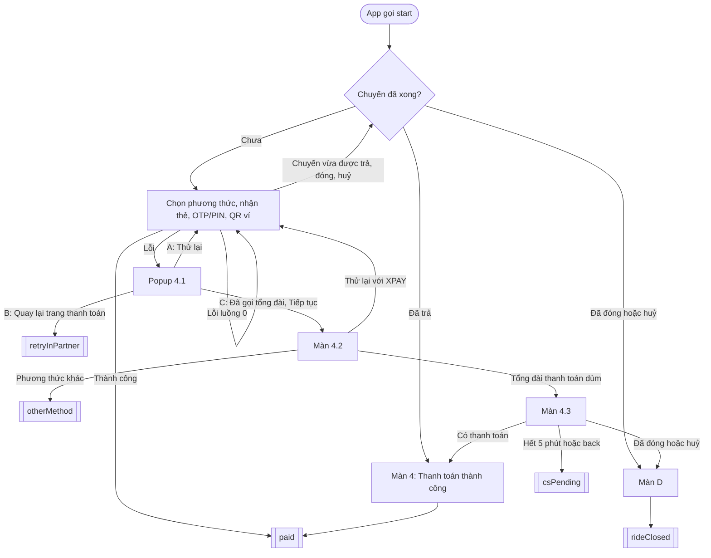

# XPAY Payment SDK — Thanh toán không thành công

Tài liệu nghiệp vụ cho đội mobile, backend và vận hành của đối tác: khi thanh toán qua XPAY không thành công thì SDK làm gì, tài xế thấy gì, kết quả trả về app là gì, và app, server đối tác phải làm gì tiếp theo.

Áp dụng cho Flutter, Android native và iOS native, từ bản SDK 3.1128.1. Tài liệu này thay cho `failure_categories.vi.md`: SDK không còn trả `failureCategory`, `isRetryable` theo nhóm lỗi hay `message` để app tự hiện popup.

## Mục lục

1. [Tổng quan](#1-tổng-quan)
2. [Năm luồng xử lý](#2-năm-luồng-xử-lý)
3. [Các màn hình của SDK](#3-các-màn-hình-của-sdk)
4. [Kết quả trả về app](#4-kết-quả-trả-về-app)
5. [App đối tác làm gì với từng kết quả](#5-app-đối-tác-làm-gì-với-từng-kết-quả)
6. [Báo payment-failure từ server](#6-báo-payment-failure-từ-server)
7. [Giao dịch còn treo: void và huỷ QR](#7-giao-dịch-còn-treo-void-và-huỷ-qr)
8. [Mã lỗi theo luồng](#8-mã-lỗi-theo-luồng)
9. [Tình huống thường gặp](#9-tình-huống-thường-gặp)

## 1. Tổng quan

SDK tự xử lý mọi lỗi thanh toán trên màn hình của SDK: kiểm tra chuyến khi mở, thử lại, gợi ý gọi tổng đài, chờ tổng đài thanh toán dùm. Khi SDK đóng, app chỉ nhận **một** kết quả cuối và rẽ nhánh theo `status`.

| SDK đảm nhận                                                                           | App và server đối tác đảm nhận                                               |
| -------------------------------------------------------------------------------------- | ---------------------------------------------------------------------------- |
| Kiểm tra trạng thái chuyến mỗi lần mở (`GET /merchant/ride-payment`)                   | Màn thanh toán của app (màn 0), nơi tài xế chọn XPAY, tiền mặt hay cách khác |
| Tự thử lại lỗi tạm thời, xin phiên mới qua `fetchSession` khi phiên hết hạn            | Xin phiên thanh toán (`payment-session`) và đưa xuống app                    |
| Popup lỗi 4.1, màn 4.2 chọn cách thanh toán tiếp, màn 4.3 chờ tổng đài, màn 4 và màn D | Màn thanh toán thành công của app (5.1)                                      |
| Hiện số tổng đài XPAY và mã chuyến trên popup, chạm số để gọi                          | Báo `payment-failure` khi tài xế ở lại màn 0 mà chưa thu được bằng XPAY      |
| Huỷ mã QR ví đang hiện trước khi đóng                                                  | Void giao dịch còn chờ mã (`pendingAuthId`), thu tiền mặt theo quy trình     |

Tổng đài XPAY: **1900 2189**, có sẵn trong SDK (`XPayPayment.supportHotline` trên Flutter và iOS, `XPayPayment.SUPPORT_HOTLINE` trên Android).



## 2. Năm luồng xử lý

Mỗi lỗi rơi vào đúng một luồng. Luồng 0 và D không hiện popup 4.1.

| Luồng                 | Khi nào                                                                                                                                                           | Tài xế thấy                                                                                                               | SDK đóng với                           |
| --------------------- | ----------------------------------------------------------------------------------------------------------------------------------------------------------------- | ------------------------------------------------------------------------------------------------------------------------- | -------------------------------------- |
| 0 — SDK tự xử lý      | Mất mạng ngắn, máy chủ lỗi tạm thời, bị giới hạn tần suất, giao dịch đang xử lý, phiên hết hạn (khi app truyền `fetchSession`), nhập sai mã, chọn nhầm màn thẻ/ví | Loading lâu hơn một chút, hoặc lỗi báo ngay trên màn nhập mã                                                              | Không đóng                             |
| A — Thử lại trong SDK | Thẻ hoặc mã của khách không dùng được: không đủ số dư, thẻ khoá, hết hạn, vượt hạn mức, sai mã quá số lần, quét sai, QR ví hết hạn                                | Popup 4.1, nút "Thử lại" về màn chọn phương thức để đổi thẻ hoặc cách thu. **3 lần thất bại liên tiếp thì chuyển sang C** | Không đóng                             |
| B — Thử lại ở app     | Phiên thanh toán hỏng hoặc không xin lại được, cước vừa đổi, lỗi tích hợp                                                                                         | Popup 4.1, nút "Quay lại trang thanh toán"                                                                                | `retryInPartner`                       |
| C — Gọi tổng đài      | Lỗi hệ thống, mất kết nối kéo dài, chính sách hoặc ngân sách công ty, ví từ chối, hết 3 lần ở luồng A                                                             | Popup 4.1, nút "Tiếp tục" khoá tới khi tài xế tick "Tôi đã gọi và xác nhận với tổng đài", rồi sang màn 4.2                | `otherMethod`, `csPending`, hoặc như D |
| D — Chuyến đã xong    | Chuyến đã được trả (thường là tổng đài trả dùm), đã đóng không thu, hoặc đã huỷ                                                                                   | Màn 4 hoặc màn D, không phải lỗi                                                                                          | `paid` hoặc `rideClosed`               |

## 3. Các màn hình của SDK

### Kiểm tra chuyến khi mở

Mỗi lần `start`, kể cả khi mở lại XPAY sau khi app bị tắt, SDK hiện "Đang kiểm tra trạng thái chuyến" và gọi `GET /merchant/ride-payment` (tối đa 15 giây):

1. Chuyến đã có thanh toán: vào thẳng màn 4.
2. Chuyến đã đóng không thu, hoặc đã huỷ: vào màn D.
3. Chuyến chưa ai trả, hoặc không kiểm tra được (mất mạng, máy chủ lỗi): vào màn chọn phương thức như bình thường.

Bấm back trong lúc kiểm tra thì SDK đóng với `cancelled`.

### Popup 4.1 — Thanh toán không thành công

1. Hiện lý do lỗi, mã chuyến (`XP-…`) để tài xế đọc cho tổng đài, và dòng "Tổng đài XPAY" kèm số 1900 2189.
2. Chạm số tổng đài thì mở ứng dụng gọi điện với số điền sẵn. Máy không gọi được (máy tính bảng không SIM, máy ảo) thì SDK sao chép số và hiện "Đã sao chép số tổng đài. Dán vào ứng dụng gọi điện để gọi."
3. Chạm ra ngoài hoặc bấm back không đóng popup.
4. Nút theo luồng: "Thử lại" (A), "Quay lại trang thanh toán" (B), ô tick và "Tiếp tục" (C).

### Màn 4.2 — Thanh toán chưa thành công

"Hãy chọn cách thanh toán tiếp theo như đã thống nhất với tổng đài." với 3 lựa chọn:

1. **Thử lại với XPAY:** về màn chọn phương thức. Nếu trước đó ví công ty từ chối, SDK về đúng ô nhập mã của giao dịch ví cũ, mã cũ vẫn dùng được và không gửi mã mới.
2. **Thử lại với phương thức thanh toán khác:** SDK đóng với `otherMethod`. Bấm back ở màn này cũng vậy.
3. **Tổng đài thanh toán dùm:** sang màn 4.3.

### Màn 4.3 — Đang chờ tổng đài thanh toán

Màn có đồng hồ đếm ngược 5 phút và số tiền cần thu. SDK kiểm tra chuyến mỗi 5 giây, giãn dần tới 15 giây:

1. Tổng đài đã thanh toán: sang màn 4.
2. Tổng đài đóng chuyến không thu, hoặc chuyến bị huỷ: sang màn D.
3. Hết 5 phút, hoặc tài xế bấm back: SDK đóng với `csPending`. Hết giờ **không** có nghĩa là thất bại: tổng đài vẫn có thể thanh toán sau đó.

### Màn 4 — Thanh toán thành công

Hiện số tiền đã thu theo XPAY (tổng đài có thể trừ số khác số đã khoá trong phiên) và dòng "Tổng đài đã thanh toán" khi tổng đài trả dùm. Màn tự đóng sau 3 giây với `paid`.

### Màn D — Chuyến đã đóng hoặc đã huỷ

1. "Tổng đài đã đóng chuyến, không thu": tổng đài đóng chuyến mà không trừ tiền của khách.
2. "Chuyến đã huỷ": chuyến bị huỷ hoặc đã chuyển sang hãng khác.

Bấm "Quay lại" thì SDK đóng với `rideClosed`. Không thu thêm tiền của khách.

### Khi rời SDK giữa chừng

1. Đang hiện mã QR ví: SDK huỷ mã với XPAY trước rồi mới đóng, để khách không quét được mã cũ.
2. Giao dịch thẻ đang chờ OTP/PIN: phiên không void được giao dịch, nên SDK trả `pendingAuthId` để server đối tác void, xem [mục 7](#7-giao-dịch-còn-treo-void-và-huỷ-qr).
3. Trong lúc XPAY đang authorize thẻ hoặc xác thực mã, nút back bị vô hiệu hoá.
4. App tự đóng màn hình SDK: SDK không hiện thêm màn nào và trả kết quả theo chỗ đang đứng. Đang ở màn 4.2 thì `otherMethod`, màn 4.3 thì `csPending`, màn 4 thì `paid`, màn D thì `rideClosed`, còn lại là `cancelled`. Nếu lúc đó XPAY đang authorize thẻ hoặc xác thực mã, SDK chờ kết quả rồi mới trả: thành công thì `paid`, chuyến vừa được trả, đóng hoặc huỷ thì `paid` hoặc `rideClosed`, bị từ chối hoặc lỗi thì `cancelled` (kèm `pendingAuthId` nếu còn giao dịch chờ mã).

## 4. Kết quả trả về app

`XPayPaymentResult` có các trường sau. Tên giá trị trên Android viết hoa có gạch dưới (`RETRY_IN_PARTNER`, `PAYMENT_DECLINED`…).

| Trường              | Kiểu                  | Ý nghĩa                                                                                                                        |
| ------------------- | --------------------- | ------------------------------------------------------------------------------------------------------------------------------ |
| `status`            | `XPayPaymentStatus`   | `paid`, `retryInPartner`, `otherMethod`, `csPending`, `rideClosed`, `cancelled`, `unavailable`                                 |
| `isRetryable`       | `bool`                | `true` với `retryInPartner` và `cancelled`: app được mở lại XPAY ngay. `false` với các trạng thái còn lại                      |
| `isSuccessful`      | `bool`                | `true` khi `status` là `paid`                                                                                                  |
| `failure`           | `XPayPaymentFailure?` | Lý do XPAY không thu được, có với `retryInPartner`, `otherMethod`, `csPending`, `unavailable`                                  |
| `failure.reason`    | `XPayFailureReason`   | `paymentDeclined`, `sdkError`, `other`. Server gửi nguyên văn vào `payment-failure` (`payment_declined`, `sdk_error`, `other`) |
| `failure.authId`    | `String?`             | Giao dịch thẻ bị từ chối gần nhất. Chuyến ví không có                                                                          |
| `failure.errorCode` | `String?`             | Mã lỗi gốc (mã từ chối hoặc mã API), dùng để tra cứu và đối soát                                                               |
| `failure.note`      | `String?`             | Ghi chú cho tổng đài: `cước đổi`, `chờ tổng đài quá 5 phút`, hoặc mã lỗi khi `reason` là `sdkError`                            |
| `pendingAuthId`     | `String?`             | Giao dịch thẻ còn chờ mã khi SDK đóng. Server đối tác void trước khi thu cách khác                                             |
| `paidBy`            | `XPayPaidBy?`         | Với `paid`: `partner` (thu tại xe qua SDK) hoặc `cs` (tổng đài trả dùm)                                                        |
| `rideStatus`        | `XPayRideStatus?`     | Với `rideClosed`: `completed` (đã đóng, không thu) hoặc `cancelled` (đã huỷ)                                                   |
| `authId`            | `String?`             | Với `paid`: mã giao dịch thẻ. `null` khi trả bằng ví doanh nghiệp                                                              |
| `captureId`         | `String?`             | Với `paid`: mã capture, nếu có                                                                                                 |
| `externalRef`       | `String?`             | Với `paid`: mã chuyến `XP-…`                                                                                                   |
| `amount`            | `int?`                | Với `paid`: số tiền XPAY đã thu, có thể khác số đã khoá khi tổng đài trả dùm                                                   |
| `currency`          | `String?`             | Với `paid`: mã tiền tệ                                                                                                         |
| `createdAt`         | `DateTime?`           | Với `paid`: thời điểm XPAY ghi nhận, nếu có                                                                                    |
| `errorCode`         | `String?`             | Với `unavailable`: mã lỗi của SDK, xem bảng dưới                                                                               |

Mã lỗi của SDK khi `status` là `unavailable`:

| Mã                        | Nguyên nhân                                                                                       |
| ------------------------- | ------------------------------------------------------------------------------------------------- |
| `sdk_not_initialized`     | Gọi `start` trước khi `initialize` hoàn tất                                                       |
| `sdk_busy`                | Gọi `start` khi một thanh toán khác chưa kết thúc                                                 |
| `sdk_invalid_request`     | JSON phiên không đọc được. Chưa gửi gì lên XPAY                                                   |
| `sdk_unsupported`         | Không phương thức nào của phiên chạy được trên thiết bị (ví dụ phiên chỉ có `chip_tap`, trên iOS) |
| `sdk_unexpected_response` | Phần native không nhận được kết quả hợp lệ từ SDK                                                 |
| `sdk_result_lost`         | Chỉ Android: hệ điều hành đã dừng app trong lúc SDK mở, kết quả bị mất                            |
| `sdk_presentation_failed` | Chỉ iOS: không hiện được màn hình SDK từ view controller đã truyền                                |

`sdk_session_amount_changed` không phải lỗi `unavailable`: đó là `failure.errorCode` của `retryInPartner` khi `fetchSession` trả về phiên có cước khác.

## 5. App đối tác làm gì với từng kết quả

| `status`         | SDK đóng ở                                                                                          | `isRetryable` | App đối tác nên                                                                                                                                   | Báo `payment-failure`                         |
| ---------------- | --------------------------------------------------------------------------------------------------- | ------------- | ------------------------------------------------------------------------------------------------------------------------------------------------- | --------------------------------------------- |
| `paid`           | Màn 4                                                                                               | `false`       | Hiện màn thành công (5.1). Xác nhận với backend bằng `externalRef`                                                                                | Không                                         |
| `retryInPartner` | Popup 4.1 luồng B, "Quay lại trang thanh toán"                                                      | `true`        | Về màn thanh toán, cho tài xế mở lại XPAY bằng **phiên mới**. `note = cước đổi` thì hiện lại số tiền mới trước khi mở                             | Chỉ khi tài xế ở lại màn 0, không mở lại XPAY |
| `otherMethod`    | Màn 4.2, "Thử lại với phương thức thanh toán khác"                                                  | `false`       | Void `pendingAuthId` nếu có, rồi về màn thanh toán để chọn cách khác                                                                              | Có                                            |
| `csPending`      | Màn 4.3, hết 5 phút hoặc back                                                                       | `false`       | **Không thu cách khác ngay.** Hỏi tổng đài trước. Thu tiền mặt thì báo `paid_cash` trước khi nhận tiền; nhận `409 ride_already_paid` thì hiện 5.1 | Có                                            |
| `rideClosed`     | Màn D                                                                                               | `false`       | Không thu thêm. Cập nhật chuyến theo `rideStatus`                                                                                                 | Không                                         |
| `cancelled`      | Tài xế thoát trước khi có kết quả (back ở màn chọn phương thức, rời màn OTP/PIN), hoặc app đóng SDK | `true`        | Về màn thanh toán. Void `pendingAuthId` nếu có. Có thể mở lại XPAY                                                                                | Chỉ khi tài xế ở lại màn 0, không mở lại XPAY |
| `unavailable`    | SDK không mở được                                                                                   | `false`       | Xem `errorCode`: sửa tích hợp, hoặc để tài xế chọn cách khác                                                                                      | Khi tài xế ở lại màn 0                        |

Quy tắc chung:

1. **Mở lại XPAY luôn dùng phiên mới.** Backend gọi lại `POST /merchant/rides/{order_id}/payment-session` (phiên cũ bị thu hồi) rồi app truyền nguyên phản hồi mới vào `start`. Không giới hạn số lần mở lại.
2. **Có `pendingAuthId` thì void trước khi thu cách khác**, nếu không `paid_cash` bị từ chối với `409 ride_payment_pending`.
3. **Không tự hiện popup lỗi thứ hai.** Tài xế đã thấy lý do và số tổng đài trên popup 4.1; app chỉ cần đưa tài xế về màn thanh toán.
4. **Lưu kết quả** (`status`, `failure`, `pendingAuthId`, thời điểm) cùng chuyến trên backend đối tác, làm căn cứ khi xử lý khiếu nại và đối soát.

## 6. Báo payment-failure từ server

Mỗi lần SDK đóng mà tài xế ở lại màn thanh toán của app và chưa thu được bằng XPAY, **server** đối tác gọi:

```http
POST /merchant/rides/{order_id}/payment-failure
X-Merchant-Key: <merchant key cha>
Content-Type: application/json

{
  "reason": "payment_declined",
  "amount": "138000",
  "sub_fee": 10000,
  "distance_km": 9.4,
  "auth_id": "68e1f831-…",
  "note": "chờ tổng đài quá 5 phút"
}
```

Chỉ merchant key cha gọi được (`403 parent_key_required` với key khác). Chuyến giữ mở, tổng đài XPAY thấy cảnh báo và xử lý. Báo nhiều lần thì tổng đài thấy nhiều dòng.

| Trường        | Bắt buộc | Giá trị                                                                                 |
| ------------- | -------- | --------------------------------------------------------------------------------------- |
| `reason`      | Có       | Chọn theo hai bước bên dưới                                                             |
| `amount`      | Có       | Chuỗi số tiền VND khách phải trả (`fare` + `sub_fee`). Với `paid_cash`: số khách đã trả |
| `sub_fee`     | Không    | Phụ phí nằm trong `amount` (cầu đường, bến bãi…)                                        |
| `distance_km` | Không    | Quãng đường thực tế                                                                     |
| `auth_id`     | Không    | `failure.authId`, khi có. Phải là giao dịch của chuyến này, nếu không trả `404`         |
| `note`        | Không    | `failure.note`, hoặc ghi chú của tài xế cho tổng đài. Tối đa 500 ký tự                  |

### Chọn `reason`

Bước 1, do app đối tác quyết theo chuyện xảy ra ở màn thanh toán:

| Cuối cùng ở màn 0                                                         | `reason`           | Gửi kèm                                                                                     |
| ------------------------------------------------------------------------- | ------------------ | ------------------------------------------------------------------------------------------- |
| Khách trả tiền mặt, hoặc cách khác ngoài XPAY (thẻ ngân hàng, ví điện tử) | `paid_cash`        | `amount` là số khách trả; `note` ghi cách trả nếu không phải tiền mặt. Chuyến hoàn tất ngay |
| Khách không chịu trả                                                      | `customer_refused` | `note`. Chuyến giữ mở cho tổng đài                                                          |
| Chưa thu được, để tổng đài xử lý                                          | Theo bước 2        | Chuyến giữ mở cho tổng đài                                                                  |

Bước 2, khi chưa thu được gì: gửi nguyên `failure.reason`, `failure.authId` và `failure.note` của kết quả.

| SDK đóng vì                                                                 | `failure.reason`   | `failure.authId`, `failure.note`                                                   |
| --------------------------------------------------------------------------- | ------------------ | ---------------------------------------------------------------------------------- |
| 4.3 hết 5 phút hoặc back (`csPending`)                                      | `payment_declined` | Giao dịch thẻ bị từ chối gần nhất (chuyến ví: không có); `chờ tổng đài quá 5 phút` |
| 4.2 "Phương thức khác", trước đó thẻ hoặc ví bị từ chối, hoặc hết 3 lần thử | `payment_declined` | Giao dịch thẻ bị từ chối gần nhất                                                  |
| 4.2 "Phương thức khác", trước đó lỗi hệ thống                               | `sdk_error`        | `note` là mã lỗi                                                                   |
| 4.1 "Quay lại trang thanh toán", phiên hỏng hoặc lỗi tích hợp               | `sdk_error`        | `note` là mã lỗi                                                                   |
| 4.1 "Quay lại trang thanh toán", cước vừa đổi                               | `other`            | `cước đổi`                                                                         |
| SDK không mở được (`unavailable`)                                           | `sdk_error`        | `note` là mã lỗi SDK                                                               |
| Tài xế thoát XPAY (`cancelled`)                                             | Không có `failure` | Gửi `other`, `note` mô tả chuyện xảy ra                                            |

Không báo khi `paid`, `rideClosed`, và khi app mở lại XPAY sau `retryInPartner` hoặc `cancelled`.

### Thu tiền mặt: báo trước, nhận tiền sau

Khách muốn trả tiền mặt ở màn 0 thì server báo `reason: "paid_cash"` **trước khi** tài xế nhận tiền:

1. `200`: chuyến hoàn tất ở số tiền đó (`ride_status: "completed"`, `final_fare`), tổng đài không trừ thẻ được nữa. Tài xế nhận tiền. Không trừ thẻ, không trừ ví công ty. Gửi lại cùng số tiền thì nhận lại đúng kết quả cũ.
2. `409 ride_payment_pending`: còn giao dịch chờ mã (`details.auth_id`) hoặc mã QR chưa xác nhận (`details.intent_id`). Dọn theo [mục 7](#7-giao-dịch-còn-treo-void-và-huỷ-qr) rồi báo lại.
3. `409 ride_already_paid`: chuyến đã có người trả, thường là tổng đài trừ thẻ trong lúc chờ. **Không nhận tiền mặt**; đã nhận thì trả lại khách. Hiện màn thành công 5.1.
4. `404 ride_not_found`: không có chuyến này của merchant, hoặc chuyến đã huỷ.

XPAY khoá theo chuyến: tổng đài trừ thẻ và `paid_cash` không thể cùng thành công.

## 7. Giao dịch còn treo: void và huỷ QR

| Còn treo                          | Có trong                                                               | Cách dọn                                                                                                      |
| --------------------------------- | ---------------------------------------------------------------------- | ------------------------------------------------------------------------------------------------------------- |
| Giao dịch thẻ đang chờ OTP/PIN    | `pendingAuthId`, hoặc `details.auth_id` của `409 ride_payment_pending` | Server gọi `POST /merchant/payments/{auth_id}/void` bằng merchant key, hoặc chờ tự hết hạn sau khoảng 10 phút |
| Mã QR ví chưa được khách xác nhận | `details.intent_id` của `409 ride_payment_pending`                     | `POST /merchant/payment-intents/{intent_id}/cancel`. SDK đã tự huỷ mã QR khi đóng bình thường                 |

## 8. Mã lỗi theo luồng

Bảng tra cứu cho đội vận hành và hỗ trợ. App không cần đọc các mã này: SDK đã chọn luồng và câu thông báo. Mã từ chối lấy từ `decline_reason` của giao dịch, mã API lấy từ `code` của response lỗi; cả hai nằm trong `failure.errorCode`.

| Luồng | Mã                                                                                                                                                                                                                                                                                                                                                                                                                                                                                                                                                                                                                                                                                                                                                                                                         |
| ----- | ---------------------------------------------------------------------------------------------------------------------------------------------------------------------------------------------------------------------------------------------------------------------------------------------------------------------------------------------------------------------------------------------------------------------------------------------------------------------------------------------------------------------------------------------------------------------------------------------------------------------------------------------------------------------------------------------------------------------------------------------------------------------------------------------------------- |
| 0     | Timeout, mất kết nối, HTTP 5xx, `429`, `request_in_flight`: tự gửi lại tối đa 3 lần. `service_payment_in_flight`: authorize lại tối đa 3 lần. `corporate_wallet_unavailable`: gửi lại mã thêm 2 lần. `ride_payment_session_expired`: gọi `fetchSession`. Mã OTP/PIN sai, hết hạn, `otp_not_pending`, gửi mã quá nhiều lần: báo trên màn nhập mã. `ride_on_corporate_wallet`, `ride_not_on_corporate_wallet`: chuyển sang màn ví hoặc màn thẻ                                                                                                                                                                                                                                                                                                                                                               |
| A     | `insufficient_funds`, `card_inactive`, `card_blocked`, `card_expired`, `card_outside_validity_window`, `card_link_inactive`, `per_transaction_limit_exceeded`, `daily_limit_exceeded`, `monthly_limit_exceeded`, `merchant_not_allowed`, `mcc_not_allowed`, `channel_not_allowed`, `velocity_limit_exceeded`, `token_invalid_or_expired`, `verification_code_required`, `verification_code_invalid`, `verification_expired`, `otp_expired`, `card_locked_too_many_attempts`, `chip_cryptogram_invalid`, `chip_nonce_replayed`, `chip_counter_replay`, `chip_credential_revoked`, `chip_credential_not_active`, `service_payment_insufficient_funds`, `not_found`, `ride_card_not_found`, `no_registered_phone`, `static_code_unavailable`, `otp_delivery_failed`, `resend_limit_reached`; mã QR ví hết hạn |
| B     | `ride_payment_session_revoked`, `409 amount_locked`, `sdk_session_amount_changed` (cước đổi); `ride_payment_session_invalid`; `ride_payment_session_expired` khi không có `fetchSession` hoặc `fetchSession` lỗi; `422 amount_locked`, `validation_failed`, `unsupported_entry_mode`, `idempotency_conflict`, `forbidden_sub_account_allocation` (lỗi tích hợp)                                                                                                                                                                                                                                                                                                                                                                                                                                            |
| C     | `corporate_monthly_limit_exceeded`, `trip_budget_exceeded`, `policy_violation`, `employee_policy_violation`, `employee_policy_unavailable`, `service_payment_declined`, `service_payment_user_invalid`, `service_payment_duplicate_order`, `service_payment_auth_failed`, `service_payment_invalid_request`, `service_payment_failed`, `service_payment_unavailable`, `corporate_wallet_refused`, `corporate_wallet_unavailable` (sau khi gửi lại), `unauthorized`, các mã từ chối chưa biết, mọi lỗi hệ thống còn lại, 3 lần thất bại liên tiếp ở luồng A                                                                                                                                                                                                                                                 |
| D     | `ride_already_paid`, `ride_not_found`, `verification_not_pending` (SDK kiểm tra lại chuyến hoặc giao dịch rồi vào màn 4, màn D, hoặc kết quả của giao dịch)                                                                                                                                                                                                                                                                                                                                                                                                                                                                                                                                                                                                                                                |

## 9. Tình huống thường gặp

| Tình huống                                                              | SDK                                                               | Tài xế và app đối tác                                                                                                                            |
| ----------------------------------------------------------------------- | ----------------------------------------------------------------- | ------------------------------------------------------------------------------------------------------------------------------------------------ |
| Thẻ không đủ số dư, bị khoá hoặc hết hạn                                | Luồng A: "Thử lại" để khách đổi thẻ hoặc cách thu                 | Khách đưa thẻ khác. Sau 3 lần vẫn lỗi, SDK chuyển sang gọi tổng đài                                                                              |
| Khách không có thẻ khác và không chịu trả tiền mặt                      | Luồng C sau 3 lần                                                 | Tài xế gọi tổng đài. Tổng đài kiểm tra với doanh nghiệp rồi thanh toán dùm, hoặc thống nhất cách khác. Không thu được thì báo `customer_refused` |
| XPAY gián đoạn, không gửi được mã                                       | Luồng 0 tự thử lại, rồi luồng C                                   | **Không thu tiền mặt trước khi gọi tổng đài.** Tổng đài thanh toán dùm khi cần. Không quy lỗi cho khách hay tài xế                               |
| Máy tài xế mất mạng                                                     | Luồng 0 tự thử lại; vẫn lỗi thì luồng C "Không kết nối được XPAY" | Khôi phục kết nối, mở lại XPAY. Không yêu cầu khách trả tiền mặt vì lỗi này                                                                      |
| Chính sách hoặc ngân sách công ty từ chối, ví công ty từ chối           | Luồng C                                                           | Tổng đài làm việc với doanh nghiệp. Doanh nghiệp không điều chỉnh thì khách trả cách khác (`otherMethod`, rồi `paid_cash`)                       |
| Tổng đài đã trả dùm trong lúc tài xế còn ở popup hoặc màn 4.2           | Bấm "Thử lại với XPAY" thì vào màn 4 với số tiền tổng đài đã trừ  | `paid`, `paidBy = cs`. Không thu thêm                                                                                                            |
| Cước đổi trong lúc đang thanh toán (backend mở phiên mới với cước khác) | Luồng B "Cước đã được cập nhật…"                                  | `retryInPartner`, `note = cước đổi`. Hiện số tiền mới rồi mở lại XPAY bằng phiên mới                                                             |
| Hết 5 phút chờ tổng đài, khách đòi trả tiền mặt                         | `csPending`                                                       | Hỏi tổng đài. Báo `paid_cash` trước khi nhận tiền; `409 ride_already_paid` nghĩa là tổng đài đã trừ thẻ, không nhận tiền mặt                     |
