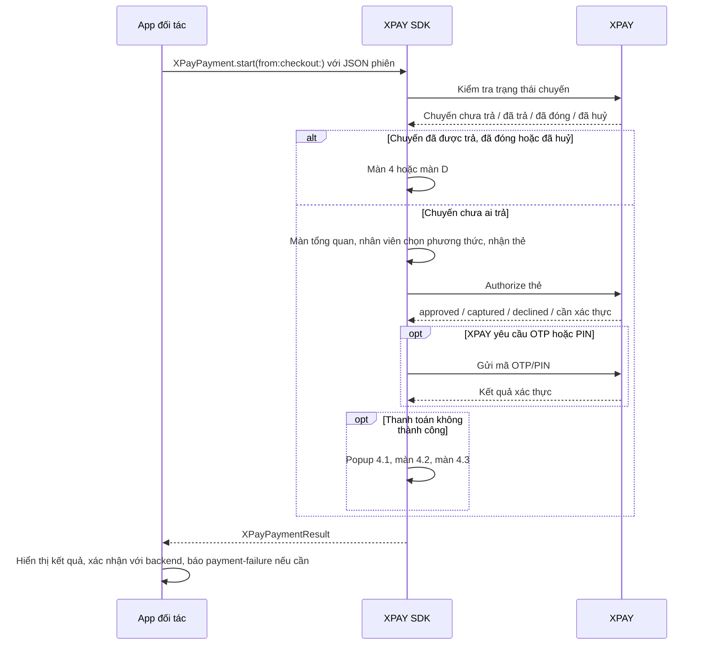

# XPAY Payment SDK cho iOS native — Tài liệu tích hợp

Phiên bản SDK 3.1128.1

SDK giúp app iOS (Swift) của đối tác thu tiền bằng thẻ XPAY. SDK đảm nhận toàn bộ phần thẻ trong quy trình thanh toán: đọc thẻ (quét QR hoặc nhập số thẻ), gửi yêu cầu authorize lên XPAY,
hiển thị bước xác thực OTP/PIN khi XPAY yêu cầu, rồi trả về cho app **đúng một kết quả**.

Mỗi lần thanh toán, app đưa cho SDK **phản hồi của phiên thanh toán** (do backend đối tác xin từ XPAY). Số tiền bị khoá khi backend xin phiên, và SDK thu đúng số tiền đó (xem [mục 5](#5-mã-phiên-thanh-toán)).

Tài liệu dành cho đội mobile của đối tác dùng iOS native. App Android native xem [android_integration.vi.md](android_integration.vi.md). App viết bằng Flutter xem [README.vi.md](../README.vi.md).

## Mục lục

1. [SDK làm gì](#1-sdk-làm-gì)
2. [Yêu cầu hệ thống](#2-yêu-cầu-hệ-thống)
3. [Cài đặt](#3-cài-đặt)
4. [Cấu hình iOS](#4-cấu-hình-ios)
5. [Mã phiên thanh toán](#5-mã-phiên-thanh-toán)
6. [Khởi tạo SDK](#6-khởi-tạo-sdk)
7. [Thực hiện một thanh toán](#7-thực-hiện-một-thanh-toán)
8. [API reference](#8-api-reference)
9. [Kết quả và cách xử lý](#9-kết-quả-và-cách-xử-lý)
10. [Mã lỗi](#10-mã-lỗi)
11. [Thử lại và chống trừ tiền hai lần](#11-thử-lại-và-chống-trừ-tiền-hai-lần)
12. [Xác nhận thanh toán từ backend](#12-xác-nhận-thanh-toán-từ-backend)
13. [Logging](#13-logging)
14. [Bảo mật](#14-bảo-mật)
15. [Giới hạn hiện tại](#15-giới-hạn-hiện-tại)
16. [Câu hỏi thường gặp](#16-câu-hỏi-thường-gặp)

---

## 1. SDK làm gì

| SDK đảm nhận                                                                       | App đối tác đảm nhận                                                                                    |
| ---------------------------------------------------------------------------------- | ------------------------------------------------------------------------------------------------------- |
| Kiểm tra trạng thái chuyến mỗi lần mở                                              | Đặt "Thẻ XPAY" vào danh sách phương thức thanh toán của app và khởi động module XPAY khi nhân viên chọn |
| Màn tổng quan & chọn phương thức, màn nhập số thẻ, quét mã QR, xác thực PIN/OTP    | Nhập cước, xin phiên thanh toán cho từng lần thanh toán và đưa cho SDK nguyên phản hồi của phiên        |
| Gửi yêu cầu authorize lên XPAY                                                     | Màn thanh toán thành công của app, điều hướng, cập nhật dữ liệu của app                                 |
| Popup thanh toán không thành công, màn chọn cách thanh toán tiếp, màn chờ tổng đài | Báo `payment-failure` từ server, void giao dịch còn treo, thu tiền mặt                                  |
| Màn "Thanh toán thành công" khi chuyến đã được trả, màn chuyến đã đóng hoặc đã huỷ |                                                                                                         |
| Trả về đúng một kết quả cho mỗi lần thanh toán                                     |                                                                                                         |

SDK hiện lỗi và các màn xử lý lỗi của mình, nhưng **không** thay màn thanh toán thành công của app: khi có kết quả, SDK đóng màn hình của mình và trả kết quả về cho app. App tự hiển thị dựa trên kết quả đó.

App đối tác không chọn phương thức. Màn đầu tiên của SDK hiện số tiền, thông tin chuyến (mã cuốc, điểm đón, điểm trả, biển số xe) và các phương thức theo đúng thứ tự `entry_modes` trong phản hồi của phiên. Nhân viên chọn một:

| Giá trị `entry_modes` | Nhân viên làm gì                                                                    | iOS   |
| --------------------- | ----------------------------------------------------------------------------------- | ----- |
| `ride_card`           | Thu bằng thẻ đã liên kết của chuyến (hiện tên thẻ và 4 số cuối), không cần nhập thẻ | Có    |
| `card_qr`             | Quét mã QR in trên thẻ XPAY, hoặc chọn ảnh QR từ thư viện                           | Có    |
| `manual_pan`          | Nhập số thẻ                                                                         | Có    |
| `chip_tap`            | Chạm thẻ chip XPAY của khách vào điện thoại                                         | Không |
| `token`               | Quét mã thanh toán dùng một lần trên ứng dụng XPERISE                               | Có    |

Thẻ chip XPAY là MIFARE Classic, và iOS không cho app truy cập thẻ MIFARE Classic. Vì vậy SDK không bao giờ hiện `chip_tap` trên iOS. Phiên chỉ có `chip_tap` thì thanh toán trả `unsupported`
mà không mở màn hình nào.

Chọn `card_qr` thì chỉ nhận QR thẻ, chọn `token` thì chỉ nhận mã dùng một lần.

### Chuyến thanh toán bằng ví doanh nghiệp

Khi `payment_method` của phiên là `corporate_wallet`, chuyến được trả bằng ví doanh nghiệp của khách. Màn đầu tiên vẫn hiện số tiền và thông tin chuyến, nhưng thay danh sách phương thức thẻ bằng:

| Phương thức                       | Diễn ra thế nào                                                                                                                                       |
| --------------------------------- | ----------------------------------------------------------------------------------------------------------------------------------------------------- |
| Hiển thị mã QR                    | SDK hiện mã QR cho đúng số tiền đã khoá. Khách quét bằng ứng dụng XPERISE và thanh toán. SDK kiểm tra mỗi 3 giây, trả kết quả ngay khi khách trả xong |
| Gửi mã qua SMS / Gửi mã qua email | Mỗi người đi × mỗi kênh XPAY có thông tin là một dòng, người đặt chuyến đứng đầu. SDK gửi mã 6 số; nhân viên nhập mã khách đọc                        |

1. Dòng "Hiển thị mã QR" luôn có. Các dòng gửi mã lấy từ XPAY: người không có số điện thoại thì không có dòng SMS, không có email thì không có dòng email. Không ai có thông tin thì chỉ còn mã QR.
2. Ở màn nhập mã, nhân viên có thể gửi lại mã (40 giây sau lần gửi trước), và bấm **Đổi** để chuyển sang số điện thoại hoặc email khác.
3. Quay lại từ màn nhập mã thì về danh sách phương thức. Quay lại từ màn QR thì SDK huỷ mã QR với XPAY trước, rồi mới về danh sách phương thức. Nếu XPAY chưa xác nhận đã huỷ, SDK giữ nguyên màn QR và báo lỗi, vì khách vẫn có thể quét mã đó; quay lại lần nữa để thử lại.
4. Mã sai, mã hết hạn hoặc nhập sai quá số lần được báo ngay trên màn nhập mã, thanh toán không kết thúc. Nhân viên gửi mã mới rồi tiếp tục.
5. Phiên ví doanh nghiệp không cần `entry_modes`, và luôn mở được vì mã QR và gửi mã không phụ thuộc phần cứng.

## 2. Yêu cầu hệ thống

| Thành phần | Tối thiểu |
| ---------- | --------- |
| iOS        | 15.0      |
| Xcode      | 27.2      |
| Swift      | 5.9       |

Lưu ý:

1. **Xcode:** các xcframework trong bộ SDK được build bằng Xcode 27.2, kèm `.swiftinterface`. Xcode cũ hơn bản build không đọc được giao diện module; Xcode mới hơn đọc được.
2. Bộ SDK là các framework động (dynamic). Xcode tự nhúng (embed) chúng vào app khi bạn thêm Swift package, không cần cấu hình thêm.
3. SDK mở một Flutter engine riêng cho màn thanh toán. App đã nhúng một Flutter framework khác (của bên thứ ba hoặc của chính bạn) thì **không** dùng chung được với bộ SDK này: liên hệ XPAY trước khi tích hợp.
4. **Không chạy trên iOS Simulator.** Bộ SDK là bản release của Flutter, chỉ chạy trên iPhone thật. App vẫn build được cho simulator, nhưng trên simulator `initialize` ném `XPayInitializationError` ("does not run on the iOS Simulator"). Kiểm thử SDK trên thiết bị thật; quét QR cũng cần camera.

## 3. Cài đặt

SDK được phát hành trên GitHub: <https://github.com/nggiahuy09/xpay-payment-sdk>. Mỗi bản có một tag dạng `v3.1128.1`, một mục trong [CHANGELOG.md](../CHANGELOG.md) và một bản Release. Số phiên bản **không** theo Semantic Versioning: đọc CHANGELOG trước khi nâng cấp để biết bản mới có thay đổi cần sửa code hay không.

XPAY gửi riêng cho bạn:

1. Base URL của môi trường sandbox, và production khi go-live.
2. Thẻ test cho môi trường sandbox.
3. `X-Merchant-Key` cho backend của bạn (không đưa vào app, xem [mục 5](#5-mã-phiên-thanh-toán)).

SDK được cài bằng Swift Package Manager, theo một trong hai cách. Cách A không cần tải file: Xcode tự tải SDK từ repo GitHub. Cách B dùng file zip trong trang Release, cho máy build không truy cập được GitHub.

**Cách A: URL của repo GitHub.**

1. Trong Xcode: **File → Add Package Dependencies…**, dán URL `https://github.com/nggiahuy09/xpay-payment-sdk` vào ô tìm kiếm.
2. Ở **Dependency Rule**, chọn **Exact Version** và nhập `3.1128.1`. Số phiên bản không theo Semantic Versioning, nên đừng chọn "Up to Next Major/Minor": Xcode có thể tự nâng lên một bản cần sửa code.
3. Thêm product `XPayPayment` vào target app.

Nếu project dùng `Package.swift` thay cho Xcode project:

```swift
dependencies: [
    .package(url: "https://github.com/nggiahuy09/xpay-payment-sdk", exact: "3.1128.1"),
],
targets: [
    .target(name: "MyApp", dependencies: [.product(name: "XPayPayment", package: "xpay-payment-sdk")]),
]
```

Xcode tải các xcframework (khoảng 75 MB) từ trang Release của đúng phiên bản và kiểm tra checksum của từng file; file bị sửa thì Xcode báo lỗi và không build. Nâng cấp: đổi số phiên bản ở **Package Dependencies** của project (hoặc trong `Package.swift`).

**Cách B: file zip.**

1. Tải `xpay-payment-sdk-ios-3.1128.1.zip` ở trang [Releases](https://github.com/nggiahuy09/xpay-payment-sdk/releases). Mã SHA-256 của file nằm trong ghi chú của Release. Kiểm tra trước khi dùng:

   ```bash
   shasum -a 256 xpay-payment-sdk-ios-3.1128.1.zip
   ```

   Kết quả phải trùng với mã trong ghi chú Release. Nếu XPAY gửi mã SHA-256 qua kênh riêng (email, chat), đối chiếu với mã đó.

2. Giải nén vào thư mục project, ví dụ thành `Vendor/XPayPayment/`. Thư mục này chứa `Package.swift` và các xcframework trong `Frameworks/`.
3. Trong Xcode: **File → Add Package Dependencies… → Add Local…**, chọn thư mục `XPayPayment`.
4. Ở hộp thoại tiếp theo, thêm product `XPayPayment` vào target app.

Nếu project dùng `Package.swift`:

```swift
dependencies: [
    .package(path: "Vendor/XPayPayment"),
],
targets: [
    .target(name: "MyApp", dependencies: [.product(name: "XPayPayment", package: "XPayPayment")]),
]
```

Nâng cấp với cách B: xoá thư mục `XPayPayment` cũ, giải nén bộ SDK mới vào cùng chỗ, rồi build lại (**Product → Clean Build Folder** nếu Xcode còn giữ framework cũ).

Hai cách cho cùng một bộ SDK. Trong code, chỉ cần một dòng import:

```swift
import XPayPayment
```

## 4. Cấu hình iOS

Thêm vào `Info.plist` của app:

```xml
<key>NSCameraUsageDescription</key>
<string>Ứng dụng cần quyền camera để quét mã QR thẻ XPAY khi thanh toán.</string>
<key>NSPhotoLibraryUsageDescription</key>
<string>Ứng dụng cần quyền truy cập ảnh để quét mã QR thẻ XPAY từ ảnh đã chụp.</string>
```

Thiếu `NSCameraUsageDescription`, iOS sẽ dừng app ngay khi màn quét QR xin quyền camera. Câu thông báo là của app bạn, có thể viết lại cho phù hợp.

Không cần entitlement NFC, vì SDK không dùng NFC trên iOS.

Đảm bảo **iOS Deployment Target** của target app từ 15.0 trở lên.

## 5. Mã phiên thanh toán

Mỗi lần thanh toán được xác thực bằng một **mã phiên** (session token) của chuyến, do **backend của đối tác** xin từ XPAY. SDK không bao giờ nhìn thấy merchant key hay bất kỳ secret dài hạn nào. App truyền nguyên phản hồi của phiên khi khởi động module; SDK tự lấy mã phiên trong đó và gửi kèm trong mọi request của lần thanh toán đó.

Luồng xin mã phiên:

1. Nhân viên nhập cước của chuyến trên app đối tác. App gửi `order_id` và cước cho backend.
2. Backend gọi `POST /merchant/rides/{order_id}/payment-session` bằng `X-Merchant-Key` (chỉ nằm trên server), body JSON gồm `amount` (chuỗi, bằng `fare` + `sub_fee`, tính bằng đồng), `fare` (số), tuỳ chọn `sub_fee` (số, mặc định 0) và `distance_km` (số).
3. XPAY trả `session_token` cùng `amount` đã khoá, `external_ref` (dạng `XP-…`) và dữ liệu chuyến. Token chỉ hiện một lần.
4. Backend chuyển **nguyên** body phản hồi xuống app, không cần tách field. App truyền nguyên chuỗi JSON đó vào `sessionJson` khi khởi động module. SDK tự đọc `session_token`, `amount`, `external_ref`, `payment_method` và `payment_template` (`currency`, `product_type`).

Quy tắc:

1. **Mã phiên dùng cho đúng một chuyến và hết hạn sau 15 phút.** Hết hạn giữa chừng thì SDK gọi `fetchSession` để lấy phiên mới, xem [Gia hạn phiên](#gia-hạn-phiên-fetchsession).
2. **Số tiền bị khoá theo phiên.** SDK thu đúng `amount` trong phản hồi của phiên. Muốn thu số tiền khác thì xin phiên mới; không sửa JSON trước khi đưa vào SDK.
3. **Mở phiên mới cho cùng một chuyến sẽ thu hồi các phiên trước.** Request dùng phiên cũ bị trả `ride_payment_session_revoked` (HTTP 401), SDK hiện popup "Cước đã được cập nhật" và trả `retryInPartner`. Chỉ xin phiên ngay trước khi thu tiền, và không xin phiên mới khi một thanh toán của chuyến đó còn đang mở (trừ trong `fetchSession`).
4. **Mã phiên bị XPAY từ chối** mà SDK không lấy được phiên mới (không có `fetchSession`, phiên không hợp lệ): SDK hiện popup "Không mở được phiên thanh toán" hoặc "Phiên thanh toán không hợp lệ" và trả `retryInPartner`. App xin mã phiên mới rồi mở lại XPAY.
5. **JSON không đọc được thì không thanh toán.** Chuỗi không phải JSON object, thiếu `session_token`, `amount` không phải số nguyên đồng (ví dụ `"138000.50"`), hoặc (với phiên thẻ) `entry_modes` không còn phương thức nào SDK biết thì SDK trả `unavailable` với `sdk_invalid_request` và không gửi gì lên XPAY. Lý do cụ thể được gửi qua `onLog` (`feature = payment`, `action = start_payment`, xem [mục 13](#13-logging)).
6. SDK chỉ giữ mã phiên trong bộ nhớ trong lúc thanh toán, không lưu xuống máy và không ghi log mã phiên.

### Gia hạn phiên: `fetchSession`

Phiên chỉ sống 15 phút, nên có thể hết hạn khi tài xế đang thao tác (khách tìm thẻ, chờ mã OTP). Truyền `fetchSession` vào `XPayCheckout` để SDK tự lấy phiên mới mà không làm gián đoạn thanh toán:

```swift
XPayCheckout(
    sessionJson: sessionJson,
    fetchSession: { [partnerBackend, order] in
        try await partnerBackend.openPaymentSession(orderId: order.id, fare: order.fare, subFee: order.subFee, distanceKm: order.distanceKm)
    }
)
```

1. Khi XPAY trả `401 ride_payment_session_expired`, SDK gọi `fetchSession` một lần, chờ tối đa 15 giây.
2. `fetchSession` gọi backend xin lại phiên cho **cùng chuyến, cùng cước** (`POST /merchant/rides/{order_id}/payment-session`) và trả về nguyên JSON phản hồi.
3. SDK gửi lại đúng request vừa bị từ chối, cùng body và cùng idempotency key, với phiên mới. Tài xế chỉ thấy loading lâu hơn một chút.
4. Phiên mới có cước khác: SDK hiện popup "Cước đã được cập nhật" và trả `retryInPartner` với `failure.errorCode = sdk_session_amount_changed`, `failure.note = cước đổi`.
5. `fetchSession` ném lỗi, quá 15 giây, hoặc trả phiên của chuyến khác: SDK hiện popup "Không mở được phiên thanh toán" và trả `retryInPartner` với `failure.reason = .sdkError`.
6. `fetchSession` chạy trên main actor (`@MainActor () async throws -> String`): dùng API `async` như `URLSession.data(for:)` để không chặn giao diện.

## 6. Khởi tạo SDK

Gọi `initialize` một lần trước lần thanh toán đầu tiên, ví dụ khi mở app hoặc sau khi nhân viên đăng nhập. Gọi lại khi cần đổi ngôn ngữ hoặc base URL. `initialize` là hàm `async throws`, chạy trên main actor:

```swift
Task { @MainActor in
    do {
        try await XPayPayment.initialize(
            config: XPayConfig(
                environment: XPayEnvironment(baseUrl: "https://<xpay api host>"),
                language: .vi,
                onLog: { event in myLogger.log(event.description) }
            )
        )
    } catch {
        myLogger.log("XPAY initialize failed: \(error.localizedDescription)")
    }
}
```

Lần gọi đầu tiên khởi động engine của SDK. Gọi sớm (khi mở app hoặc sau khi đăng nhập) để màn thanh toán mở ngay khi nhân viên cần.

Lưu ý khi gọi lại `initialize`:

1. Không gọi khi đang có một thanh toán mở (tức thanh toán chưa trả kết quả). Khi đó `initialize` ném `XPayInitializationError` và giữ nguyên cấu hình cũ.
2. Không gọi khi lần `initialize` trước chưa xong. Khi đó lần gọi sau ném `XPayInitializationError`, lần gọi trước vẫn chạy tiếp.
3. Trong lúc `initialize` đang chạy, thanh toán trả `unavailable` với `errorCode = sdk_not_initialized`. Luôn chờ `initialize` xong rồi mới bắt đầu thanh toán.

## 7. Thực hiện một thanh toán

### Luồng tổng quát



### Khởi động module và nhận kết quả

Gọi `XPayPayment.start(from:checkout:)` từ view controller đang hiển thị. Hàm `await` cho tới khi màn SDK đã đóng hẳn, rồi trả về kết quả:

```swift
final class CheckoutViewController: UIViewController {
    private func payWithXPay(sessionJson: String) {
        Task { @MainActor in
            let checkout = XPayCheckout(sessionJson: sessionJson, fetchSession: { [viewModel] in try await viewModel.openPaymentSession() })
            let result = await XPayPayment.start(from: self, checkout: checkout)
            handle(result)
        }
    }

    private func handle(_ result: XPayPaymentResult) {
        partnerBackend.saveXPayResult(orderId: order.id, result: result)
        switch result.status {
        case .paid:
            confirmOnBackend(externalRef: result.externalRef)
            showPaidScreen()
        case .rideClosed:
            closeRide(result.rideStatus)
        case .retryInPartner, .otherMethod, .csPending, .cancelled, .unavailable:
            showPaymentScreen(lastXPayResult: result)
        @unknown default:
            showPaymentScreen(lastXPayResult: result)
        }
    }
}
```

`viewModel.openPaymentSession()` là hàm `async` của đối tác, xin phiên mới cho chuyến đang thu, xem [Gia hạn phiên](#gia-hạn-phiên-fetchsession). Màn thanh toán của app dùng `lastXPayResult` để: cho mở lại XPAY ngay khi `isRetryable`; nhắc hỏi tổng đài trước khi thu cách khác với `csPending`; void `pendingAuthId` và báo `payment-failure` khi tài xế chốt cách thu khác. Xem [mục 9](#9-kết-quả-và-cách-xử-lý).

App dùng SwiftUI: lấy view controller đang hiển thị (ví dụ qua một `UIViewControllerRepresentable` nhỏ, hoặc `rootViewController` của window hiện tại) rồi truyền vào `from:`.

### Hành vi khi thanh toán

1. SDK trình bày (present) màn hình của mình toàn màn hình, phía trên view controller trên cùng đang được present từ `presenter`. Khi thanh toán kết thúc, SDK tự đóng màn hình rồi mới trả kết quả, nên app có thể present màn kết quả ngay sau `await`. SDK không đụng tới navigation stack của app.
2. Màn hình SDK không đóng được bằng cử chỉ vuốt xuống.
3. Màn danh sách phương thức có nút quay lại ở góc trên bên trái: bấm vào thì kết quả là `cancelled`. Ở màn nhận thẻ, nút quay lại (nút đóng ở màn quét QR) đưa về danh sách phương thức. Ở màn xác thực, nút quay lại hỏi lại; đồng ý rời đi thì kết quả là `cancelled` kèm `pendingAuthId`.
4. Trong lúc XPAY đang authorize thẻ hoặc đang xác thực mã của ví doanh nghiệp, nút quay lại không có tác dụng, để nhân viên không rời khỏi một thanh toán có thể đã bị trừ tiền. SDK tự xử lý việc này, app không cần làm gì.
5. Nếu app tự đóng màn SDK (ví dụ gọi `dismiss` trên view controller phía dưới), thanh toán kết thúc với `cancelled`, kèm `pendingAuthId` nếu thanh toán đang chờ xác thực. Nếu lúc đó XPAY đang authorize thẻ, `start` chờ có kết quả authorize rồi mới trả về, vì thẻ có thể đã bị trừ tiền: thành công thì `paid`, cần xác thực thì `cancelled` kèm `pendingAuthId`, bị từ chối hoặc lỗi thì `cancelled`; SDK không hiện thêm màn nào sau khi app đã đóng. Đang chờ tổng đài thanh toán (màn 4.3) thì kết quả là `csPending`. Với chuyến ví doanh nghiệp: nếu lúc đó đang xác thực mã, `start` chờ kết quả xác thực rồi mới trả về; nếu màn QR đang mở, SDK huỷ mã QR với XPAY trước rồi mới trả `cancelled`. Chỉ đóng màn SDK khi thật cần, ví dụ khi nhân viên đăng xuất, và vẫn xử lý kết quả `start` trả về.
6. Mã QR không phải của XPAY, hoặc không đúng loại với phương thức đã chọn (QR thẻ / mã dùng một lần), bị báo lỗi ngay trên màn hình quét, SDK không gửi request nào và nhân viên có thể quét lại mà không cần tạo phiên giao dịch mới.
7. Mỗi lần mở, SDK kiểm tra trạng thái chuyến trước (tối đa 15 giây). Chuyến đã được trả thì vào thẳng màn thanh toán thành công, đã đóng hoặc đã huỷ thì vào màn chuyến đã đóng, không cho thu lần nữa. Không kiểm tra được (mất mạng) thì vào màn chọn phương thức như bình thường.
8. Thanh toán không thành công được SDK xử lý trên màn hình của SDK (popup 4.1, màn 4.2, màn 4.3) trước khi đóng. App không cần hiện thêm popup lỗi.

## 8. API reference

### Tổng quan

SDK có hai thao tác, dùng theo thứ tự dưới đây. Mỗi kiểu dữ liệu trong mục này đều thuộc một nhánh của sơ đồ.

```text
XPayPayment
├── 1. initialize(config: XPayConfig) async throws   Gọi một lần trước khi thanh toán (mục 6)
│       ├── environment: XPayEnvironment             Base URL sandbox hoặc production
│       ├── language:    XPayLanguage                Ngôn ngữ màn hình SDK
│       └── onLog:       ((XPayLogEvent) -> Void)?   Nhận sự kiện log (mục 13)
│
└── 2. start(from: UIViewController, checkout: XPayCheckout) async -> XPayPaymentResult
                │                                    Mỗi lần thanh toán (mục 7)
                ▼
        XPayPaymentResult
        ├── status:        XPayPaymentStatus         Ý nghĩa từng trạng thái (mục 9)
        ├── isRetryable:   Bool                      Mở lại XPAY ngay được không (mục 9)
        ├── failure:       XPayPaymentFailure?       Lý do, gửi vào payment-failure (mục 9)
        ├── pendingAuthId: String?                   Giao dịch còn chờ mã, cần void (mục 12)
        └── errorCode:     String?                   So với hằng số XPayErrorCode (mục 10)
```

### Ví dụ đầy đủ

```swift
import UIKit
import XPayPayment

final class CheckoutViewController: UIViewController {
    override func viewDidLoad() {
        super.viewDidLoad()
        Task { @MainActor in
            do {
                try await XPayPayment.initialize(
                    config: XPayConfig(
                        environment: XPayEnvironment(baseUrl: "https://<xpay api host>"),
                        language: .vi,
                        onLog: { event in myLogger.log(event.description) }
                    )
                )
            } catch {
                myLogger.log("XPAY initialize failed: \(error.localizedDescription)")
            }
        }
    }

    private func payWithXPay(sessionJson: String) {
        Task { @MainActor in
            let checkout = XPayCheckout(sessionJson: sessionJson, fetchSession: { [viewModel] in try await viewModel.openPaymentSession() })
            let result = await XPayPayment.start(from: self, checkout: checkout)
            handle(result)
        }
    }

    private func handle(_ result: XPayPaymentResult) {
        partnerBackend.saveXPayResult(orderId: order.id, result: result)
        switch result.status {
        case .paid:
            confirmOnBackend(externalRef: result.externalRef)
            showPaidScreen()
        case .rideClosed:
            closeRide(result.rideStatus)
        case .retryInPartner, .otherMethod, .csPending, .cancelled, .unavailable:
            showPaymentScreen(lastXPayResult: result)
        @unknown default:
            showPaymentScreen(lastXPayResult: result)
        }
    }
}
```

`XPayPaymentStatus`, `XPayFailureReason`, `XPayPaidBy`, `XPayRideStatus`, `XPayLanguage`, `XPayLogLevel` và `XPayLogCategory` có thể được thêm giá trị ở các phiên bản sau. Luôn có nhánh `@unknown default` khi `switch` trên các enum này, để app vẫn build được khi nâng cấp SDK.

### `XPayPayment`

Điểm vào duy nhất của SDK (`enum XPayPayment`). Cả hai hàm chạy trên main actor.

| Thành phần                                                                                               | Mô tả                                               |
| -------------------------------------------------------------------------------------------------------- | --------------------------------------------------- |
| `static func initialize(config: XPayConfig) async throws`                                                | Cấu hình SDK                                        |
| `static func start(from presenter: UIViewController, checkout: XPayCheckout) async -> XPayPaymentResult` | Mở luồng thanh toán và nhận kết quả                 |
| `static let supportHotline = "19002189"`                                                                 | Số tổng đài XPAY. SDK đã hiện số này trên popup lỗi |

#### `initialize`

Cấu hình SDK: ngôn ngữ, base URL và callback log. Có thể gọi lại để cấu hình lại, trừ khi đang có thanh toán mở hoặc lần `initialize` trước chưa xong: khi đó hàm ném `XPayInitializationError`. Xem [mục 6](#6-khởi-tạo-sdk).

#### `start`

Mở luồng thanh toán và luôn trả về **đúng một** `XPayPaymentResult`. Hàm không ném lỗi khi thanh toán thất bại; mọi lỗi đều nằm trong kết quả.

Thứ tự kiểm tra trước khi mở màn hình:

| Điều kiện                                                        | Kết quả                                              |
| ---------------------------------------------------------------- | ---------------------------------------------------- |
| Chưa gọi `initialize`, hoặc `initialize` chưa thành công lần nào | `unavailable`, `errorCode = sdk_not_initialized`     |
| Đang có một thanh toán khác mở                                   | `unavailable`, `errorCode = sdk_busy`                |
| `presenter` không nằm trong window nào                           | `unavailable`, `errorCode = sdk_presentation_failed` |
| Request không hợp lệ (xem bảng `XPayCheckout`)                   | `unavailable`, `errorCode = sdk_invalid_request`     |
| Không phương thức nào của phiên chạy được trên máy               | `unavailable`, `errorCode = sdk_unsupported`         |

Ba dòng đầu trả kết quả ngay, không mở màn hình. Hai dòng cuối mở màn SDK rồi đóng ngay. Không trường hợp nào ở bảng trên gửi request lên XPAY.

### `XPayCheckout`

Dùng ở: tham số `checkout` của `start`.

| Trường         | Kiểu                                      | Bắt buộc | Mô tả                                                                                                                                                                                                                                                                                                                                                                                                                                     |
| -------------- | ----------------------------------------- | -------- | ----------------------------------------------------------------------------------------------------------------------------------------------------------------------------------------------------------------------------------------------------------------------------------------------------------------------------------------------------------------------------------------------------------------------------------------- |
| `sessionJson`  | `String`                                  | Có       | Nguyên body phản hồi của `POST /merchant/rides/{order_id}/payment-session`. SDK lấy `session_token`, `amount` (số nguyên đồng, tối thiểu 1.000), `external_ref` (1–64 ký tự), `payment_template.currency` (mặc định `VND`), `payment_template.product_type`, `entry_modes`, `ride_card`, `order_id` và thông tin chuyến trong `payment_template.enhanced_data` từ đây, xem [mục 5](#5-mã-phiên-thanh-toán). `description` che giá trị này |
| `fetchSession` | `(@MainActor () async throws -> String)?` | Không    | SDK gọi khi phiên hết hạn giữa chừng. Trả về nguyên JSON của một phiên mới cho **cùng chuyến, cùng cước**. Mặc định `nil`. Xem [Gia hạn phiên](#gia-hạn-phiên-fetchsession)                                                                                                                                                                                                                                                               |

### `XPayConfig`

Dùng ở: tham số của `initialize`.

| Trường        | Kiểu                        | Bắt buộc | Mặc định | Mô tả                                                              |
| ------------- | --------------------------- | -------- | -------- | ------------------------------------------------------------------ |
| `environment` | `XPayEnvironment`           | Có       |          | Môi trường XPAY (sandbox hoặc production)                          |
| `language`    | `XPayLanguage`              | Không    | `.vi`    | Ngôn ngữ của màn hình SDK                                          |
| `onLog`       | `((XPayLogEvent) -> Void)?` | Không    | `nil`    | Nhận sự kiện nghiệp vụ trên main thread, xem [mục 13](#13-logging) |

### `XPayEnvironment`

Dùng ở: trường `environment` của `XPayConfig`.

| Trường    | Kiểu     | Bắt buộc | Mô tả                                                          |
| --------- | -------- | -------- | -------------------------------------------------------------- |
| `baseUrl` | `String` | Có       | Base URL của XPAY API. XPAY cung cấp URL sandbox và production |

### `XPayLanguage`

Dùng ở: trường `language` của `XPayConfig`.

| Giá trị | Ngôn ngữ   |
| ------- | ---------- |
| `.vi`   | Tiếng Việt |
| `.en`   | Tiếng Anh  |

### `XPayInitializationError`

Dùng ở: lỗi do `initialize` ném ra. Trường `message` (cũng là `localizedDescription`) mô tả lý do, chỉ để ghi log.

### `XPayPaymentResult`

Dùng ở: kết quả của mỗi lần thanh toán.

| Trường          | Kiểu                  | Mô tả                                                                                                                      |
| --------------- | --------------------- | -------------------------------------------------------------------------------------------------------------------------- |
| `status`        | `XPayPaymentStatus`   | Trạng thái cuối cùng, luôn có. Xem [mục 9](#9-kết-quả-và-cách-xử-lý)                                                       |
| `failure`       | `XPayPaymentFailure?` | Lý do XPAY không thu được, có với `retryInPartner`, `otherMethod`, `csPending`, `unavailable`                              |
| `pendingAuthId` | `String?`             | Giao dịch thẻ còn chờ mã OTP/PIN khi SDK đóng. Server đối tác void trước khi thu cách khác                                 |
| `paidBy`        | `XPayPaidBy?`         | Với `paid`: `partner` (thu tại xe qua SDK) hoặc `cs` (tổng đài trả dùm)                                                    |
| `rideStatus`    | `XPayRideStatus?`     | Với `rideClosed`: `completed` (tổng đài đã đóng chuyến, không thu) hoặc `cancelled` (đã huỷ)                               |
| `authId`        | `String?`             | Với `paid`: mã giao dịch thẻ. Luôn `nil` với thanh toán bằng ví doanh nghiệp                                               |
| `captureId`     | `String?`             | Với `paid`: mã capture, nếu có                                                                                             |
| `externalRef`   | `String?`             | Với `paid`: mã chuyến `XP-…`                                                                                               |
| `amount`        | `Int64?`              | Với `paid`: số tiền XPAY đã thu. Khi tổng đài trả dùm, có thể khác số đã khoá trong phiên                                  |
| `currency`      | `String?`             | Với `paid`: mã tiền tệ                                                                                                     |
| `createdAt`     | `Date?`               | Với `paid`: thời điểm XPAY ghi nhận, nếu có                                                                                |
| `errorCode`     | `String?`             | Với `unavailable`: mã lỗi của SDK. Xem [mục 10](#10-mã-lỗi)                                                                |
| `isSuccessful`  | `Bool`                | `true` khi `status` là `paid`                                                                                              |
| `isRetryable`   | `Bool`                | `true` với `retryInPartner` và `cancelled`: app được mở lại XPAY ngay (bằng phiên mới). `false` với các trạng thái còn lại |

### `XPayPaymentFailure`

Dùng ở: trường `failure` của `XPayPaymentResult`.

| Trường      | Kiểu                | Mô tả                                                                                                                                     |
| ----------- | ------------------- | ----------------------------------------------------------------------------------------------------------------------------------------- |
| `reason`    | `XPayFailureReason` | Lý do để server gửi nguyên văn (`reason.rawValue`) vào `payment-failure`                                                                  |
| `authId`    | `String?`           | Giao dịch thẻ bị từ chối gần nhất. Chuyến ví không có                                                                                     |
| `errorCode` | `String?`           | Mã lỗi gốc (mã từ chối hoặc mã API), dùng để tra cứu và đối soát. Xem [mục 10](#10-mã-lỗi)                                                |
| `note`      | `String?`           | Ghi chú cho tổng đài: `cước đổi`, `chờ tổng đài quá 5 phút`, hoặc mã lỗi khi `reason` là `sdkError`. Gửi vào `note` của `payment-failure` |

### `XPayPaymentStatus`

Dùng ở: trường `status` của `XPayPaymentResult`. Mỗi giá trị có thuộc tính `isRetryable`. Cách xử lý: xem [mục 9](#9-kết-quả-và-cách-xử-lý).

| Giá trị          | `isRetryable` | Khi nào                                                                       |
| ---------------- | ------------- | ----------------------------------------------------------------------------- |
| `paid`           | `false`       | Chuyến đã được thanh toán, qua SDK hoặc do tổng đài trả dùm                   |
| `retryInPartner` | `true`        | Popup lỗi luồng B, tài xế bấm "Quay lại trang thanh toán"                     |
| `otherMethod`    | `false`       | Màn 4.2, tài xế chọn "Thử lại với phương thức thanh toán khác"                |
| `csPending`      | `false`       | Màn 4.3 hết 5 phút, hoặc tài xế bấm back. Tổng đài có thể vẫn đang thanh toán |
| `rideClosed`     | `false`       | Màn D: chuyến đã đóng không thu, hoặc đã huỷ                                  |
| `cancelled`      | `true`        | Tài xế thoát trước khi có kết quả, hoặc app đóng màn hình SDK                 |
| `unavailable`    | `false`       | SDK không mở được màn hình thanh toán                                         |

### `XPayFailureReason`, `XPayPaidBy`, `XPayRideStatus`

| Enum                | Giá trị                                                                                                                                                                                     |
| ------------------- | ------------------------------------------------------------------------------------------------------------------------------------------------------------------------------------------- |
| `XPayFailureReason` | `paymentDeclined` (`payment_declined`): thẻ hoặc ví từ chối, hoặc hết số lần thử. `sdkError` (`sdk_error`): lỗi hệ thống, phiên, tích hợp hoặc SDK. `other` (`other`): hiện là cước vừa đổi |
| `XPayPaidBy`        | `partner`: thu tại xe qua SDK. `cs`: tổng đài XPAY trả dùm                                                                                                                                  |
| `XPayRideStatus`    | `completed`: tổng đài đã đóng chuyến, không thu. `cancelled`: chuyến đã bị huỷ                                                                                                              |

### `XPayLogEvent`

Dùng ở: tham số của callback `onLog` trong `XPayConfig`.

| Trường          | Kiểu              | Mô tả                                                                                     |
| --------------- | ----------------- | ----------------------------------------------------------------------------------------- |
| `level`         | `XPayLogLevel`    | `.info`, `.warn`, `.error`                                                                |
| `category`      | `XPayLogCategory` | `.api` (kết quả gọi API), `.behavior` (hành vi người dùng), `.error` (dữ liệu bất thường) |
| `feature`       | `String`          | Khu vực phát sinh sự kiện: `payment`, `verification`, `corporate_wallet`                  |
| `action`        | `String`          | Hành động cụ thể, xem [mục 13](#13-logging)                                               |
| `reason`        | `String?`         | Lý do chi tiết, nếu có                                                                    |
| `errorCode`     | `String?`         | Mã lỗi, nếu sự kiện đến từ một lỗi                                                        |
| `serverMessage` | `String?`         | Thông báo lỗi gốc từ XPAY, nếu có                                                         |
| `input`         | `[String: Any?]`  | Các định danh liên quan                                                                   |

`description` in đủ các trường trên trên một dòng, dùng được ngay cho log.

## 9. Kết quả và cách xử lý

SDK tự hiện lỗi và hướng dẫn tài xế trên màn hình của SDK: thử lại trong SDK, quay về app, hoặc gọi tổng đài XPAY rồi chọn cách thanh toán tiếp. Khi SDK đóng, app nhận một kết quả và làm theo bảng dưới. Năm luồng xử lý, từng màn hình và quy trình đầy đủ: [failure_handling.vi.md](failure_handling.vi.md).

| Trạng thái       | SDK đóng ở                                                      | Trường có giá trị                                                                                      | App nên làm gì                                                                                                                |
| ---------------- | --------------------------------------------------------------- | ------------------------------------------------------------------------------------------------------ | ----------------------------------------------------------------------------------------------------------------------------- |
| `paid`           | Màn 4 "Thanh toán thành công", tự đóng sau 3 giây               | `paidBy`, `externalRef`, `amount`, `currency`; `authId`, `captureId`, `createdAt` khi có               | Xác nhận với backend bằng `externalRef`, hiện màn thành công của app                                                          |
| `retryInPartner` | Popup lỗi, "Quay lại trang thanh toán"                          | `failure`                                                                                              | Về màn thanh toán, cho mở lại XPAY bằng phiên mới. `failure.note` là `cước đổi` thì hiện lại số tiền mới trước                |
| `otherMethod`    | Màn 4.2, "Thử lại với phương thức thanh toán khác"              | `failure`; `pendingAuthId` khi có                                                                      | Void `pendingAuthId` nếu có, về màn thanh toán để chọn cách khác, báo `payment-failure`                                       |
| `csPending`      | Màn 4.3 "Đang chờ tổng đài thanh toán", hết 5 phút hoặc back    | `failure` (`reason` là `paymentDeclined`, `note` là `chờ tổng đài quá 5 phút`); `pendingAuthId` khi có | **Không thu cách khác ngay**: hỏi tổng đài trước. Báo `payment-failure`; thu tiền mặt thì báo `paid_cash` trước khi nhận tiền |
| `rideClosed`     | Màn D "Tổng đài đã đóng chuyến, không thu" hoặc "Chuyến đã huỷ" | `rideStatus`                                                                                           | Không thu thêm, cập nhật chuyến theo `rideStatus`                                                                             |
| `cancelled`      | Tài xế thoát trước khi có kết quả, hoặc app đóng màn hình SDK   | `pendingAuthId` khi tài xế rời màn OTP/PIN                                                             | Về màn thanh toán. Void `pendingAuthId` nếu có. Có thể mở lại XPAY                                                            |
| `unavailable`    | Không mở màn hình nào                                           | `errorCode`, `failure` (`reason` là `sdkError`)                                                        | Xem [mục 10](#10-mã-lỗi): sửa tích hợp, hoặc để tài xế chọn cách khác                                                         |

Lưu ý:

1. **Mở lại XPAY luôn dùng phiên mới.** Backend gọi lại `POST /merchant/rides/{order_id}/payment-session` (phiên cũ bị thu hồi), app gọi lại `start` với nguyên phản hồi mới. Không giới hạn số lần mở lại.
2. **Thanh toán bằng ví doanh nghiệp** thành công cũng là `paid`, nhưng `authId` và `captureId` trống, vì không có giao dịch thẻ. Xác nhận bằng `externalRef`.
3. **`paid` với `paidBy` là `cs`**: tổng đài XPAY đã trả dùm, kể cả khi SDK phát hiện việc này lúc mở hoặc lúc tài xế đang thử lại. Không thu thêm của khách.
4. **App không cần hiện popup lỗi thứ hai.** Tài xế đã thấy lý do, mã chuyến và số tổng đài trên popup của SDK. Số tổng đài cũng có sẵn trong `XPayPayment.supportHotline` nếu app cần hiện trên màn của mình.
5. **Báo `payment-failure`**: mỗi lần tài xế ở lại màn thanh toán của app mà chưa thu được bằng XPAY (`otherMethod`, `csPending`, hoặc `retryInPartner`, `cancelled`, `unavailable` mà không mở lại XPAY), server đối tác gọi `POST /merchant/rides/{order_id}/payment-failure` với `reason`, `auth_id`, `note` lấy từ `failure`. Thu tiền mặt thì gửi `reason: "paid_cash"` kèm `amount` **trước khi** nhận tiền. Không báo khi `paid`, `rideClosed`. Chi tiết: [mục 6 của failure_handling.vi.md](failure_handling.vi.md#6-báo-payment-failure-từ-server).

## 10. Mã lỗi

### `errorCode`: lỗi khi SDK không mở được

`errorCode` chỉ có giá trị khi `status` là `unavailable`. Dùng hằng số trong `XPayErrorCode` để so sánh, thay vì viết cứng chuỗi.

| Mã                        | Hằng số              | Khi nào trả về                                                                                                                                               | Cách xử lý                                       |
| ------------------------- | -------------------- | ------------------------------------------------------------------------------------------------------------------------------------------------------------ | ------------------------------------------------ |
| `sdk_not_initialized`     | `notInitialized`     | Gọi `start` khi chưa gọi `initialize` hoặc `initialize` chưa xong                                                                                            | Chờ `initialize` xong rồi gọi lại                |
| `sdk_busy`                | `busy`               | Gọi `start` khi một thanh toán khác chưa trả kết quả                                                                                                         | Chờ lần trước trả kết quả                        |
| `sdk_presentation_failed` | `presentationFailed` | `presenter` không nằm trong window nào, hoặc đang bị đóng                                                                                                    | Gọi `start` từ view controller đang hiển thị     |
| `sdk_invalid_request`     | `invalidRequest`     | `sessionJson` không đọc được (không phải JSON object, thiếu `session_token`, `amount` có phần lẻ hoặc dưới 1.000, `external_ref` rỗng hoặc dài quá 64 ký tự) | Truyền nguyên body phản hồi của phiên            |
| `sdk_unsupported`         | `unsupported`        | Không phương thức nào của phiên chạy được trên iPhone (ví dụ phiên chỉ có `chip_tap`)                                                                        | Để tài xế chọn cách khác                         |
| `sdk_unexpected_response` | `unexpectedResponse` | Phần native không nhận được kết quả hợp lệ từ SDK                                                                                                            | Mở lại XPAY bằng phiên mới, báo XPAY nếu lặp lại |

### `failure.errorCode`: mã lỗi gốc của lần thất bại

`failure.errorCode` giữ nguyên mã mà SDK dựa vào để chọn luồng, dùng để tra cứu và đối soát. App không cần rẽ nhánh theo mã này.

1. Mã từ chối của giao dịch (`decline_reason`), ví dụ `insufficient_funds`, `card_blocked`, `employee_policy_violation`.
2. Mã lỗi API của XPAY (`code`), ví dụ `ride_payment_session_revoked`, `corporate_wallet_refused`.
3. Mã của tầng mạng: `no_connection`, `no_host`, `timeout`.
4. Mã do SDK sinh ra: `sdk_session_amount_changed` (`fetchSession` trả phiên có cước khác, hằng số `XPayErrorCode.sessionAmountChanged`), `sdk_unexpected_response` (XPAY trả trạng thái SDK không xử lý được).

Bảng mã theo từng luồng: [mục 8 của failure_handling.vi.md](failure_handling.vi.md#8-mã-lỗi-theo-luồng).

## 11. Thử lại và chống trừ tiền hai lần

Mỗi yêu cầu authorize và xác thực mã của thẻ mang một idempotency key, để request gửi lại không bị trừ tiền hai lần.

1. **SDK tự gửi lại** request authorize hoặc xác thực thẻ khi lỗi tạm thời (timeout, mất kết nối, HTTP 5xx, `request_in_flight`), với cùng key và cùng body. XPAY trả lại kết quả của request đầu nếu đã ghi nhận.
2. **"Thử lại" trong SDK** (popup luồng A, hoặc "Thử lại với XPAY" ở màn 4.2): sau một lần bị từ chối, lần thử mới dùng key mới. Sau một lỗi hệ thống chưa rõ kết quả, nếu khách đưa lại cùng thẻ, SDK dùng lại key cũ để XPAY trả kết quả cũ thay vì trừ lần nữa.
3. **Mở lại XPAY từ app** (gọi lại `start`) cho cùng chuyến: nếu khách đưa cùng thẻ và số tiền không đổi, SDK dùng lại key của lần trước, trong suốt thời gian process của app còn sống.
4. **Thẻ khác hoặc số tiền khác**: request khác đi nên SDK tạo key mới. Chạm thẻ NFC luôn tạo key mới, vì mỗi lần chạm sinh ra một cryptogram mới.
5. Mã phiên không nằm trong idempotency key. Thử lại bằng một phiên mới vẫn dùng lại key cũ.
6. Chuyến đã được trả (ví dụ tổng đài trả dùm trong lúc tài xế đang thử lại) thì XPAY trả `ride_already_paid`, SDK chuyển sang màn thanh toán thành công và trả `paid`, không trừ thẻ của khách lần nữa.

Chuyến ví doanh nghiệp chỉ được trả một lần, bằng mã QR hoặc bằng mã gửi tới khách: trả xong thì XPAY đóng chuyến, và lần mở sau SDK vào thẳng màn thanh toán thành công.

## 12. Xác nhận thanh toán từ backend

Kết quả được trả về trên điện thoại của nhân viên, đây không phải nguồn đáng tin cậy. Trước khi hoàn tất đơn, backend của đối tác phải xác nhận thanh toán với XPAY bằng `externalRef` (hoặc `authId` với thanh toán thẻ).

1. `paid` với `paidBy` là `cs` cũng xác nhận bằng `externalRef`. `amount` là số XPAY đã thu, có thể khác số đã khoá trong phiên.
2. Thanh toán bằng ví doanh nghiệp không có `authId`: xác nhận bằng `externalRef`.
3. `pendingAuthId`: giao dịch thẻ còn chờ mã. Void bằng `POST /merchant/payments/{auth_id}/void` từ server, hoặc để tự hết hạn sau khoảng 10 phút. Chưa void thì `paid_cash` bị từ chối với `409 ride_payment_pending`.
4. Sau `csPending`, tổng đài vẫn có thể trả dùm. Server đối tác biết qua kênh xác nhận thanh toán đang dùng, hoặc qua `409 ride_already_paid` khi báo `paid_cash`.

## 13. Logging

Truyền `onLog` vào `XPayConfig` để nhận các sự kiện nghiệp vụ của SDK. SDK không gửi log đi đâu khác. Không truyền `onLog` thì SDK im lặng. `onLog` được gọi trên main thread; tránh làm việc nặng trong callback.

Sự kiện **không bao giờ** chứa số thẻ, cryptogram, nonce, mã xác thực hay mã phiên.

| `feature`          | `action`                                   | `level` | Khi nào                                                                                                                                                                                                                                                       | `input` chính                                                             |
| ------------------ | ------------------------------------------ | ------- | ------------------------------------------------------------------------------------------------------------------------------------------------------------------------------------------------------------------------------------------------------------- | ------------------------------------------------------------------------- |
| `payment`          | `start_payment`                            | `error` | Request bị từ chối trước khi mở màn hình (`sdk_invalid_request`). `reason`: `invalid_session_json`, `malformed_session`, `missing_session_token`, `missing_entry_modes`, `invalid_amount`, `amount_below_minimum`, `missing_currency`, `invalid_external_ref` | `session_json_length`                                                     |
| `payment`          | `checkout_failure`                         | `warn`  | Thanh toán không thành công, SDK chọn luồng xử lý. `reason` là loại lỗi                                                                                                                                                                                       | `route`, `kind`, `error_code`, `auth_id`, `attempt`, `retry_in_sdk_count` |
| `payment`          | `authorize_qr`, `authorize_manual`         | `error` | Gọi authorize thất bại (lỗi mạng, lỗi từ XPAY, xung đột)                                                                                                                                                                                                      | `entry_mode`, `auto_capture`                                              |
| `payment`          | `authorize_approved`                       | `info`  | XPAY duyệt hoặc capture                                                                                                                                                                                                                                       | `entry_mode`, `auth_id`                                                   |
| `payment`          | `authorize_declined`                       | `warn`  | XPAY từ chối                                                                                                                                                                                                                                                  | `entry_mode`, `decline_reason`                                            |
| `payment`          | `authorize_verification`                   | `info`  | XPAY yêu cầu xác thực OTP/PIN                                                                                                                                                                                                                                 | `entry_mode`, `auth_id`, `verification_method`                            |
| `payment`          | `authorize_incomplete`                     | `error` | XPAY trả trạng thái SDK không xử lý được                                                                                                                                                                                                                      | `entry_mode`                                                              |
| `verification`     | `send_verification`, `resend_verification` | `error` | Gửi hoặc gửi lại mã xác thực thất bại                                                                                                                                                                                                                         | `auth_id`, `recipient_id`                                                 |
| `verification`     | `verify`                                   | `error` | Gọi verify thất bại, hoặc XPAY trả trạng thái không mong đợi                                                                                                                                                                                                  | `auth_id`                                                                 |
| `verification`     | `verify_approved`                          | `info`  | Xác thực thành công                                                                                                                                                                                                                                           | `auth_id`                                                                 |
| `verification`     | `verify_rejected`                          | `warn`  | Mã xác thực sai                                                                                                                                                                                                                                               | `auth_id`, `attempt`                                                      |
| `verification`     | `verify_declined`                          | `warn`  | XPAY từ chối sau bước xác thực                                                                                                                                                                                                                                | `auth_id`, `decline_reason`                                               |
| `verification`     | `verify_not_pending`                       | `warn`  | XPAY báo giao dịch không còn chờ mã, SDK đọc lại kết quả của giao dịch                                                                                                                                                                                        | `auth_id`, `payment_status`, `decline_reason`                             |
| `verification`     | `verification_expired`                     | `error` | Hết thời gian xác thực                                                                                                                                                                                                                                        | `auth_id`                                                                 |
| `verification`     | `verification_abandon`                     | `info`  | Nhân viên rời màn hình xác thực                                                                                                                                                                                                                               | `auth_id`                                                                 |
| `corporate_wallet` | `get_otp_channels`                         | `error` | Không tải được danh sách người nhận mã. Màn hình vẫn cho thu bằng mã QR                                                                                                                                                                                       | Không có                                                                  |
| `corporate_wallet` | `request_otp`, `resend_otp`                | `error` | Gửi hoặc gửi lại mã thất bại. `reason` là nguyên nhân, ví dụ `otpVelocityExceeded`                                                                                                                                                                            | `method`, `recipient_id`                                                  |
| `corporate_wallet` | `verify_otp`                               | `error` | Xác thực mã thất bại. `reason` là nguyên nhân, ví dụ `otpInvalid`                                                                                                                                                                                             | `wallet_payment_id`                                                       |
| `corporate_wallet` | `verify_otp_captured`                      | `info`  | Xác thực mã thành công, ví đã được trừ                                                                                                                                                                                                                        | `wallet_payment_id`                                                       |
| `corporate_wallet` | `create_intent`                            | `error` | Không tạo được mã QR                                                                                                                                                                                                                                          | `product_type`, `currency`, `external_ref`, `amount`                      |
| `corporate_wallet` | `poll_intent`                              | `error` | Kiểm tra mã QR gặp lỗi không thử lại được, thanh toán kết thúc                                                                                                                                                                                                | `intent_id`                                                               |
| `corporate_wallet` | `cancel_intent`                            | `error` | Huỷ mã QR thất bại; `reason = cancel_unconfirmed` khi chưa xác nhận được mã đã bị huỷ                                                                                                                                                                         | `intent_id`                                                               |
| `corporate_wallet` | `intent_captured`                          | `info`  | Khách đã trả qua mã QR                                                                                                                                                                                                                                        | `intent_id`                                                               |
| `corporate_wallet` | `intent_ended`                             | `warn`  | Mã QR kết thúc mà không được trả. `reason`: `declined`, `canceled`, `expired`                                                                                                                                                                                 | `intent_id`                                                               |

Danh sách này có thể được bổ sung ở các phiên bản sau. App không nên dựa vào việc một sự kiện cụ thể luôn xuất hiện để điều khiển luồng nghiệp vụ;
hãy dùng `XPayPaymentResult`.

## 14. Bảo mật

Những gì SDK đảm bảo:

1. Không chứa secret nào. Mọi request xác thực bằng mã phiên của đúng lần thanh toán đó.
2. Không lưu mã phiên, số thẻ hay mã xác thực xuống bộ nhớ máy.
3. Không ghi log số thẻ, cryptogram, nonce, mã xác thực hay mã phiên. `XPayCheckout.description` che `sessionJson`.
4. Không gửi log hay dữ liệu đi đâu ngoài XPAY và callback `onLog` của app.
5. Log debug nội bộ của SDK bị tắt trong bản release.

Những gì đối tác cần làm:

1. Không lưu và không ghi log mã phiên thanh toán (không in `sessionJson` ra log).
2. Giữ `X-Merchant-Key` trên server của đối tác, không đưa vào app hay vào repo.
3. Xác nhận mọi thanh toán từ backend trước khi hoàn tất đơn (xem [mục 12](#12-xác-nhận-thanh-toán-từ-backend)).
4. Không ghi log hay chụp màn hình các màn hình SDK chứa số thẻ.
5. Kiểm tra SHA-256 của file zip trước khi dùng (xem [mục 3](#3-cài-đặt)).

## 15. Giới hạn hiện tại

1. Màn hình SDK dùng giao diện của XPAY, chưa tuỳ biến theme được.
2. SDK hiện lỗi và các màn xử lý lỗi của mình, nhưng không thay màn thanh toán thành công của app. App tự hiển thị dựa trên kết quả.
3. Không hỗ trợ chạm thẻ chip (`chip_tap`) trên iOS, xem [mục 1](#1-sdk-làm-gì).
4. Các phương thức quét QR được hiện mà không kiểm tra máy có camera hay không. Nhân viên vẫn có thể chọn ảnh QR từ thư viện.
5. SDK chỉ cài được bằng Swift Package Manager (URL repo hoặc file zip); chưa có bản CocoaPods.
6. Bộ SDK chứa một Flutter engine nên làm tăng đáng kể dung lượng app.
7. Không chạy trên iOS Simulator, xem [mục 2](#2-yêu-cầu-hệ-thống).
8. Mã QR của ví doanh nghiệp được kiểm tra mỗi 3 giây, nên khoản trả qua QR có thể được báo về chậm tối đa 3 giây.

## 16. Câu hỏi thường gặp

**Thanh toán trả ngay `unavailable` với `sdk_not_initialized`.**
Chưa gọi `XPayPayment.initialize`, gọi nhưng chưa chờ xong, hoặc lần gọi đó đã ném lỗi.

**Thanh toán trả ngay `unavailable` với `sdk_presentation_failed`.**
`presenter` chưa được hiển thị (ví dụ gọi trong `viewDidLoad`) hoặc đã bị đóng. Gọi `start` từ view controller đang nằm trên màn hình, ví dụ trong action của nút bấm.

**Thanh toán trả ngay `unavailable` với `sdk_invalid_request`.**
`sessionJson` không đọc được: không phải JSON object hoặc bị cắt bớt, thiếu `session_token`, `amount` có phần lẻ hoặc dưới 1.000, hoặc `external_ref` rỗng. Truyền nguyên body phản hồi của phiên, xem bảng `XPayCheckout`.

**Phiên hết hạn giữa chừng, SDK hiện "Không mở được phiên thanh toán".**
App chưa truyền `fetchSession`, hoặc `fetchSession` lỗi, quá 15 giây, hoặc trả phiên của chuyến khác. Kết quả là `retryInPartner` với `failure.errorCode = ride_payment_session_expired`: xin phiên mới rồi mở lại XPAY. Nên truyền `fetchSession`, xem [Gia hạn phiên](#gia-hạn-phiên-fetchsession).

**SDK hiện "Cước đã được cập nhật", kết quả `retryInPartner` với `failure.note = cước đổi`.**
Backend đã mở phiên mới cho chuyến với cước khác (`ride_payment_session_revoked`, `amount_locked`, hoặc `fetchSession` trả cước khác). Hiện lại số tiền mới cho tài xế rồi mở XPAY bằng phiên mới nhất.

**SDK hiện "Đã xảy ra lỗi khi xử lý thanh toán", `failure.note` là `amount_locked` hoặc `validation_failed`.**
Lỗi tích hợp: JSON đưa vào SDK đã bị sửa, hoặc dữ liệu phiên không hợp lệ. Truyền nguyên phản hồi của `payment-session` mới nhất.

**Mở XPAY mà SDK vào thẳng màn "Thanh toán thành công" hoặc "Chuyến đã huỷ".**
Đúng như thiết kế: chuyến đã được trả (thường là tổng đài trả dùm), đã đóng hoặc đã huỷ. Kết quả là `paid` hoặc `rideClosed`; không thu thêm.

**Thanh toán trả `unavailable` với `sdk_unsupported`.**
Phiên chỉ có `chip_tap`, phương thức iOS không hỗ trợ. Yêu cầu backend mở phiên có thêm `card_qr`, `manual_pan` hoặc `token`.

**Xcode báo lỗi tải package hoặc checksum không khớp (cách A).**
Máy build không tải được file từ `github.com` (proxy, firewall), hoặc file đã bị thay đổi. Kiểm tra mạng tới `github.com` và `objects.githubusercontent.com`, rồi **File → Packages → Reset Package Caches**. Máy build không ra được GitHub thì dùng cách B.

**`initialize` ném lỗi "does not run on the iOS Simulator".**
App đang chạy trên simulator. Chạy trên iPhone thật, xem [mục 2](#2-yêu-cầu-hệ-thống).

**`initialize` ném lỗi "GeneratedPluginRegistrant was not found".**
Product `XPayPayment` chưa được thêm vào target app, hoặc Xcode còn giữ bản build cũ. Kiểm tra mục **Frameworks, Libraries, and Embedded Content** của target có `XPayPayment`, rồi **Product → Clean Build Folder**.

**Xcode báo "failed to build module 'xpay_payment_sdk'" hoặc "compiled with a newer version of the compiler".**
Xcode của bạn cũ hơn bản đã build SDK. Nâng cấp Xcode theo [mục 2](#2-yêu-cầu-hệ-thống).

**App dừng ngay khi mở màn quét QR.**
Thiếu `NSCameraUsageDescription` trong `Info.plist`, xem [mục 4](#4-cấu-hình-ios).

**Màn hình quét QR báo không có quyền camera.**
Người dùng đã từ chối quyền camera. SDK hiển thị thông báo kèm nút mở Cài đặt; nhân viên vẫn có thể chọn ảnh QR từ thư viện.

**Thanh toán ví doanh nghiệp thành công nhưng `authId` là `null`.**
Đúng như thiết kế: thanh toán ví không tạo giao dịch thẻ. Xác nhận với backend bằng `externalRef`.

**Màn chọn phương thức của chuyến ví chỉ có "Hiển thị mã QR".**
XPAY không có số điện thoại hay email nào của người đặt chuyến và người đi cùng, hoặc không tải được danh sách (màn hình báo lỗi kèm nút thử lại). Vẫn thu được bằng mã QR.

**Có cần hiển thị màn hình kết quả không?**
Có với thanh toán thành công: app hiện màn thành công của mình khi nhận `paid`. Với lỗi thì không: SDK đã hiện lý do và hướng dẫn tài xế, app chỉ cần đưa tài xế về màn thanh toán.

**Có thể gọi thẳng API XPAY thay vì dùng SDK không?**
Không nên. Luồng chống trừ tiền hai lần phụ thuộc vào logic bên trong SDK, và việc tự xử lý số thẻ trong app làm tăng phạm vi PCI-DSS của đối tác.
