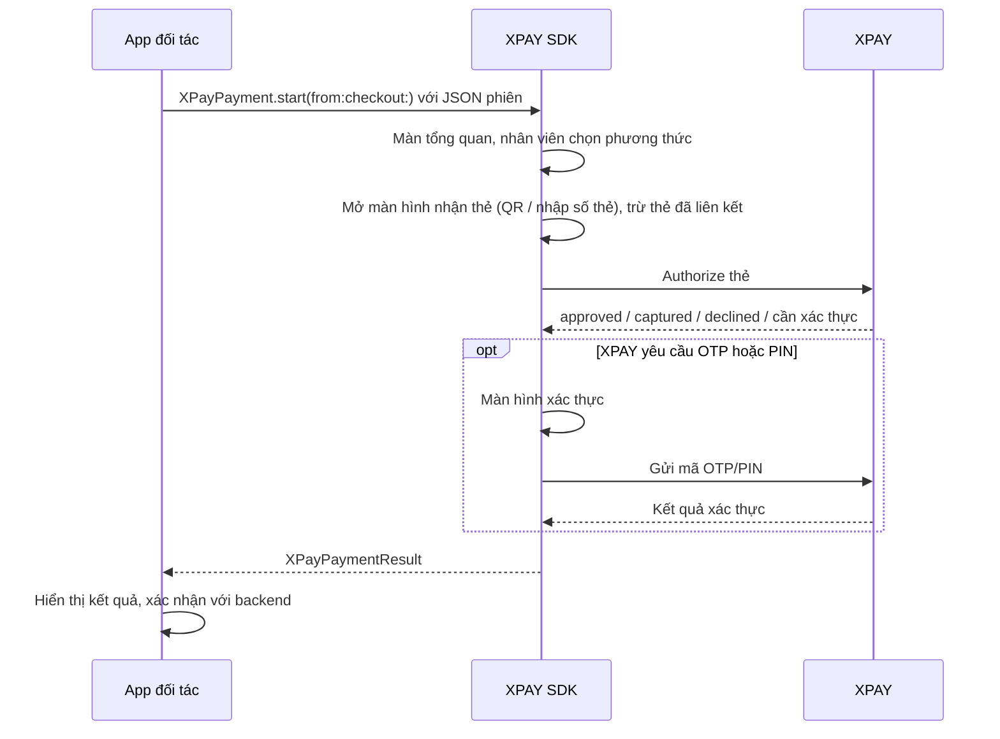

# XPAY Payment SDK cho iOS native — Tài liệu tích hợp

Phiên bản SDK 3.1119.1

SDK giúp app iOS (Swift) của đối tác thu tiền bằng thẻ XPAY. SDK đảm nhận toàn bộ phần thẻ trong quy trình thanh toán: đọc thẻ (quét QR hoặc nhập số thẻ), gửi yêu cầu authorize lên XPAY,
hiển thị bước xác thực OTP/PIN khi XPAY yêu cầu, rồi trả về cho app **đúng một kết quả**.

Mỗi lần thanh toán, app đưa cho SDK **phản hồi của phiên thanh toán** (do backend đối tác xin từ XPAY). Số tiền bị khoá khi backend xin phiên, và SDK thu đúng số tiền đó (xem [mục 5](#5-mã-phiên-thanh-toán)).

Tài liệu dành cho đội mobile của đối tác dùng iOS native. App Android native xem [android_integration.vi.md](android_integration.vi.md). App viết bằng Flutter xem [README.vi.md](../README.vi.md).

## Mục lục

1. [SDK làm gì](#1-sdk-làm-gì)
2. [Yêu cầu hệ thống](#2-yêu-cầu-hệ-thống)
3. [Cài đặt](#3-cài-đặt)
4. [Cấu hình iOS](#4-cấu-hình-ios)
5. [Mã phiên thanh toán](#5-mã-phiên-thanh-toán)
6. [Khởi tạo SDK](#6-khởi-tạo-sdk)
7. [Thực hiện một thanh toán](#7-thực-hiện-một-thanh-toán)
8. [API reference](#8-api-reference)
9. [Kết quả và cách xử lý](#9-kết-quả-và-cách-xử-lý)
10. [Mã lỗi](#10-mã-lỗi)
11. [Thử lại và chống trừ tiền hai lần](#11-thử-lại-và-chống-trừ-tiền-hai-lần)
12. [Xác nhận thanh toán từ backend](#12-xác-nhận-thanh-toán-từ-backend)
13. [Logging](#13-logging)
14. [Bảo mật](#14-bảo-mật)
15. [Giới hạn hiện tại](#15-giới-hạn-hiện-tại)
16. [Câu hỏi thường gặp](#16-câu-hỏi-thường-gặp)

---

## 1. SDK làm gì

| SDK đảm nhận                                                                    | App đối tác đảm nhận                                                                                    |
| ------------------------------------------------------------------------------- | ------------------------------------------------------------------------------------------------------- |
| Màn tổng quan & chọn phương thức, màn nhập số thẻ, quét mã QR, xác thực PIN/OTP | Đặt "Thẻ XPAY" vào danh sách phương thức thanh toán của app và khởi động module XPAY khi nhân viên chọn |
| Gửi yêu cầu authorize lên XPAY                                                  | Nhập cước, xin phiên thanh toán cho từng lần thanh toán và đưa cho SDK nguyên phản hồi của phiên        |
| Trả về đúng một kết quả cho mỗi lần thanh toán                                  | Màn hình thành công/thất bại, điều hướng, cập nhật dữ liệu của app                                      |

SDK **không** hiển thị màn hình thành công hay bị từ chối: khi có kết quả, SDK đóng màn hình của mình và trả kết quả về cho app. App tự hiển thị dựa trên kết quả đó.

App đối tác không chọn phương thức. Màn đầu tiên của SDK hiện số tiền, thông tin chuyến (mã cuốc, điểm đón, điểm trả, biển số xe) và các phương thức theo đúng thứ tự `entry_modes` trong phản hồi của phiên. Nhân viên chọn một:

| Giá trị `entry_modes` | Nhân viên làm gì                                                                    | iOS   |
| --------------------- | ----------------------------------------------------------------------------------- | ----- |
| `ride_card`           | Thu bằng thẻ đã liên kết của chuyến (hiện tên thẻ và 4 số cuối), không cần nhập thẻ | Có    |
| `card_qr`             | Quét mã QR in trên thẻ XPAY, hoặc chọn ảnh QR từ thư viện                           | Có    |
| `manual_pan`          | Nhập số thẻ                                                                         | Có    |
| `chip_tap`            | Chạm thẻ chip XPAY của khách vào điện thoại                                         | Không |
| `token`               | Quét mã thanh toán dùng một lần trên ứng dụng XPERISE                               | Có    |

Thẻ chip XPAY là MIFARE Classic, và iOS không cho app truy cập thẻ MIFARE Classic. Vì vậy SDK không bao giờ hiện `chip_tap` trên iOS. Phiên chỉ có `chip_tap` thì thanh toán trả `unsupported`
mà không mở màn hình nào.

Chọn `card_qr` thì chỉ nhận QR thẻ, chọn `token` thì chỉ nhận mã dùng một lần.

## 2. Yêu cầu hệ thống

| Thành phần | Tối thiểu |
| ---------- | --------- |
| iOS        | 15.0      |
| Xcode      | 27.2      |
| Swift      | 5.9       |

Lưu ý:

1. **Xcode:** các xcframework trong bộ SDK được build bằng Xcode 27.2, kèm `.swiftinterface`. Xcode cũ hơn bản build không đọc được giao diện module; Xcode mới hơn đọc được.
2. Bộ SDK là các framework động (dynamic). Xcode tự nhúng (embed) chúng vào app khi bạn thêm Swift package, không cần cấu hình thêm.
3. SDK mở một Flutter engine riêng cho màn thanh toán. App đã nhúng một Flutter framework khác (của bên thứ ba hoặc của chính bạn) thì **không** dùng chung được với bộ SDK này: liên hệ XPAY trước khi tích hợp.
4. **Không chạy trên iOS Simulator.** Bộ SDK là bản release của Flutter, chỉ chạy trên iPhone thật. App vẫn build được cho simulator, nhưng trên simulator `initialize` ném `XPayInitializationError` ("does not run on the iOS Simulator"). Kiểm thử SDK trên thiết bị thật; quét QR cũng cần camera.

## 3. Cài đặt

SDK được phát hành trên GitHub: <https://github.com/nggiahuy09/xpay-payment-sdk>. Mỗi bản có một tag dạng `v3.1119.1`, một mục trong [CHANGELOG.md](../CHANGELOG.md) và một bản Release. Số phiên bản **không** theo Semantic Versioning: đọc CHANGELOG trước khi nâng cấp để biết bản mới có thay đổi cần sửa code hay không.

XPAY gửi riêng cho bạn:

1. Base URL của môi trường sandbox, và production khi go-live.
2. Thẻ test cho môi trường sandbox.
3. `X-Merchant-Key` cho backend của bạn (không đưa vào app, xem [mục 5](#5-mã-phiên-thanh-toán)).

SDK được cài bằng Swift Package Manager, theo một trong hai cách. Cách A không cần tải file: Xcode tự tải SDK từ repo GitHub. Cách B dùng file zip trong trang Release, cho máy build không truy cập được GitHub.

**Cách A: URL của repo GitHub.**

1. Trong Xcode: **File → Add Package Dependencies…**, dán URL `https://github.com/nggiahuy09/xpay-payment-sdk` vào ô tìm kiếm.
2. Ở **Dependency Rule**, chọn **Exact Version** và nhập `3.1119.1`. Số phiên bản không theo Semantic Versioning, nên đừng chọn "Up to Next Major/Minor": Xcode có thể tự nâng lên một bản cần sửa code.
3. Thêm product `XPayPayment` vào target app.

Nếu project dùng `Package.swift` thay cho Xcode project:

```swift
dependencies: [
    .package(url: "https://github.com/nggiahuy09/xpay-payment-sdk", exact: "3.1119.1"),
],
targets: [
    .target(name: "MyApp", dependencies: [.product(name: "XPayPayment", package: "xpay-payment-sdk")]),
]
```

Xcode tải các xcframework (khoảng 75 MB) từ trang Release của đúng phiên bản và kiểm tra checksum của từng file; file bị sửa thì Xcode báo lỗi và không build. Nâng cấp: đổi số phiên bản ở **Package Dependencies** của project (hoặc trong `Package.swift`).

**Cách B: file zip.**

1. Tải `xpay-payment-sdk-ios-3.1119.1.zip` ở trang [Releases](https://github.com/nggiahuy09/xpay-payment-sdk/releases). Mã SHA-256 của file nằm trong ghi chú của Release. Kiểm tra trước khi dùng:

   ```bash
   shasum -a 256 xpay-payment-sdk-ios-3.1119.1.zip
   ```

   Kết quả phải trùng với mã trong ghi chú Release. Nếu XPAY gửi mã SHA-256 qua kênh riêng (email, chat), đối chiếu với mã đó.

2. Giải nén vào thư mục project, ví dụ thành `Vendor/XPayPayment/`. Thư mục này chứa `Package.swift` và các xcframework trong `Frameworks/`.
3. Trong Xcode: **File → Add Package Dependencies… → Add Local…**, chọn thư mục `XPayPayment`.
4. Ở hộp thoại tiếp theo, thêm product `XPayPayment` vào target app.

Nếu project dùng `Package.swift`:

```swift
dependencies: [
    .package(path: "Vendor/XPayPayment"),
],
targets: [
    .target(name: "MyApp", dependencies: [.product(name: "XPayPayment", package: "XPayPayment")]),
]
```

Nâng cấp với cách B: xoá thư mục `XPayPayment` cũ, giải nén bộ SDK mới vào cùng chỗ, rồi build lại (**Product → Clean Build Folder** nếu Xcode còn giữ framework cũ).

Hai cách cho cùng một bộ SDK. Trong code, chỉ cần một dòng import:

```swift
import XPayPayment
```

## 4. Cấu hình iOS

Thêm vào `Info.plist` của app:

```xml
<key>NSCameraUsageDescription</key>
<string>Ứng dụng cần quyền camera để quét mã QR thẻ XPAY khi thanh toán.</string>
<key>NSPhotoLibraryUsageDescription</key>
<string>Ứng dụng cần quyền truy cập ảnh để quét mã QR thẻ XPAY từ ảnh đã chụp.</string>
```

Thiếu `NSCameraUsageDescription`, iOS sẽ dừng app ngay khi màn quét QR xin quyền camera. Câu thông báo là của app bạn, có thể viết lại cho phù hợp.

Không cần entitlement NFC, vì SDK không dùng NFC trên iOS.

Đảm bảo **iOS Deployment Target** của target app từ 15.0 trở lên.

## 5. Mã phiên thanh toán

Mỗi lần thanh toán được xác thực bằng một **mã phiên** (session token) của chuyến, do **backend của đối tác** xin từ XPAY. SDK không bao giờ nhìn thấy merchant key hay bất kỳ secret dài hạn nào. App truyền nguyên phản hồi của phiên khi khởi động module; SDK tự lấy mã phiên trong đó và gửi kèm trong mọi request của lần thanh toán đó.

Luồng xin mã phiên:

1. Nhân viên nhập cước của chuyến trên app đối tác. App gửi `order_id` và cước cho backend.
2. Backend gọi `POST /merchant/rides/{order_id}/payment-session` bằng `X-Merchant-Key` (chỉ nằm trên server), body JSON gồm `amount` (chuỗi, bằng `fare` + `sub_fee`, tính bằng đồng), `fare` (số), tuỳ chọn `sub_fee` (số, mặc định 0) và `distance_km` (số).
3. XPAY trả `session_token` cùng `amount` đã khoá, `external_ref` (dạng `XP-…`) và dữ liệu chuyến. Token chỉ hiện một lần.
4. Backend chuyển **nguyên** body phản hồi xuống app, không cần tách field. App truyền nguyên chuỗi JSON đó vào `sessionJson` khi khởi động module. SDK tự đọc `session_token`, `amount`, `external_ref` và `payment_template` (`currency`, `product_type`).

Quy tắc:

1. **Mã phiên dùng cho đúng một chuyến và hết hạn sau 15 phút.** SDK không tự refresh mã phiên.
2. **Số tiền bị khoá theo phiên.** SDK thu đúng `amount` trong phản hồi của phiên. Muốn thu số tiền khác thì xin phiên mới; không sửa JSON trước khi đưa vào SDK.
3. **Mở phiên mới cho cùng một chuyến sẽ thu hồi các phiên trước.** Request dùng phiên cũ bị trả `ride_payment_session_revoked` (HTTP 401). Chỉ xin phiên ngay trước khi thu tiền, và không xin phiên mới khi một thanh toán của chuyến đó còn đang mở.
4. **Mã phiên bị XPAY từ chối** (hết hạn, bị thu hồi, không hợp lệ): thanh toán trả `failed` kèm `errorCode` từ XPAY (`token_expired` khi hết hạn). App cần xin một mã phiên mới rồi bắt đầu lại.
5. **JSON không đọc được thì không thanh toán.** Chuỗi không phải JSON object, thiếu `session_token`, `amount` không phải số nguyên đồng (ví dụ `"138000.50"`), hoặc `entry_modes` không còn phương thức nào SDK biết thì SDK trả `failed` với `sdk_invalid_request` và không gửi gì lên XPAY. Lý do cụ thể được gửi qua `onLog` (`feature = payment`, `action = start_payment`, xem [mục 13](#13-logging)).
6. SDK chỉ giữ mã phiên trong bộ nhớ trong lúc thanh toán, không lưu xuống máy và không ghi log mã phiên.

## 6. Khởi tạo SDK

Gọi `initialize` một lần trước lần thanh toán đầu tiên, ví dụ khi mở app hoặc sau khi nhân viên đăng nhập. Gọi lại khi cần đổi ngôn ngữ hoặc base URL. `initialize` là hàm `async throws`, chạy trên main actor:

```swift
Task { @MainActor in
    do {
        try await XPayPayment.initialize(
            config: XPayConfig(
                environment: XPayEnvironment(baseUrl: "https://<xpay api host>"),
                language: .vi,
                onLog: { event in myLogger.log(event.description) }
            )
        )
    } catch {
        myLogger.log("XPAY initialize failed: \(error.localizedDescription)")
    }
}
```

Lần gọi đầu tiên khởi động engine của SDK. Gọi sớm (khi mở app hoặc sau khi đăng nhập) để màn thanh toán mở ngay khi nhân viên cần.

Lưu ý khi gọi lại `initialize`:

1. Không gọi khi đang có một thanh toán mở (tức thanh toán chưa trả kết quả). Khi đó `initialize` ném `XPayInitializationError` và giữ nguyên cấu hình cũ.
2. Không gọi khi lần `initialize` trước chưa xong. Khi đó lần gọi sau ném `XPayInitializationError`, lần gọi trước vẫn chạy tiếp.
3. Trong lúc `initialize` đang chạy, thanh toán trả `failed` với `errorCode = sdk_not_initialized`. Luôn chờ `initialize` xong rồi mới bắt đầu thanh toán.

## 7. Thực hiện một thanh toán

### Luồng tổng quát



### Khởi động module và nhận kết quả

Gọi `XPayPayment.start(from:checkout:)` từ view controller đang hiển thị. Hàm `await` cho tới khi màn SDK đã đóng hẳn, rồi trả về kết quả:

```swift
final class CheckoutViewController: UIViewController {
    private func payWithXPay(sessionJson: String) {
        Task { @MainActor in
            let result = await XPayPayment.start(from: self, checkout: XPayCheckout(sessionJson: sessionJson))
            handle(result)
        }
    }

    private func handle(_ result: XPayPaymentResult) {
        switch result.status {
        case .approved, .captured:
            confirmOnBackend(externalRef: result.externalRef, authId: result.authId)
        case .declined, .duplicate, .failed:
            showMessage(result.message ?? "Thanh toán không thành công.")
        case .expired:
            showMessage("Đã hết thời gian xác thực. Vui lòng tạo thanh toán mới.")
        case .cancelled, .unsupported:
            break
        @unknown default:
            showMessage(result.message ?? "Thanh toán không thành công.")
        }
    }
}
```

App dùng SwiftUI: lấy view controller đang hiển thị (ví dụ qua một `UIViewControllerRepresentable` nhỏ, hoặc `rootViewController` của window hiện tại) rồi truyền vào `from:`.

### Hành vi khi thanh toán

1. SDK trình bày (present) màn hình của mình toàn màn hình, phía trên view controller trên cùng đang được present từ `presenter`. Khi thanh toán kết thúc, SDK tự đóng màn hình rồi mới trả kết quả, nên app có thể present màn kết quả ngay sau `await`. SDK không đụng tới navigation stack của app.
2. Màn hình SDK không đóng được bằng cử chỉ vuốt xuống.
3. Màn danh sách phương thức có nút quay lại ở góc trên bên trái: bấm vào thì kết quả là `cancelled`. Ở màn nhận thẻ, nút quay lại (nút đóng ở màn quét QR) đưa về danh sách phương thức. Ở màn xác thực, nút quay lại kết thúc thanh toán với `cancelled`.
4. Trong lúc XPAY đang authorize thẻ, nút quay lại không có tác dụng, để nhân viên không rời khỏi một thanh toán có thể đã bị trừ tiền. SDK tự xử lý việc này, app không cần làm gì.
5. Nếu app tự đóng màn SDK (ví dụ gọi `dismiss` trên view controller phía dưới), thanh toán kết thúc với `cancelled`, kèm `authId` nếu thanh toán đã được authorize và đang chờ xác thực. Nếu lúc đó XPAY đang authorize thẻ, `start` chờ có kết quả authorize rồi mới trả về, vì thẻ có thể đã bị trừ tiền: kết quả là kết quả authorize thật (`approved`, `captured`, `declined`, `failed`…), hoặc `cancelled` kèm `authId` nếu thanh toán cần xác thực. Chỉ đóng màn SDK khi thật cần, ví dụ khi nhân viên đăng xuất, và vẫn xử lý kết quả `start` trả về.
6. Mã QR không phải của XPAY, hoặc không đúng loại với phương thức đã chọn (QR thẻ / mã dùng một lần), bị báo lỗi ngay trên màn hình quét, SDK không gửi request nào và nhân viên có thể quét lại mà không cần tạo phiên giao dịch mới.

## 8. API reference

### Tổng quan

SDK có hai thao tác, dùng theo thứ tự dưới đây. Mỗi kiểu dữ liệu trong mục này đều thuộc một nhánh của sơ đồ.

```text
XPayPayment
├── 1. initialize(config: XPayConfig) async throws   Gọi một lần trước khi thanh toán (mục 6)
│       ├── environment: XPayEnvironment             Base URL sandbox hoặc production
│       ├── language:    XPayLanguage                Ngôn ngữ màn hình SDK và message
│       └── onLog:       ((XPayLogEvent) -> Void)?   Nhận sự kiện log (mục 13)
│
└── 2. start(from: UIViewController, checkout: XPayCheckout) async -> XPayPaymentResult
                │                                    Mỗi lần thanh toán (mục 7)
                ▼
        XPayPaymentResult
        ├── status:    XPayPaymentStatus             Ý nghĩa từng trạng thái (mục 9)
        └── errorCode: String?                       So với hằng số XPayErrorCode (mục 10)
```

### Ví dụ đầy đủ

```swift
import UIKit
import XPayPayment

final class CheckoutViewController: UIViewController {
    override func viewDidLoad() {
        super.viewDidLoad()
        Task { @MainActor in
            do {
                try await XPayPayment.initialize(
                    config: XPayConfig(
                        environment: XPayEnvironment(baseUrl: "https://<xpay api host>"),
                        language: .vi,
                        onLog: { event in myLogger.log(event.description) }
                    )
                )
            } catch {
                myLogger.log("XPAY initialize failed: \(error.localizedDescription)")
            }
        }
    }

    private func payWithXPay(sessionJson: String) {
        Task { @MainActor in
            let result = await XPayPayment.start(from: self, checkout: XPayCheckout(sessionJson: sessionJson))
            handle(result)
        }
    }

    private func handle(_ result: XPayPaymentResult) {
        switch result.status {
        case .approved, .captured:
            confirmOnBackend(externalRef: result.externalRef, authId: result.authId)
        case .failed:
            switch result.errorCode {
            case XPayErrorCode.notInitialized, XPayErrorCode.busy:
                retryLater()
            default:
                showMessage(result.message ?? "Thanh toán không thành công.")
            }
        case .declined, .duplicate:
            showMessage(result.message ?? "Thanh toán không thành công.")
        case .expired:
            showMessage("Đã hết thời gian xác thực. Vui lòng tạo thanh toán mới.")
        case .cancelled, .unsupported:
            break
        @unknown default:
            showMessage(result.message ?? "Thanh toán không thành công.")
        }
    }
}
```

`XPayPaymentStatus`, `XPayLanguage`, `XPayLogLevel` và `XPayLogCategory` có thể được thêm giá trị ở các phiên bản sau. Luôn có nhánh `@unknown default` khi `switch` trên các enum này, để app vẫn build được khi nâng cấp SDK.

### `XPayPayment`

Điểm vào duy nhất của SDK (`enum XPayPayment`). Cả hai hàm chạy trên main actor.

| Thành phần                                                                                               | Mô tả                               |
| -------------------------------------------------------------------------------------------------------- | ----------------------------------- |
| `static func initialize(config: XPayConfig) async throws`                                                | Cấu hình SDK                        |
| `static func start(from presenter: UIViewController, checkout: XPayCheckout) async -> XPayPaymentResult` | Mở luồng thanh toán và nhận kết quả |

#### `initialize`

Cấu hình SDK: ngôn ngữ, base URL và callback log. Có thể gọi lại để cấu hình lại, trừ khi đang có thanh toán mở hoặc lần `initialize` trước chưa xong: khi đó hàm ném `XPayInitializationError`. Xem [mục 6](#6-khởi-tạo-sdk).

#### `start`

Mở luồng thanh toán và luôn trả về **đúng một** `XPayPaymentResult`. Hàm không ném lỗi khi thanh toán thất bại; mọi lỗi đều nằm trong kết quả.

Thứ tự kiểm tra trước khi mở màn hình:

| Điều kiện                                                        | Kết quả                                         |
| ---------------------------------------------------------------- | ----------------------------------------------- |
| Chưa gọi `initialize`, hoặc `initialize` chưa thành công lần nào | `failed`, `errorCode = sdk_not_initialized`     |
| Đang có một thanh toán khác mở                                   | `failed`, `errorCode = sdk_busy`                |
| `presenter` không nằm trong window nào                           | `failed`, `errorCode = sdk_presentation_failed` |
| Request không hợp lệ (xem bảng `XPayCheckout`)                   | `failed`, `errorCode = sdk_invalid_request`     |
| Không phương thức nào của phiên chạy được trên máy               | `unsupported`                                   |

Ba dòng đầu trả kết quả ngay, không mở màn hình. Hai dòng cuối mở màn SDK rồi đóng ngay. Không trường hợp nào ở bảng trên gửi request lên XPAY.

### `XPayCheckout`

Dùng ở: tham số `checkout` của `start`.

| Trường        | Kiểu     | Bắt buộc | Mô tả                                                                                                                                                                                                                                                                                                                                                                                                                                     |
| ------------- | -------- | -------- | ----------------------------------------------------------------------------------------------------------------------------------------------------------------------------------------------------------------------------------------------------------------------------------------------------------------------------------------------------------------------------------------------------------------------------------------- |
| `sessionJson` | `String` | Có       | Nguyên body phản hồi của `POST /merchant/rides/{order_id}/payment-session`. SDK lấy `session_token`, `amount` (số nguyên đồng, tối thiểu 1.000), `external_ref` (1–64 ký tự), `payment_template.currency` (mặc định `VND`), `payment_template.product_type`, `entry_modes`, `ride_card`, `order_id` và thông tin chuyến trong `payment_template.enhanced_data` từ đây, xem [mục 5](#5-mã-phiên-thanh-toán). `description` che giá trị này |

### `XPayConfig`

Dùng ở: tham số của `initialize`.

| Trường        | Kiểu                        | Bắt buộc | Mặc định | Mô tả                                                              |
| ------------- | --------------------------- | -------- | -------- | ------------------------------------------------------------------ |
| `environment` | `XPayEnvironment`           | Có       |          | Môi trường XPAY (sandbox hoặc production)                          |
| `language`    | `XPayLanguage`              | Không    | `.vi`    | Ngôn ngữ của màn hình SDK và của `XPayPaymentResult.message`       |
| `onLog`       | `((XPayLogEvent) -> Void)?` | Không    | `nil`    | Nhận sự kiện nghiệp vụ trên main thread, xem [mục 13](#13-logging) |

### `XPayEnvironment`

Dùng ở: trường `environment` của `XPayConfig`.

| Trường    | Kiểu     | Bắt buộc | Mô tả                                                          |
| --------- | -------- | -------- | -------------------------------------------------------------- |
| `baseUrl` | `String` | Có       | Base URL của XPAY API. XPAY cung cấp URL sandbox và production |

### `XPayLanguage`

Dùng ở: trường `language` của `XPayConfig`.

| Giá trị | Ngôn ngữ   |
| ------- | ---------- |
| `.vi`   | Tiếng Việt |
| `.en`   | Tiếng Anh  |

### `XPayInitializationError`

Dùng ở: lỗi do `initialize` ném ra. Trường `message` (cũng là `localizedDescription`) mô tả lý do, chỉ để ghi log.

### `XPayPaymentResult`

Dùng ở: giá trị trả về của `start`.

| Trường         | Kiểu                | Mô tả                                                                    |
| -------------- | ------------------- | ------------------------------------------------------------------------ |
| `status`       | `XPayPaymentStatus` | Trạng thái cuối cùng, luôn có                                            |
| `authId`       | `String?`           | Mã authorize của XPAY. Dùng để đối soát với backend                      |
| `captureId`    | `String?`           | Mã capture, chỉ có khi `captured`                                        |
| `bookingRef`   | `String?`           | Mã booking, có khi thanh toán thành công sau bước xác thực               |
| `externalRef`  | `String?`           | Mã tham chiếu của đối tác, do XPAY trả về                                |
| `amount`       | `Int64?`            | Số tiền XPAY ghi nhận                                                    |
| `currency`     | `String?`           | Mã tiền tệ XPAY ghi nhận                                                 |
| `createdAt`    | `Date?`             | Thời điểm XPAY tạo giao dịch                                             |
| `declineCode`  | `String?`           | Mã từ chối thô từ XPAY, khi `declined`                                   |
| `errorCode`    | `String?`           | Mã lỗi, khi `failed`. Xem [mục 10](#10-mã-lỗi)                           |
| `message`      | `String?`           | Câu thông báo sẵn sàng hiển thị cho nhân viên, theo ngôn ngữ đã cấu hình |
| `isSuccessful` | `Bool`              | `true` khi `status` là `approved` hoặc `captured`                        |

### `XPayPaymentStatus`

Dùng ở: trường `status` của `XPayPaymentResult`. `rawValue` là chuỗi chữ thường (`"approved"`…). Ý nghĩa và cách xử lý: xem [mục 9](#9-kết-quả-và-cách-xử-lý).

`.approved`, `.captured`, `.declined`, `.cancelled`, `.duplicate`, `.failed`, `.expired`, `.unsupported`.

### `XPayLogEvent`

Dùng ở: tham số của callback `onLog` trong `XPayConfig`.

| Trường          | Kiểu              | Mô tả                                                                                     |
| --------------- | ----------------- | ----------------------------------------------------------------------------------------- |
| `level`         | `XPayLogLevel`    | `.info`, `.warn`, `.error`                                                                |
| `category`      | `XPayLogCategory` | `.api` (kết quả gọi API), `.behavior` (hành vi người dùng), `.error` (dữ liệu bất thường) |
| `feature`       | `String`          | Khu vực phát sinh sự kiện: `payment`, `verification`                                      |
| `action`        | `String`          | Hành động cụ thể, xem [mục 13](#13-logging)                                               |
| `reason`        | `String?`         | Lý do chi tiết, nếu có                                                                    |
| `errorCode`     | `String?`         | Mã lỗi, nếu sự kiện đến từ một lỗi                                                        |
| `serverMessage` | `String?`         | Thông báo lỗi gốc từ XPAY, nếu có                                                         |
| `input`         | `[String: Any?]`  | Các định danh liên quan                                                                   |

`description` in đủ các trường trên trên một dòng, dùng được ngay cho log.

## 9. Kết quả và cách xử lý

| Trạng thái    | Ý nghĩa                                                  | Trường có giá trị                                                                                   | App nên làm gì                                                       |
| ------------- | -------------------------------------------------------- | --------------------------------------------------------------------------------------------------- | -------------------------------------------------------------------- |
| `approved`    | Thanh toán thành công                                    | `authId`, `externalRef`, `amount`, `currency`, `createdAt`; thêm `bookingRef` nếu qua bước xác thực | Xác nhận với backend rồi hoàn tất đơn                                |
| `captured`    | Thanh toán thành công                                    | Như `approved`, thêm `captureId`                                                                    | Như `approved`                                                       |
| `declined`    | XPAY từ chối                                             | `declineCode`, `message`; `authId` nếu có                                                           | Hiển thị `message`, cho nhân viên thử thẻ khác hoặc phương thức khác |
| `cancelled`   | Nhân viên thoát trước khi thanh toán xong                | `authId` nếu thanh toán đã được authorize và đang chờ xác thực                                      | Quay lại màn chọn phương thức. Nếu có `authId`, kiểm tra với backend |
| `duplicate`   | XPAY đang giữ một request khác dưới cùng idempotency key | `message`                                                                                           | Kiểm tra với backend trước khi thu tiền lại                          |
| `failed`      | Request lỗi, hoặc XPAY trả dữ liệu SDK không xử lý được  | `errorCode`, `message`; `authId` nếu có                                                             | Hiển thị `message`. Nếu có `authId`, kiểm tra với backend            |
| `expired`     | Hết thời gian xác thực                                   | `authId`                                                                                            | Tạo thanh toán mới                                                   |
| `unsupported` | Thiết bị không chạy được phương thức nào của phiên       | Không có                                                                                            | Chọn phương thức thanh toán khác                                     |

`approved` và `captured` đều là thanh toán thành công; app xử lý hai trạng thái như nhau.

Về `message`:

1. Câu thông báo đã được dịch theo `XPayConfig.language`, có thể hiển thị thẳng cho nhân viên.
2. Khi XPAY trả về một mã lỗi chưa có câu thông báo riêng, `message` kết thúc bằng một dòng `Mã lỗi:` (hoặc `Error code:` với tiếng Anh) để bộ phận hỗ trợ tra cứu.
3. Các lỗi SDK trả ngay mà không mở màn hình (`sdk_not_initialized`, `sdk_busy`, `sdk_presentation_failed`) không có `message`.

Cách thử lại sau mỗi kết quả: xem [mục 11](#11-thử-lại-và-chống-trừ-tiền-hai-lần).

## 10. Mã lỗi

`errorCode` chỉ có giá trị khi `status` là `failed`.

### Mã do SDK sinh ra

Dùng hằng số trong `XPayErrorCode` để so sánh với `XPayPaymentResult.errorCode`, thay vì viết cứng chuỗi.

| Mã                        | Hằng số              | Khi nào trả về                                                                                                                                                                          | Cách xử lý                                          |
| ------------------------- | -------------------- | --------------------------------------------------------------------------------------------------------------------------------------------------------------------------------------- | --------------------------------------------------- |
| `sdk_not_initialized`     | `notInitialized`     | Khởi động module khi chưa gọi `initialize` hoặc `initialize` chưa xong. SDK không mở màn hình                                                                                           | Chờ `initialize` xong rồi khởi động lại             |
| `sdk_busy`                | `busy`               | Khởi động module khi một thanh toán khác chưa trả kết quả. SDK không mở màn hình                                                                                                        | Chờ lần trước trả kết quả                           |
| `sdk_presentation_failed` | `presentationFailed` | `presenter` chưa nằm trong window (chưa hiển thị, hoặc đã bị đóng), hoặc view controller trên cùng đang bị đóng. SDK không mở màn hình                                                  | Gọi lại từ view controller đang hiển thị            |
| `sdk_invalid_request`     | `invalidRequest`     | `sessionJson` không đọc được (không phải JSON object, thiếu `session_token`, `amount` có phần lẻ hoặc dưới 1.000, `external_ref` rỗng hoặc dài quá 64 ký tự). SDK không gửi gì lên XPAY | Sửa dữ liệu truyền vào                              |
| `sdk_unexpected_response` | `unexpectedResponse` | Sau khi đọc thẻ hoặc authorize, XPAY trả trạng thái hoặc dữ liệu mà SDK không xử lý được                                                                                                | Kiểm tra với backend bằng `authId` nếu có, báo XPAY |

### Mã từ tầng mạng

| Mã              | Nguyên nhân                                                          |
| --------------- | -------------------------------------------------------------------- |
| `no_connection` | Không có kết nối mạng                                                |
| `no_host`       | Không kết nối được tới server (sai base URL, lỗi DNS, lỗi chứng chỉ) |
| `timeout`       | Server không phản hồi trong 30 giây                                  |

### Mã từ XPAY

Các giá trị `errorCode` khác được XPAY trả về và SDK chuyển nguyên cho app. Danh sách mã do XPAY cung cấp riêng. Các mã liên quan tới mã phiên:

| Mã                             | Nguyên nhân                                                                                | Cách xử lý                                                             |
| ------------------------------ | ------------------------------------------------------------------------------------------ | ---------------------------------------------------------------------- |
| `token_expired`                | Mã phiên đã hết hạn (quá 15 phút)                                                          | Xin mã phiên mới từ backend rồi thanh toán lại                         |
| `ride_payment_session_revoked` | Mã phiên bị thu hồi vì backend đã mở phiên mới cho cùng chuyến                             | Dùng mã phiên mới nhất; tránh mở nhiều phiên song song cho một chuyến  |
| `amount_locked`                | `amount` khác số tiền đã khoá trong phiên (HTTP 422 ở bước authorize, 409 ở bước xác thực) | Truyền đúng `amount` của phiên, hoặc xin phiên mới với số tiền cần thu |

`message` của các mã này là câu thông báo chung kèm dòng mã lỗi (mục 9).

## 11. Thử lại và chống trừ tiền hai lần

Mỗi yêu cầu authorize mang một idempotency key, để request gửi lại không bị trừ tiền hai lần.

1. **Thử lại cùng một thanh toán**: khởi động lại module với JSON của cùng phiên (hoặc phiên mới của cùng chuyến) và các trường khác giữ nguyên. Nếu khách đưa cùng thẻ, SDK dùng lại key cũ, và XPAY trả lại kết quả ban đầu thay vì trừ tiền lần nữa. Điều này đúng giữa các lần khởi động module, trong suốt thời gian app còn chạy.
2. **Thanh toán mới**: mỗi chuyến có `external_ref` riêng trong phản hồi của phiên.
3. **Thẻ khác hoặc thông tin đơn thay đổi**: request khác đi nên SDK tạo key mới.
4. **`duplicate`**: XPAY đang giữ một request khác dưới cùng key. Có thể đã có giao dịch: kiểm tra trước khi thu tiền lại.

Mã phiên không nằm trong idempotency key. Thử lại bằng một phiên mới (sau khi phiên cũ hết hạn) vẫn dùng lại key cũ. Lưu ý mở phiên mới sẽ thu hồi phiên cũ (xem [mục 5](#5-mã-phiên-thanh-toán)).

Gợi ý cho app:

1. Sau một thanh toán **thất bại**, thử lại cho cùng chuyến; `external_ref` của chuyến không đổi nên lần thử lại dùng lại key.
2. Sau một thanh toán **thành công**, chuyến đã đóng; chuyến tiếp theo dùng phản hồi của phiên mới.

## 12. Xác nhận thanh toán từ backend

Kết quả được trả về trên điện thoại của nhân viên, đây không phải nguồn đáng tin cậy. Trước khi hoàn tất đơn, backend của đối tác phải xác nhận thanh toán với XPAY bằng `authId`
hoặc `externalRef`.

Xử lý tương tự với các kết quả `cancelled` và `failed` có `authId`: thanh toán đã được authorize và vẫn có thể hoàn tất hoặc hết hạn phía XPAY.

Nếu app bị hệ điều hành đóng trong lúc thanh toán (ví dụ nằm nền lâu khi khách đọc OTP), app không nhận được kết quả nào. Giao dịch có thể **đã thành công** phía XPAY: đối soát qua backend theo `order_id` / `external_ref` trước khi thu lại.

## 13. Logging

Truyền `onLog` vào `XPayConfig` để nhận các sự kiện nghiệp vụ của SDK. SDK không gửi log đi đâu khác. Không truyền `onLog` thì SDK im lặng. `onLog` được gọi trên main thread; tránh làm việc nặng trong callback.

Sự kiện **không bao giờ** chứa số thẻ, cryptogram, nonce, mã xác thực hay mã phiên.

| `feature`      | `action`                                   | `level` | Khi nào                                                                                                                                                                                                                                                       | `input` chính                                  |
| -------------- | ------------------------------------------ | ------- | ------------------------------------------------------------------------------------------------------------------------------------------------------------------------------------------------------------------------------------------------------------- | ---------------------------------------------- |
| `payment`      | `start_payment`                            | `error` | Request bị từ chối trước khi mở màn hình (`sdk_invalid_request`). `reason`: `invalid_session_json`, `malformed_session`, `missing_session_token`, `missing_entry_modes`, `invalid_amount`, `amount_below_minimum`, `missing_currency`, `invalid_external_ref` | `session_json_length`                          |
| `payment`      | `authorize_qr`, `authorize_manual`         | `error` | Gọi authorize thất bại (lỗi mạng, lỗi từ XPAY, xung đột)                                                                                                                                                                                                      | `entry_mode`, `auto_capture`                   |
| `payment`      | `authorize_approved`                       | `info`  | XPAY duyệt hoặc capture                                                                                                                                                                                                                                       | `entry_mode`, `auth_id`                        |
| `payment`      | `authorize_declined`                       | `warn`  | XPAY từ chối                                                                                                                                                                                                                                                  | `entry_mode`, `decline_reason`                 |
| `payment`      | `authorize_verification`                   | `info`  | XPAY yêu cầu xác thực OTP/PIN                                                                                                                                                                                                                                 | `entry_mode`, `auth_id`, `verification_method` |
| `payment`      | `authorize_incomplete`                     | `error` | XPAY trả trạng thái SDK không xử lý được                                                                                                                                                                                                                      | `entry_mode`                                   |
| `verification` | `send_verification`, `resend_verification` | `error` | Gửi hoặc gửi lại mã xác thực thất bại                                                                                                                                                                                                                         | `auth_id`, `recipient_id`                      |
| `verification` | `verify`                                   | `error` | Gọi verify thất bại, hoặc XPAY trả trạng thái không mong đợi                                                                                                                                                                                                  | `auth_id`                                      |
| `verification` | `verify_approved`                          | `info`  | Xác thực thành công                                                                                                                                                                                                                                           | `auth_id`                                      |
| `verification` | `verify_rejected`                          | `warn`  | Mã xác thực sai                                                                                                                                                                                                                                               | `auth_id`, `attempt`                           |
| `verification` | `verify_declined`                          | `warn`  | XPAY từ chối sau bước xác thực                                                                                                                                                                                                                                | `auth_id`, `decline_reason`                    |
| `verification` | `verification_expired`                     | `error` | Hết thời gian xác thực                                                                                                                                                                                                                                        | `auth_id`                                      |
| `verification` | `verification_abandon`                     | `info`  | Nhân viên rời màn hình xác thực                                                                                                                                                                                                                               | `auth_id`                                      |

Danh sách này phản ánh phiên bản `3.1119.1` và có thể được bổ sung ở các phiên bản sau. App không nên dựa vào việc một sự kiện cụ thể luôn xuất hiện để điều khiển luồng nghiệp vụ;
hãy dùng `XPayPaymentResult`.

## 14. Bảo mật

Những gì SDK đảm bảo:

1. Không chứa secret nào. Mọi request xác thực bằng mã phiên của đúng lần thanh toán đó.
2. Không lưu mã phiên, số thẻ hay mã xác thực xuống bộ nhớ máy.
3. Không ghi log số thẻ, cryptogram, nonce, mã xác thực hay mã phiên. `XPayCheckout.description` che `sessionJson`.
4. Không gửi log hay dữ liệu đi đâu ngoài XPAY và callback `onLog` của app.
5. Log debug nội bộ của SDK bị tắt trong bản release.

Những gì đối tác cần làm:

1. Không lưu và không ghi log mã phiên thanh toán (không in `sessionJson` ra log).
2. Giữ `X-Merchant-Key` trên server của đối tác, không đưa vào app hay vào repo.
3. Xác nhận mọi thanh toán từ backend trước khi hoàn tất đơn (xem [mục 12](#12-xác-nhận-thanh-toán-từ-backend)).
4. Không ghi log hay chụp màn hình các màn hình SDK chứa số thẻ.
5. Kiểm tra SHA-256 của file zip trước khi dùng (xem [mục 3](#3-cài-đặt)).

## 15. Giới hạn hiện tại

1. Màn hình SDK dùng giao diện của XPAY, chưa tuỳ biến theme được.
2. SDK không hiển thị màn hình thành công hay bị từ chối. App tự hiển thị dựa trên kết quả.
3. Không hỗ trợ chạm thẻ chip (`chip_tap`) trên iOS, xem [mục 1](#1-sdk-làm-gì).
4. Các phương thức quét QR được hiện mà không kiểm tra máy có camera hay không. Nhân viên vẫn có thể chọn ảnh QR từ thư viện.
5. SDK chỉ cài được bằng Swift Package Manager (URL repo hoặc file zip); chưa có bản CocoaPods.
6. Bộ SDK chứa một Flutter engine nên làm tăng đáng kể dung lượng app.
7. Không chạy trên iOS Simulator, xem [mục 2](#2-yêu-cầu-hệ-thống).

## 16. Câu hỏi thường gặp

**Thanh toán trả ngay `failed` với `sdk_not_initialized`.**
Chưa gọi `XPayPayment.initialize`, gọi nhưng chưa chờ xong, hoặc lần gọi đó đã ném lỗi.

**Thanh toán trả ngay `failed` với `sdk_presentation_failed`.**
`presenter` chưa được hiển thị (ví dụ gọi trong `viewDidLoad`) hoặc đã bị đóng. Gọi `start` từ view controller đang nằm trên màn hình, ví dụ trong action của nút bấm.

**Thanh toán trả ngay `failed` với `sdk_invalid_request`.**
`sessionJson` không đọc được: không phải JSON object hoặc bị cắt bớt, thiếu `session_token`, `amount` có phần lẻ hoặc dưới 1.000, hoặc `external_ref` rỗng. Truyền nguyên body phản hồi của phiên, xem bảng `XPayCheckout`.

**Thanh toán trả `failed` với `token_expired` hoặc `ride_payment_session_revoked`.**
Mã phiên đã quá 15 phút, hoặc đã bị thu hồi vì backend mở phiên mới cho cùng chuyến. Kiểm tra trạng thái thanh toán với backend, rồi xin mã phiên mới
(xem [mục 5](#5-mã-phiên-thanh-toán) và [mục 11](#11-thử-lại-và-chống-trừ-tiền-hai-lần)). Nên xin phiên ngay trước khi thu tiền.

**Thanh toán trả `unsupported`.**
Phiên chỉ có `chip_tap`, phương thức iOS không hỗ trợ. Yêu cầu backend mở phiên có thêm `card_qr`, `manual_pan` hoặc `token`.

**Xcode báo lỗi tải package hoặc checksum không khớp (cách A).**
Máy build không tải được file từ `github.com` (proxy, firewall), hoặc file đã bị thay đổi. Kiểm tra mạng tới `github.com` và `objects.githubusercontent.com`, rồi **File → Packages → Reset Package Caches**. Máy build không ra được GitHub thì dùng cách B.

**`initialize` ném lỗi "does not run on the iOS Simulator".**
App đang chạy trên simulator. Chạy trên iPhone thật, xem [mục 2](#2-yêu-cầu-hệ-thống).

**`initialize` ném lỗi "GeneratedPluginRegistrant was not found".**
Product `XPayPayment` chưa được thêm vào target app, hoặc Xcode còn giữ bản build cũ. Kiểm tra mục **Frameworks, Libraries, and Embedded Content** của target có `XPayPayment`, rồi **Product → Clean Build Folder**.

**Xcode báo "failed to build module 'xpay_payment_sdk'" hoặc "compiled with a newer version of the compiler".**
Xcode của bạn cũ hơn bản đã build SDK. Nâng cấp Xcode theo [mục 2](#2-yêu-cầu-hệ-thống).

**App dừng ngay khi mở màn quét QR.**
Thiếu `NSCameraUsageDescription` trong `Info.plist`, xem [mục 4](#4-cấu-hình-ios).

**Màn hình quét QR báo không có quyền camera.**
Người dùng đã từ chối quyền camera. SDK hiển thị thông báo kèm nút mở Cài đặt; nhân viên vẫn có thể chọn ảnh QR từ thư viện.

**Có cần hiển thị màn hình kết quả không?**
Có. SDK chỉ trả `XPayPaymentResult`, app tự hiển thị thành công hoặc thất bại.

**Có thể gọi thẳng API XPAY thay vì dùng SDK không?**
Không nên. Luồng chống trừ tiền hai lần phụ thuộc vào logic bên trong SDK, và việc tự xử lý số thẻ trong app làm tăng phạm vi PCI-DSS của đối tác.
